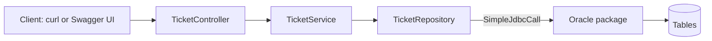

# Java, Spring Boot and React: Beginner Training (classroom repo)

This repository holds the code and learning material we build **during the classroom** for a 12-day (48-hour, 4 hours per day) hands-on programme that teaches **Java, server-side programming with Spring Boot, and a React front end**, starting from the basics.

The learning plan is unchanged. What changed is the data layer: the course uses a **hybrid approach**. **Spring Data JPA** and **Oracle PL/SQL packages called from Spring Boot** (`SimpleJdbcCall`, and MyBatis as an optional second way) both appear, and the learner is taught **which one to pick for which job** (section 5, "JPA or PL/SQL"). JPA is taught first (Day 2) and kept shallow. PL/SQL gets the larger share, because that is where the business rules, transactions and reports live.

**Status (2026-10-31):**

- Day 2 code is in `support-assistant/` (in-memory REST API, then JPA).
- The PL/SQL module (`oracle-pl-sql-spring-boot/`) has six parts and four walkthroughs, with the matching projects at the repo root.
- `equipment-register/` is a practice case study with a starter project.
- Days 3, 4, 6 to 12 have no material in this repo yet.

This file is local only (it is not committed). It is the source of truth for how content in this repo is written.

---

## 1. The one rule: keep it simple

The learners are **new to Java and new to server-side programming**. If a learner cannot follow a sentence or an example on the first read, rewrite it.

### Depth: everything is in scope, each topic stays shallow

Every topic in the day plan is covered, but only far enough for the learner to use it and recognise it later.

For each topic, cover only:

1. **What it is**, in two or three sentences.
2. **One minimal working example** that the learner types and runs.
3. **One common mistake** and how to spot it.

Leave out internals, tuning, edge cases, alternative approaches, and "advanced note" asides. Show **one** way to do a thing. If a topic starts to need more than that, cut it down rather than splitting it into more lessons. The one exception is the optional MyBatis part, which shows the same calls a second way and is clearly marked optional.

### Writing

- Use plain, short sentences. One idea per paragraph.
- Introduce **one new concept at a time**. Do not mention a second concept until the first one has been used.
- Explain a term the first time it appears, in one sentence, with an everyday comparison where it helps (e.g. "a controller is like a receptionist: it receives the request and passes it to the right person").
- Avoid jargon and abbreviations. If you must use one, spell it out once (ORM, JPA, PL/SQL, DTO, JWT).
- Do not say "simply", "just", "obviously", or "as you know".
- Put "what" and "how" before "why". Add a short "why" only when it helps the reader remember.
- For fictional characters (Meera, Karan), use their names. Do not use gendered pronouns for them.

### Examples

- Keep examples **small**: ideally under 20 lines, one purpose each.
- Use everyday names and ideas (a `Student`, a `Book`, a `Task`) for stand-alone examples, and the names in section 5 for the projects.
- Use plain, familiar code. Do not use a language feature the reader has not been taught yet. If a feature is needed (for example a `record` for a DTO), introduce it in one short example first.
- Build each example on the previous one. The reader should be able to type the code, run it, and see a result within a few minutes.
- Every example must be **run and checked** before it is written down. Show the expected output.
- Add a short comment only where a line is not obvious to a beginner. Do not comment every line.

### Structure of a part (a topic note)

Used by `oracle-pl-sql-spring-boot/01-…06-*.md` and by each day's notes:

1. **What you will build** (or **What you will learn**): two or three bullets, with a time estimate under the title.
2. **The ideas**: a few short sections, each with a small example, a diagram or a table when it helps.
3. **Build steps**: numbered steps. Each ends with a **Check** line the reader can run ("You should see …").
4. **Common mistakes**.
5. **Practice**: two or three small tasks with an observable result. No answers inline.
6. **Recap**: three or four bullets.

### Structure of a walkthrough (a build guide)

A walkthrough is a folder named `<project>-walkthrough/` with a `README.md` index and one file per step (`01-…md`, `02-…md`). The index has: what you are building, what you will build (with a table of endpoints), prerequisites, a steps table with a time estimate for each step, and a link to the finished project. Each step file has a back / previous / next line, then **Goal**, **Why this matters**, numbered sub-sections, and a **Check**. The last step is "Recap and exercises". If the walkthrough has SQL, the scripts sit beside it in `db/oracle/`.

A walkthrough guides; it does not hand over every answer. Show small snippets (up to about 15 lines) in the text, and keep the full finished classes in the project folder.

Keep a day short enough to finish in 4 hours. Section time estimates should add up to about that. If it does not fit, remove content.

### Troubleshooting notes

When a tool is likely to fail on the learners' network, write a short note:

- Open with the **symptom** the learner sees, quoted exactly as the tool prints it.
- Give numbered steps, each with a **Check** line.
- End with a "common messages" table (message → cause → fix) and a **Check yourself** list.
- Use placeholders for anything environment-specific: `PROXY_HOST`, `PROXY_PORT`, `YOUR_USERNAME`, `YOUR_PASSWORD`, `MIRROR_URL`. Never put a real proxy address, hostname, or credential in the repo.
- Try the failure and the fix yourself where possible, and say what was not verified.

Oracle problems follow the same shape. The common ones: `ORA-01017` (login, often an unset environment variable), `PLS-00201` (package not created), `ORA-04063` (package body has errors), `ORA-06550` (wrong number or type of arguments).

When a day introduces a tool that downloads from the internet (npm, a package manager, a CDN link, Git), check the Day 1 proxy notes and add or adjust a note if the day needs one. The Day 1 folder is not in this repo.

---

## 2. Audience and tone

Everything in this repo is read by the learners. Write it for them directly.

- Address the reader as **"you"**. Use steps in the imperative ("Create…", "Run…", "Check…").
- **Do not mention** the learners' experience, background, or current stack as a fact about them (no "since you are new to…", "you may already know…"). Describing what a technique replaces is fine (for example, how Oracle Forms and JSP parts map to Spring Boot parts), as long as it is about the technology and not about the reader.
- **Do not include anything trainer-, instructor-, or session-facing**: no trainer notes, talk tracks, "say to the class", demo scripts, delivery tips, timing advice for a facilitator, or answers kept "for instructors". The `solutions/` folder is the only place for finished answers to exercises, and it is kept apart from the walkthroughs.
- Do not use judgemental labels such as "legacy", "outdated", or "old-fashioned". Use neutral technical labels.
- Learner-facing words: "you", "your project", "the case study", "Day N". Avoid "participants", "trainees", "the team", "the class".
- Everything runs on the **learner's own machine or the organization's own network**. The Oracle database is a database on that network. Do not suggest cloud services, Docker/Kubernetes, container registries, SaaS tools, or public endpoints. Do not rely on a CDN: keep front-end library files in the project.

Planning documents (such as a proposal for the author to approve) are not learner material. Say so at the top of the file, and do not commit them as part of the learner-facing content unless asked.

---

## 3. Diagrams and presentation

- Use **Mermaid** (fenced ```` ```mermaid ```` blocks) when a picture explains better than prose. No ASCII art for diagrams. A plain `text` tree is fine for a folder layout.
- Keep each diagram small (about 6 to 8 nodes). Split a large diagram instead of shrinking it.
- Give each diagram a one-line lead-in sentence and a short "How to read it" note.
- Use Mermaid-compatible syntax only. Do not use `<br/>` or other HTML in labels. Quote flowchart labels containing `/`, `{}`, or `:`. In sequence diagrams avoid `{}` and `;` in message text, and use an example id (`/tickets/7/status`) instead of `{id}`.
- Use `flowchart` for request flow and pipelines (controller → service → repository → package), `sequenceDiagram` for call flows, `stateDiagram-v2` for the ticket lifecycle, `erDiagram` for tables.
- **Render every diagram before reporting done**, for example with `npx @mermaid-js/mermaid-cli -p <puppeteer-config> -i file.md -o out.md`, using the local Chrome through a Puppeteer config if the bundled browser is not installed. Report any diagram that was not rendered.
- Use tables for comparisons, numbered lists for steps, and blockquotes (`> **Note:**`, `> **Warning:**`) for common mistakes.
- Code goes in fenced blocks with a language tag.
- Do not add a diagram just for decoration.
- Any overview or index page leads with the day-wise plan. The case study comes after it.

---

## 4. Branches and git

All work is on **`main`**, the only branch. The `old-content` and `solutions` branches from the earlier plan do not exist; finished reference answers live in the `solutions/` folder on `main`.

- Before writing any file, run `git branch --show-current` and confirm you are on `main`. If the working tree is dirty and you must switch, stop and tell the user rather than stashing or discarding anything.
- Do not commit, push, merge, or delete branches unless the user asks.
- Do not commit build output (`target/`), IDE folders (`.idea/`, `.vscode/`), or test reports. `.gitignore` covers them. Earlier commits added and then removed some; do not repeat that.

---

## 5. Case study and projects

Everything is built around one running idea, **Support Assistant**: a ticketing API for a support desk. A second, smaller case study, **Plant Equipment Register**, is a practice exercise.

### Support Assistant

- **Ticket lifecycle:** `OPEN → IN_PROGRESS → RESOLVED → CLOSED`. A change must move one step forward. A `CLOSED` ticket cannot change. The package refuses anything else.
- **Priority and due date:** `HIGH` 1 day, `MEDIUM` 3 days, `LOW` 7 days, set when the ticket is created (by `create_ticket`, in the database).
- **Comments:** a ticket has many comments. A closed ticket takes no comments.
- **Where the rules live:** in the PL/SQL package. Java does not repeat them. Java receives the request, calls the package, and turns Oracle error numbers into HTTP answers.
- **Characters:** Meera (employee) and Karan (agent).

Request flow in the PL/SQL projects:



### Projects (each folder at the repo root is a separate Maven project)

| Folder | What it is | State |
|---|---|---|
| `support-assistant/` | Day 2. In-memory REST API, then Spring Data JPA with `Ticket` and `Comment` entities, DTOs, a hand-written mapper, Swagger UI. Endpoints under `/api/v1/tickets` | Built in class |
| `support-assistant-plsql/` | First PL/SQL project: `SimpleJdbcCall`, `dev` and `qa` profiles chosen by the `PROFILE` environment variable | Partly built (open count, create, find so far) |
| `support-assistant-with-relations/` | Ticket with many comments through `DESK_TICKET_PKG` | Partly built (no error handler or tests yet) |
| `support-assistant-plsql-mybatis/` | The same API as the first PL/SQL project, with MyBatis annotations instead of `SimpleJdbcCall` | Finished |
| `support-assistant-plsql-pagination/` | `GET /api/tickets` returns one page, read by `FIND_PAGE` with `OFFSET … FETCH NEXT` | Finished |
| `solutions/support-assistant-plsql-relations/` | Finished answer for the relations walkthrough, kept apart from it | Finished |
| `equipment-register/` | Practice case study: starter project with `TODO`s, and `case-study.md` | Starter |

The folders that contain `mvnw` and `.gitattributes` were generated by Spring Initializr and are the ones built live in class. The others were written as complete reference projects.

### PL/SQL learning material: `oracle-pl-sql-spring-boot/`

| Part | Topic | Walkthrough folder |
|---|---|---|
| 1 | Entities or not: what a call needs, and when to use JPA | none (reading). Extend it with the "JPA or PL/SQL" table above |
| 2 | Call a function, a procedure with an `OUT` value, a `SYS_REFCURSOR` | `support-assistant-plsql-walkthrough/` |
| 3 | Errors from `RAISE_APPLICATION_ERROR`, commit and rollback | (same walkthrough) |
| 4 (optional) | The same calls with MyBatis | none |
| 5 | Transaction management, `REQUIRES_NEW`, an error log | `support-assistant-plsql-transactions-walkthrough/` |
| 6 | Pagination | `support-assistant-plsql-pagination-walkthrough/` |
| (extra) | Parent and children: two cursors, one joined cursor, a transaction across two inserts | `support-assistant-plsql-relations-walkthrough/` |

### JPA or PL/SQL: which to use for what

This is the teaching point of the hybrid approach. Use the same table and the same rules of thumb everywhere in the material.

| Job | Use | Why |
|---|---|---|
| Read one row by id, list rows, simple filters | **JPA** (`findById`, derived query methods) | Almost no code. No package to write |
| Read a parent with its children (ticket and comments) | **JPA** (`@OneToMany`), with a fetch join | The objects come back already linked. Show the N+1 problem once |
| Reference data that rarely changes (priorities, departments) | **JPA** | Plain CRUD, no rules |
| A simple page of a list | **JPA** (`Pageable`) | One parameter. No SQL |
| A rule that every caller must obey (allowed status steps, due date from priority, "a closed ticket takes no comments") | **PL/SQL** | The rule lives once, next to the data. A script, a report or another application cannot go around it |
| Work on several rows or tables that must succeed or fail together | **PL/SQL**, called from a `@Transactional` service | The database does the steps. Spring Boot decides commit or rollback |
| Locking a row before a change (`SELECT … FOR UPDATE`) | **PL/SQL** | Exact and short |
| Bulk changes, reports, totals, joins across tables | **PL/SQL** (a `SYS_REFCURSOR`) | One call, one round trip. The database does the counting |
| Pages with a total count and a rule-based sort, on a large table | **PL/SQL** (`OFFSET … FETCH NEXT`) | One call returns the page and the total |
| Logging that must survive a rollback | **PL/SQL** (`AUTONOMOUS_TRANSACTION`) or a `REQUIRES_NEW` service | The log line is kept even when the main work is undone |
| Calling code that already exists in the database | **PL/SQL** | Do not rewrite it in Java |

Short rule to teach: **reads and plain CRUD → JPA. Rules, workflows, bulk work and reports → PL/SQL.**

Rules for the material:

- **One owner for each rule.** A rule is written in the package or in Java, never in both. The lifecycle and due-date rules belong to the package.
- **Write through the package, read through JPA.** When the package changes a table, map the JPA entity for that table as read-only (`@Immutable`), so JPA cannot change a row and skip the rules. State this in one sentence, with one example.
- Both ways share one `DataSource` and one transaction. A `@Transactional` service method can call a repository and a package, and both commit or roll back together.
- **Common mistake to show once:** JPA keeps loaded objects in memory. After a package changes a row, an entity loaded earlier in the same transaction is stale. Read it again in a new transaction (or call `entityManager.refresh`). In the other direction, JPA changes are not sent to the database until the transaction flushes, so a package called in the middle does not see them.
- Do not use JPA to write to a table whose rules are in a package, and do not write SQL in Java for a job that JPA already does in one line.
- Every part that teaches one way ends with a one-line "when to use the other way" pointer.

**Support Assistant, split by feature** (target for the hybrid project):

| Feature | Way | Reason |
|---|---|---|
| `GET /tickets/{id}`, `GET /tickets?status=OPEN` | JPA | Plain reads |
| `GET /tickets/{id}` with comments | JPA relationship | Parent and children, linked objects |
| `POST /tickets` (sets the due date) | PL/SQL `create_ticket` | The due-date rule |
| `PATCH /tickets/{id}/status` | PL/SQL `change_status` | The lifecycle rule and the row lock |
| `POST /tickets/{id}/comments` | PL/SQL `add_comment` | A closed ticket takes no comments |
| `POST /tickets/bulk-status`, summary counts | PL/SQL | Several rows, all or none |
| `GET /tickets` as pages with a total | JPA `Pageable` first, then PL/SQL `FIND_PAGE` | Compare the two once |

### The ways a Java call reaches PL/SQL (keep identical across material)

| Program | How it is called with `SimpleJdbcCall` |
|---|---|
| Function | `executeFunction(Number.class, args…)` |
| Procedure, no output | `execute(args…)` |
| Procedure with an `OUT` value | `execute(args…)` returns a `Map`. Read the key in upper case (`P_TICKET_ID`) and convert with `Number.longValue()` |
| Procedure with a `SYS_REFCURSOR` | `.returningResultSet("P_NAME", this::rowMapper)`, then read the `List` from the `Map` |

The values go in the order of the `IN` parameters. Show **this** way first; MyBatis is the optional second way.

### Naming (keep identical across all material)

- Java packages: `com.bsp.supportassistant` (the stand-alone JPA project, the relations, MyBatis and pagination projects), `com.bsp.supportassistantplsql`, `com.bsp.equipment`. Sub-packages: `api` (controllers), `service`, `repository`, `dto`, `exception`, `config`. The JPA project also has `model` (entities) and `mapper`.
- In a hybrid project, the JPA repository is `TicketRepository` (an interface that extends `JpaRepository`), and the class that calls the package is `TicketPackageRepository`. The service uses both. Entities for tables written by a package are read-only.
- DTOs are records named for what they carry, with no `DTO` suffix: `CreateTicketRequest`, `TicketResponse`, `TicketCreated`, `PageResponse`, `EquipmentRequest`.
- Error body `ApiError` (`status`, `error`, `message`, `timestamp`) in `exception`, produced by `GlobalExceptionHandler`.
- Oracle objects are prefixed so projects can share one schema: `SUPPORT_` (`SUPPORT_TICKETS`, `SUPPORT_TICKET_LOG`, `SUPPORT_ERROR_LOG`, `SUPPORT_TICKET_PKG`, `SUPPORT_TICKET_PAGE_PKG`, `SUPPORT_ERROR_PKG`), `DESK_` (`DESK_TICKETS`, `DESK_COMMENTS`, `DESK_TICKET_PKG`), and `EQUIPMENT` / `EQUIPMENT_PKG`. One sequence per table, named `<TABLE>_SEQ`.
- Package programs use lower-case names in SQL (`create_ticket`, `change_status`, `find_tickets`) and upper case in Java (`"CREATE_TICKET"`). Parameters start with `p_` (`p_ticket_id`), and cursor parameters are `P_TICKETS`, `P_RESULT` and so on.
- Error numbers raised with `RAISE_APPLICATION_ERROR` map to HTTP: `-20001` and `-20002` (bad value) → `400`, `-20003` (not found) → `404`, `-20004` (status change not allowed) → `409`. The relations package adds `-20005` (comment missing a field) → `400` and `-20006` (ticket closed) → `409`. Keep these numbers the same when adding a package.
- Endpoints in the PL/SQL projects are under `/api/tickets`. The JPA project uses `/api/v1/tickets` and the equipment register uses `/api/v1/equipment`. Do not rename an existing path to make them match.

### Later days (not in this repo yet)

Security (login, JWT, roles `EMPLOYEE` and `AGENT`), the React front end (`TicketList`, `TicketCard`, `TicketForm`, `LoginPage`, `Navbar`, `ProtectedRoute`, `AuthContext`), the reverse proxy under `/api/**`, and deployment (executable JAR, `systemd` service `helpdesk-api.service`, nginx, health check) follow the earlier plan. When they are written, they build on the Support Assistant API, and the API is the PL/SQL version. Update this section when that material is added.

---

## 6. Day-by-day plan

Each day starts from the previous day's finished project, so the learner extends one running system. Topics are kept shallow (see section 1).

| Day | Area | Focus |
|---|---|---|
| **1** | Setup | Java setup, a basic Java app, IntelliJ project vs Maven project, Maven features, a basic Spring Boot app with a simple API (material not in this repo) |
| **2** | Setup, database (JPA) | Project structure, Java naming conventions, the Spring Boot flow, REST API basics, storing data with JPA (entity, repository), one relationship. See the N+1 problem once |
| **3** (checkpoint) | APIs | Controllers, DTOs, validation, `ApiError` |
| **4** | APIs, testing | Service layer, status rules, comments, first unit tests |
| **5** | Database (PL/SQL, hybrid) | Oracle PL/SQL called from Spring Boot, transactions, pagination, then JPA and PL/SQL together: which one for which job |
| **6** (checkpoint) | Security | Login, JWT, roles |
| **7** | Testing, profiles | Controller and service tests, repository tests (JPA) and package tests (PL/SQL, rolled back), `dev` and `qa` profiles |
| **8** (checkpoint) | Deployment | Executable JAR, `systemd` service, nginx, health check |
| **9** | Frontend | HTML, CSS, Bootstrap, JavaScript `fetch`, CORS |
| **10** | Frontend | React basics: components, state, Axios |
| **11** (checkpoint) | Frontend | React Router, forms, role-based screens |
| **12** | Deployment | Production build, one address for pages and API, capstone |

**Checkpoint days** (3, 6, 8, 11) end the walkthrough with a short checklist: it builds, the endpoints respond, the project is ready for the next day.

The Day 5 PL/SQL module is the part that grew. It also has a practice case study, `equipment-register/case-study.md`, where the learner builds a full create, read, update, delete API on a PL/SQL package from a starter project.

**Optional overview (outside the 48 hours): JSP and Thymeleaf.** A short side-by-side look at server-side pages using the same "Raise Ticket" form and "My Tickets" list.

### The database

- **Oracle is the database for the whole course**, JPA and PL/SQL alike, and for the practice case study. There is no H2: PL/SQL packages cannot run on it, and a hybrid project needs one database for both ways.
- The learner needs an Oracle user that can create tables, sequences, an index, and a package. Oracle 19c, or 21c Express Edition. `OFFSET … FETCH NEXT` needs 12c or later.
- Each project that has SQL keeps its scripts in `db/oracle/`, numbered and run in order, by hand, in SQL Developer or SQL\*Plus:
  - `01-tables.sql`: sequences and tables (and indexes).
  - `02-package.sql`: the package. Written with `CREATE OR REPLACE`, so it can be run again.
  - `03-…` onwards: later additions (`03-page-package.sql`, `03-error-log.sql`, `04-sample-tickets.sql`).
  - `99-drop.sql`: removes everything, child table first, so the learner can start again.
  - Start each script with a comment: `-- Oracle only. Run once, as the user that your application connects as.`
- Hand-write the table scripts. If JPA is used, set `spring.jpa.hibernate.ddl-auto` to `validate` or `none`, never `create` or `update`.
- Credentials come from environment variables: `DB_USERNAME`, `DB_PASSWORD`, and optionally `DB_URL` (default `jdbc:oracle:thin:@//localhost:1521/XEPDB1`). An unset variable reaches Oracle as the text `${DB_PASSWORD}`, and the first call fails with `ORA-01017`. Say this in every README that uses a database.
- A direct database connection does not use the company proxy. Problems with it are host, port, firewall, or login problems.
- If several learners share one schema, tell them to add their initials to the object names.

### Testing with the database

- Tests call the real package in the learner's database. Mark them `@Transactional` so each one rolls back and leaves the tables clean.
- One test is allowed to be **not** `@Transactional`, to show that a failed service call really undoes its work. Explain why in a comment.
- A README states how many tests there are and that they need the database and the scripts.

---

## 7. Repository layout

```text
main
├── CLAUDE.md                        # local only
├── support-assistant/               # Day 2: in-memory, then JPA
├── support-assistant-plsql/         # first PL/SQL project (built in class)
├── support-assistant-with-relations/# tickets and comments (built in class)
├── support-assistant-plsql-mybatis/ # finished, optional MyBatis version
├── support-assistant-plsql-pagination/  # finished
├── equipment-register/              # practice starter + case-study.md
├── solutions/
│   └── support-assistant-plsql-relations/   # finished answer, kept apart
└── oracle-pl-sql-spring-boot/       # the PL/SQL notes and walkthroughs
    ├── README.md                    # index of the six parts
    ├── 01-entities-or-not.md … 06-pagination.md
    └── support-assistant-plsql-<topic>-walkthrough/
        ├── README.md                # index and steps table
        ├── 01-….md, 02-….md, …      # one file per step
        └── db/oracle/               # the SQL for that walkthrough
```

- A Maven project folder holds `pom.xml`, `src/`, and a `README.md` with: what it is, the versions table, what to run in `db/oracle/`, the environment variables, how to build and run, the endpoints, the layout, how to run on Spring Boot 3.5, and **what this project does not do**.
- There is no parent `pom.xml`. Each project builds on its own.
- Code in a project contains only what that topic (and earlier ones) teach. Do not add later features.
- Folder names are lower-case, kebab-case. Walkthrough step files are zero-padded (`01-…`).
- Links between files are relative. After moving or adding a folder, check that every link still resolves.

---

## 8. Working defaults and checking code

- Java **21 (LTS)**, Maven, `jakarta.*` and never `javax.*`. Pin versions in `pom.xml`.
- **Spring Boot 4.1.1** is the version in every project. Initializr offers only 4.x, so learners get the 4.x names: `spring-boot-starter-webmvc`, `spring-boot-starter-webmvc-test`, `ojdbc17`. Each project README has a "Running on Spring Boot 3.5" table with the 3.x names (`spring-boot-starter-web`, `spring-boot-starter-test`, `ojdbc11`, parent `3.5.x`; MyBatis starter `3.0.5`). Say which version a project was actually built and tested on.
- Swagger UI comes from `springdoc-openapi-starter-webmvc-ui` (3.1.1) at `/swagger-ui.html`.
- In IntelliJ, set **Maven home path** to **Bundled (Maven 3)**. Write commands with `mvn`, not the Maven wrapper (`mvnw`), because the wrapper downloads Maven without the learner's proxy settings.
- Database access has two ways, chosen by the table in section 5. `spring-boot-starter-data-jpa` is for plain reads and CRUD. `spring-boot-starter-jdbc` with `SimpleJdbcCall` is for rules, workflows, bulk work and reports. A hybrid project has both starters (`spring-boot-starter-data-jpa` already brings in JDBC). MyBatis (`mybatis-spring-boot-starter`) is only in the optional project, and is not mixed with JPA.
- Pure PL/SQL projects (the existing `support-assistant-plsql*` folders) stay pure: no JPA, so the earlier parts do not change. The hybrid appears in its own project, introduced after the pure PL/SQL parts.
- No SQL strings in Java for a PL/SQL job. Java calls programs by name, and SQL lives in `db/oracle/`. For a JPA job, use derived query methods first, and `@Query` only when a part needs it.
- DTO mapping is done by hand. No MapStruct.
- DTOs are Java records. Introduce `record` in one short example the first time it is needed.
- Use Lombok sparingly or not at all. Do not use `@Data` on JPA entities.
- Secrets never appear in committed files. Use `${DB_USERNAME}` and `${DB_PASSWORD}` in `application.yaml`, and provide `*.example` templates when a file is needed.
- Entities are never returned from controllers. Use DTOs. Business rules live in the package wherever a package exists. In a JPA-only project they live in the service layer. Never in both.
- The service is where `@Transactional` goes. A rollback also needs the exception to leave the method.
- Every example must build and, where possible, run. Run `mvn -q clean verify` (Java) or `npm run build` (front end) before reporting a piece of work done.
- **The tests need an Oracle database.** If Oracle, a server, a proxy, or a tool is not available in the current environment, say exactly what was **not** verified (for example "compiled, but the tests that call the package were not run"). Do not claim an example works if only compilation was checked.

---

## 9. Known gaps and open decisions

Ask the user the first time one of these matters, then record the answer here.

**Things in the repo that disagree with the rules above** (fix when the user asks, or when touching the file):

- `application.yaml` in `support-assistant`, `support-assistant-plsql`, `support-assistant-with-relations` and `equipment-register` hold a fixed classroom database URL and login. The finished projects use environment variables. Do not copy the fixed values into new files or into notes.
- `support-assistant/src/main/resources/application.yml` sets `ddl-auto: update`. The rule is `validate` or `none`.
- `support-assistant-plsql/` and `equipment-register/` have `java.version` 17. The rule is 21.
- `support-assistant/` has a `testclass/MyClass.java` with no purpose in the notes.
- `oracle-pl-sql-spring-boot/README.md` is out of date: it lists four parts (part 4 as Spring Data JPA), not six, and a `support-assistant-plsql-jpa` project that does not exist (the optional project is MyBatis).
- Links in `oracle-pl-sql-spring-boot/` point to `../support-assistant-plsql/`, `../support-assistant-plsql-<topic>/` and `../../day-02-…`. The projects now sit at the repo root, and the Day 2 and Day 5 folders are not in this repo. The transactions walkthrough links to a `support-assistant-plsql-transactions/` project that is not in this repo.
- The finished `support-assistant-plsql` that the walkthroughs call "finished" is only partly built in this repo.

**Open decisions:**

- Days 3, 4, 6 to 12 have no material here. The focus column in section 6 for Days 4, 5 and 7 was changed by inference. Confirm it.
- **The hybrid project does not exist yet.** Proposed: a project `support-assistant-hybrid` (JPA entities for reads, the existing `SUPPORT_TICKET_PKG` or `DESK_TICKET_PKG` for writes), a part 7 "JPA or PL/SQL" in `oracle-pl-sql-spring-boot/` with a walkthrough, and the split table in section 5. Confirm the name, the feature split, and whether it uses the `SUPPORT_` or `DESK_` tables (`DESK_` has comments, which suits the parent and child read).
- Whether the `JPA-n` stories (see below) return, since JPA is now back in the plan.
- The earlier plan had user stories (`JPA-1` to `JPA-4`, `API-n`, `TEST-n`, `SEC-n`, `UI-n`, `DEP-n`) and a `case-study/README.md`. Neither is in this repo. Decide whether the stories return, and what the `JPA-n` ones are called now.
- Whether the earlier extras return: overdue flag with a scheduled job, a log line per status change, an Oracle function for the open count (the open count now exists as `open_count`).
- Linux (`systemd` + nginx) or Windows as the deployment path on Day 8. Linux is assumed until told otherwise.
- Whether the optional JSP/Thymeleaf overview goes before or after Day 9.
- Whether `support-assistant-plsql` and `support-assistant-with-relations` are completed in place, or stay as the live-coded copies with the finished versions in `solutions/`.
