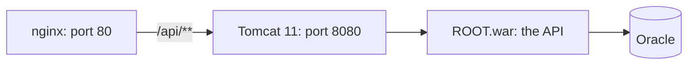

# Optional: Deploy the API as a WAR on a Separate Tomcat

**Time: about 60 minutes**

Back to the [Day 8 index](README.md) · Related: [Choose how to run the API](01-how-to-run-spring-boot.md)

This note is an alternative to steps 2 and 3. Use it when your organization requires every application to run inside a Tomcat that is installed on the server. Steps 4 and 5 (the React files and nginx) stay the same.

You need `support-assistant-security-database` with the Actuator changes from [step 2](02-build-the-jar.md), and a Linux server with `sudo`, Java 21 and a free port 8080.

## What you will build

- A WAR file of the API, built from the same project.
- Tomcat 11 installed in `/opt/tomcat`, running as a `systemd` service.
- The database login and the JWT secret given to Tomcat in one file, `setenv.sh`.



**How to read it:** the picture is the same as in the index. The only change is the box in the middle: Tomcat is a program of its own, and the API is a file inside it.

---

## The ideas

### What changes between a JAR and a WAR

| | JAR (steps 2 and 3) | WAR (this note) |
|---|---|---|
| Who starts the application | `java -jar` | Tomcat, when it finds the WAR in `webapps/` |
| Where the port is set | `SERVER_PORT` or `server.port` | `server.xml` in Tomcat |
| Where the settings go | `helpdesk-api.env`, read by the service | `setenv.sh`, read by Tomcat |
| What `systemd` runs | The API | Tomcat |
| What you change in the project | Nothing | `pom.xml` and the main class |

> **Warning: the port and address settings are ignored.** In a WAR, `SERVER_PORT` and `SERVER_ADDRESS` do nothing, because Tomcat is already running before the application starts. Set them in `server.xml` (step 4).

### Which Tomcat version

Spring Boot 4.1.1 needs Servlet 6.1, and that means **Tomcat 11**. Tomcat 9 and Tomcat 10 are too old for this project. Tomcat 11 runs on Java 17 and later, so Java 21 is fine.

### Settings for the application

Tomcat runs `bin/setenv.sh` every time it starts, if the file exists. You write `export NAME=value` lines in it, and the application sees them as environment variables. Spring Boot reads them in the same way as in step 2: `SPRING_DATASOURCE_URL`, `SPRING_DATASOURCE_USERNAME`, `SPRING_DATASOURCE_PASSWORD` and `JWT_SECRET`.

### The name of the WAR is the address

Tomcat uses the file name as the first part of the address:

| File in `webapps/` | The API is at |
|---|---|
| `ROOT.war` | `http://127.0.0.1:8080/api/tickets` |
| `helpdesk-api.war` | `http://127.0.0.1:8080/helpdesk-api/api/tickets` |

This note uses `ROOT.war`, so the nginx file from step 5 works without a change. If other applications share this Tomcat, see the last common mistake.

---

## Build steps

### 1. Change the project to build a WAR

In `pom.xml`, add the line `<packaging>war</packaging>` after `<version>`, and add this dependency as the first one inside `<dependencies>`:

```xml
<dependency>
    <groupId>org.springframework.boot</groupId>
    <artifactId>spring-boot-starter-tomcat</artifactId>
    <scope>provided</scope>
</dependency>
```

`provided` means: use it to compile, and do not put it in the WAR, because the server brings its own Tomcat.

Change `SupportAssistantApplication.java`. The class now extends `SpringBootServletInitializer`, which is the hook that Tomcat calls to start the application:

```java
@SpringBootApplication
public class SupportAssistantApplication extends SpringBootServletInitializer {

    // Tomcat calls this when it loads the WAR.
    @Override
    protected SpringApplicationBuilder configure(SpringApplicationBuilder builder) {
        return builder.sources(SupportAssistantApplication.class);
    }

    public static void main(String[] args) {
        SpringApplication.run(SupportAssistantApplication.class, args);
    }
}
```

The two new imports are `org.springframework.boot.builder.SpringApplicationBuilder` and `org.springframework.boot.web.servlet.support.SpringBootServletInitializer`. The `main` method stays, so you can still start the project from IntelliJ.

**Check:** `mvn -q clean compile` ends without an error.

### 2. Build the WAR

```bash
mvn -q clean package -DskipTests
unzip -l target/support-assistant-security-database-0.0.1-SNAPSHOT.war | grep "WEB-INF/lib/tomcat-embed"
```

**Check:** the `.war` file is in `target/` and is about 65 MB. The `grep` prints **nothing**. The Tomcat libraries are in `WEB-INF/lib-provided/`, which the server ignores. If the `grep` prints lines, the `provided` scope is missing, and the WAR carries a second Tomcat that conflicts with the server's.

### 3. Install Tomcat 11

Get the latest `11.0.x` file named `apache-tomcat-11.0.x.tar.gz` from the Tomcat download page, or from `MIRROR_URL`. Download the `.sha512` file beside it too. If the server cannot reach the internet, download on your machine and copy it with `scp`.

On the server:

```bash
sha512sum -c apache-tomcat-11.0.x.tar.gz.sha512
sudo useradd --system --no-create-home --shell /usr/sbin/nologin tomcat
sudo mkdir /opt/tomcat
sudo tar -xzf apache-tomcat-11.0.x.tar.gz -C /opt/tomcat --strip-components=1
sudo rm -rf /opt/tomcat/webapps/*
sudo chown -R tomcat:tomcat /opt/tomcat
```

`sudo rm -rf /opt/tomcat/webapps/*` removes the sample applications and the manager pages, which a server does not need.

**Check:** `sha512sum` prints `OK`. `ls /opt/tomcat` shows `bin`, `conf`, `lib`, `logs` and `webapps`.

### 4. Bind Tomcat to the server itself

Open `/opt/tomcat/conf/server.xml` with `sudo`. Find the line `<Connector port="8080"` and add `address="127.0.0.1"`:

```xml
<Connector port="8080" address="127.0.0.1" protocol="HTTP/1.1"
           connectionTimeout="20000"
           redirectPort="8443" />
```

This is the Tomcat way to do what `SERVER_ADDRESS=127.0.0.1` did in step 3. Only nginx on the same server can reach port 8080.

**Check:** the line has `address="127.0.0.1"`.

### 5. Give Tomcat the settings

Create `/opt/tomcat/bin/setenv.sh` with `sudo`:

```bash
export SPRING_DATASOURCE_URL='jdbc:oracle:thin:@//ORACLE_HOST:ORACLE_PORT/ORACLE_SERVICE'
export SPRING_DATASOURCE_USERNAME='DB_USERNAME'
export SPRING_DATASOURCE_PASSWORD='DB_PASSWORD'
export JWT_SECRET='the 64-character line from step 4 of note 2'
```

This file is a shell script, so each line starts with `export`, and the value goes in quotes. Then lock it:

```bash
sudo chown tomcat:tomcat /opt/tomcat/bin/setenv.sh
sudo chmod 600 /opt/tomcat/bin/setenv.sh
```

**Check:** `ls -l /opt/tomcat/bin/setenv.sh` shows `-rw-------` and `tomcat tomcat`.

### 6. Run Tomcat as a service

Find the Java folder:

```bash
readlink -f $(which java)
```

The answer ends in `/bin/java`. The folder before `/bin/java` is your `JAVA_HOME`, for example `/usr/lib/jvm/java-21-openjdk`.

Create `/etc/systemd/system/tomcat.service` with `sudo`:

```ini
[Unit]
Description=Tomcat 11
After=network.target

[Service]
Type=forking
User=tomcat
Group=tomcat
Environment="JAVA_HOME=/usr/lib/jvm/java-21-openjdk"
Environment="CATALINA_HOME=/opt/tomcat"
Environment="CATALINA_BASE=/opt/tomcat"
Environment="CATALINA_PID=/opt/tomcat/temp/tomcat.pid"
ExecStart=/opt/tomcat/bin/startup.sh
ExecStop=/opt/tomcat/bin/shutdown.sh
SuccessExitStatus=143
Restart=on-failure
RestartSec=5

[Install]
WantedBy=multi-user.target
```

Replace the `JAVA_HOME` path with yours. Then:

```bash
sudo systemctl daemon-reload
sudo systemctl enable --now tomcat
```

**Check:** `sudo systemctl status tomcat` shows `active (running)`. The log `/opt/tomcat/logs/catalina.out` ends with `Server startup in … milliseconds`.

### 7. Deploy the WAR

Copy the WAR to the server, then put it in `webapps/` under the name `ROOT.war`:

```bash
scp target/support-assistant-security-database-0.0.1-SNAPSHOT.war SERVER_USER@SERVER_HOST:/tmp/ROOT.war
```

On the server:

```bash
sudo mv /tmp/ROOT.war /opt/tomcat/webapps/ROOT.war
sudo chown tomcat:tomcat /opt/tomcat/webapps/ROOT.war
```

Tomcat sees the new file within a few seconds and unpacks it into a folder `webapps/ROOT/`. Watch the log:

```bash
sudo tail -f /opt/tomcat/logs/catalina.out
```

**Check:** the log shows `Deploying web application archive [/opt/tomcat/webapps/ROOT.war]`, then `Started SupportAssistantApplication in … seconds`, then `Deployment of web application archive … has finished`. Leave the log with `Ctrl+C`.

### 8. Check the health and the login

```bash
curl http://127.0.0.1:8080/actuator/health
```

**Check:** it prints `{"status":"UP"}`. Then open `http://SERVER_HOST/` through nginx, as in step 5, and log in.

### 9. Update the WAR, and go back

Keep the old WAR outside `webapps/`, then replace it:

```bash
sudo systemctl stop tomcat
sudo mkdir -p /opt/tomcat/backup
sudo cp /opt/tomcat/webapps/ROOT.war /opt/tomcat/backup/ROOT.war.previous
sudo rm -rf /opt/tomcat/webapps/ROOT /opt/tomcat/webapps/ROOT.war
sudo mv /tmp/ROOT.war /opt/tomcat/webapps/ROOT.war
sudo chown tomcat:tomcat /opt/tomcat/webapps/ROOT.war
sudo systemctl start tomcat
```

The `rm` of the folder `ROOT` matters: Tomcat does not always replace an unpacked folder when the WAR changes. Run the health check from step 8.

**Check:** it prints `{"status":"UP"}`. To go back, repeat the same commands with `/opt/tomcat/backup/ROOT.war.previous` as the file you move into `webapps/ROOT.war`.

---

## Common mistakes

> **Warning: Tomcat runs, but every address answers `404`.** The WAR failed to start, and Tomcat stays up without it. Read `/opt/tomcat/logs/catalina.out` for `Error deploying web application archive`, and the lines above it for the cause.

| Message in the log | Cause | Fix |
|---|---|---|
| ``Could not resolve placeholder 'JWT_SECRET'`` | `JWT_SECRET` is missing in `setenv.sh`, or the file is not in `/opt/tomcat/bin/` | Fix the file, then `sudo systemctl restart tomcat` |
| `ORA-12541: Cannot connect. No listener` | Wrong database host or port, or a firewall | Check `SPRING_DATASOURCE_URL` |
| `ORA-01017` | Wrong user name or password | Fix the two lines in `setenv.sh` |
| `Address already in use` | Another program uses port 8080, or Tomcat's shutdown port 8005 | Stop it, or change the port in `server.xml` |

> **Warning: settings in the wrong place.** Variables written in `/etc/environment`, `~/.bashrc` or a terminal `export` are not seen by a `systemd` service. Put them in `setenv.sh`.

> **Warning: changing `setenv.sh` and nothing happens.** Tomcat reads it when it starts. Run `sudo systemctl restart tomcat`.

> **Warning: the WAR carries a second Tomcat.** The `grep` in step 2 prints lines. Check that `spring-boot-starter-tomcat` has `<scope>provided</scope>`.

> **Warning: Tomcat 9 or 10.** The application does not start on them. Install Tomcat 11.

> **Warning: other applications share this Tomcat.** Only one application can be `ROOT.war`. Name this one `helpdesk-api.war`, and change the nginx file to `proxy_pass http://127.0.0.1:8080/helpdesk-api/;`. The `/api/` path then reaches `/helpdesk-api/api/`. The health check moves to `http://127.0.0.1:8080/helpdesk-api/actuator/health`.

---

## Practice

1. Stop Tomcat, remove the `JWT_SECRET` line, and start it again. **Result:** Tomcat is `active (running)`, `curl` on the health address answers `404`, and the log shows the `Could not resolve placeholder` message. Put the line back and restart.
2. Rename the WAR to `helpdesk-api.war` and make the nginx change from the last mistake. **Result:** the site works as before.
3. Update the WAR with a small change in a response, using step 9, then go back with the old WAR. **Result:** the change appears and then disappears.

---

## Recap

- A WAR needs three changes: `<packaging>war</packaging>`, `spring-boot-starter-tomcat` as `provided`, and a class that extends `SpringBootServletInitializer`.
- Spring Boot 4.1.1 needs Tomcat 11.
- The settings go in `bin/setenv.sh` as `export` lines. The port and the address go in `server.xml`, because the application cannot set them.
- The name of the WAR sets the address: `ROOT.war` is the root.
- nginx, the React files and the health check do not change.

**When to use the JAR instead:** if nobody requires a shared Tomcat, the JAR in steps 2 and 3 has fewer parts to install and patch.

> **Not verified:** only the build was tested, on macOS with Maven 3.9.11, Java 25 as the build JDK and Spring Boot 4.1.1, in a copy of the project with the Actuator dependency and the three changes of step 1. The copy compiled, and `mvn package` produced a 66 MB `.war`. In the WAR, the Tomcat libraries are in `WEB-INF/lib-provided/` and none are in `WEB-INF/lib/`. The Oracle driver is in `WEB-INF/lib/`, and the manifest names `WarLauncher`, so `java -jar` still starts it. Tomcat 11.0.27 was downloaded, and its files confirm that `catalina.sh` reads `bin/setenv.sh`, that the connector line in `server.xml` is the one quoted, and that it supports Servlet 6.1 and Java 17 and later. **The WAR was never started in Tomcat**, and none of steps 3 to 9 was run: the run was blocked in this session, and no Linux server was available. So the log lines, the `{"status":"UP"}` answer, the `404` after a failed deployment, the `systemd` unit, `Type=forking` with `startup.sh`, and the update steps follow standard Tomcat behaviour and have not been seen. The messages in the table come from the JAR run in step 2, not from Tomcat. Try each step on your server and correct what differs.
