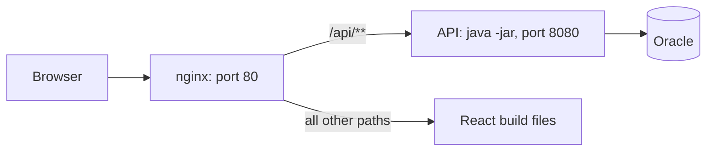

# Day 8: Deploying Support Assistant on Your Own Server

**Time: about 3 hours 30 minutes**

In this day you move Support Assistant from your laptop to a Linux server on your organization's network. You deploy two things:

- the **API**: `support-assistant-security-database`, a Spring Boot application with JWT login.
- the **React app**: `frontend-and-react-js/support-assistant`, built into plain files.

Users open one address. They do not need to know that two programs are behind it.

## What you will build

**How to read it:** nginx is a web server that listens on the server's public port. A request for `/api/...` is passed on to the API. Any other request gets the React files. The API listens on `127.0.0.1` only, so nobody can reach it except through nginx.

You use the **embedded Tomcat** that is inside the Spring Boot JAR. You do not install a separate Tomcat.

| Part | What it does | Where it lives on the server |
|---|---|---|
| API JAR | Runs the REST API | `/opt/helpdesk-api/helpdesk-api.jar` |
| Settings file | Database login and JWT secret | `/etc/helpdesk-api/helpdesk-api.env` |
| `systemd` service | Starts the JAR at boot and restarts it if it stops | `helpdesk-api.service` |
| React build | The pages | `/var/www/helpdesk/` |
| nginx | Serves the pages, passes `/api/` to the JAR | `/etc/nginx/conf.d/helpdesk.conf` |

## Prerequisites

- The API from `support-assistant-security-database`, with the two scripts in `db/oracle/` already run in the Oracle schema that the server will use.
- The React app from notes 01 to 16 of `frontend-and-react-js/`, with the address and the token code from notes 13 and 16.
- A Linux server where you can use `sudo`, with Java 21 and nginx installed (step 2 and step 5 show the check).
- On your own machine: Java 21, `mvn`, Node.js, and `scp` (or another way to copy files to the server).
- The server reaches the Oracle database on its port (the same host, port and service name that you use from your machine).

You build on your own machine and copy the results to the server. The server never has to download anything from the internet.

## Steps

| Step | Note | Time |
|---|---|---|
| 1 | [Choose how to run the API](01-how-to-run-spring-boot.md) | 20 min |
| 2 | [Build the JAR and run it with settings from outside](02-build-the-jar.md) | 45 min |
| 3 | [Run the API as a service](03-run-as-a-service.md) | 35 min |
| 4 | [Build the React app for the server](04-build-the-react-app.md) | 25 min |
| 5 | [nginx: one address for pages and API](05-nginx.md) | 50 min |
| 6 | [Health check, updates and the checkpoint](06-checkpoint.md) | 35 min |
| Optional | [Deploy the API as a WAR on a separate Tomcat](07-optional-war-on-tomcat.md). Use it in place of steps 2 and 3 when a shared Tomcat is required | 60 min |

## Names used in these notes

Replace these with your own values. Never commit real values to the repository.

| Name | Meaning |
|---|---|
| `SERVER_HOST` | The name or address of your server |
| `SERVER_USER` | Your login on the server |
| `ORACLE_HOST`, `ORACLE_PORT`, `ORACLE_SERVICE` | Where Oracle listens |
| `DB_USERNAME`, `DB_PASSWORD` | The Oracle user the API connects as |
| `MIRROR_URL` | Your organization's package mirror, if the server cannot reach the internet |

## Finished result

A browser at `http://SERVER_HOST/` shows the login page. After login, the tickets load from `http://SERVER_HOST/api/tickets`, and `curl http://127.0.0.1:8080/actuator/health` on the server answers `{"status":"UP"}`.
