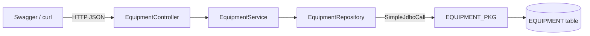
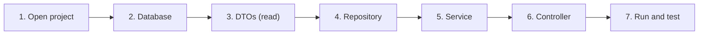
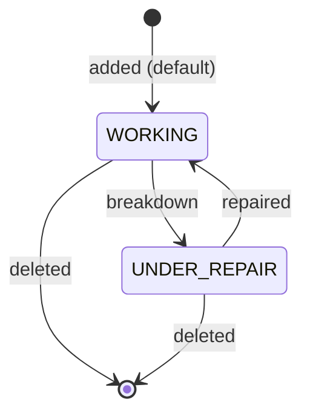
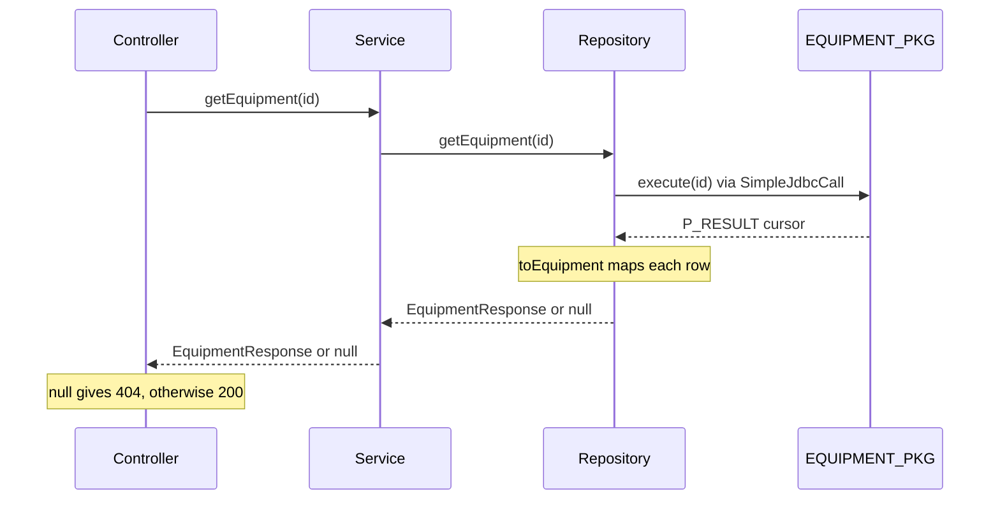

# Practice Case Study: Plant Equipment Register

## The Problem

The plant keeps a list of its equipment (cranes, pumps, motors, conveyors) and the department each one belongs to. Today this list lives in an Excel sheet. Your job is to build a small REST API so the list can be managed from any system.

You will build a Spring Boot application that does basic **CRUD** (Create, Read, Update, Delete) on equipment.

**Rule:** all database work must go through a **PL/SQL package**. No JPA, and no SQL statements inside Java. Java only *calls* procedures, using `JdbcTemplate` + `SimpleJdbcCall`, exactly like the `support-assistant-plsql` project.

---

## What You Will Build



| Method | URL | What it does | PL/SQL procedure |
|---|---|---|---|
| POST | `/api/v1/equipment` | Add new equipment | `ADD_EQUIPMENT` |
| GET | `/api/v1/equipment` | List all equipment | `GET_ALL_EQUIPMENT` |
| GET | `/api/v1/equipment/{id}` | Get one equipment | `GET_EQUIPMENT` |
| PUT | `/api/v1/equipment/{id}` | Update equipment | `UPDATE_EQUIPMENT` |
| DELETE | `/api/v1/equipment/{id}` | Delete equipment | `DELETE_EQUIPMENT` |

### Order of Work

Build from the bottom up. Each layer only calls the one below it, so finish and check a layer before moving up.



---

## Step 1: Open the Starter Project

Open the `equipment-register` folder (the folder that contains this file) in your IDE. See [README.md](README.md) for how to run it. The project already has:

- [`pom.xml`](pom.xml) with the dependencies: Spring Web MVC, Spring JDBC, the Oracle driver (`ojdbc17`) and Swagger UI (`springdoc-openapi-starter-webmvc-ui`)
- [`application.yaml`](src/main/resources/application.yaml) with the Oracle connection (check the URL, username and password)
- every package, class and method signature, with `TODO`s where you write code

| File | State |
|---|---|
| [`EquipmentRegisterApplication.java`](src/main/java/com/bsp/equipment/EquipmentRegisterApplication.java) | Complete (main class) |
| [`dto/EquipmentRequest.java`](src/main/java/com/bsp/equipment/dto/EquipmentRequest.java) | Complete |
| [`dto/EquipmentResponse.java`](src/main/java/com/bsp/equipment/dto/EquipmentResponse.java) | Complete |
| [`db/equipment.sql`](src/main/resources/db/equipment.sql) | TODO (Step 2) |
| [`repository/EquipmentRepository.java`](src/main/java/com/bsp/equipment/repository/EquipmentRepository.java) | TODO (Step 4) |
| [`service/EquipmentService.java`](src/main/java/com/bsp/equipment/service/EquipmentService.java) | TODO (Step 5) |
| [`api/EquipmentController.java`](src/main/java/com/bsp/equipment/api/EquipmentController.java) | TODO (Step 6) |

All Java files are under `src/main/java/com/bsp/equipment/`.

To list every task, use your IDE's TODO view, or run `grep -rn TODO src` from the `equipment-register` folder.

---

## Step 2: Database (`equipment.sql`)

Complete [`src/main/resources/db/equipment.sql`](src/main/resources/db/equipment.sql), then run the whole script in SQL Developer (F5).

> **Sharing one schema?** If everyone uses the same `test` user, add your initials to the table and package names (for example `EQUIPMENT_RK` and `EQUIPMENT_PKG_RK`) so you don't overwrite each other.

### 2.1 Table `EQUIPMENT`

| Column | Type | Rule |
|---|---|---|
| ID | NUMBER | Identity primary key (`GENERATED ALWAYS AS IDENTITY`) |
| NAME | VARCHAR2(100) | Not null |
| DEPARTMENT | VARCHAR2(50) | Not null |
| STATUS | VARCHAR2(20) | Default `'WORKING'`; only `'WORKING'` or `'UNDER_REPAIR'` (use a `CHECK` constraint) |

The two allowed status values, and how equipment moves between them:



Insert 2 or 3 sample rows, for example `EOT Crane 50T` in `Steel Melting Shop`, then `COMMIT`.

### 2.2 Package `EQUIPMENT_PKG`

The package specification is already in the script. Fill in each procedure body:

| Procedure | Parameters | What it must do | Hint |
|---|---|---|---|
| `ADD_EQUIPMENT` | `P_NAME`, `P_DEPARTMENT`, `P_STATUS` IN; `P_ID` OUT | Insert a row, return the new ID | `INSERT ... RETURNING ID INTO P_ID`; `NVL` for a missing status |
| `GET_ALL_EQUIPMENT` | `P_RESULT` OUT `SYS_REFCURSOR` | Return all rows ordered by ID | `OPEN P_RESULT FOR SELECT ...` |
| `GET_EQUIPMENT` | `P_ID` IN; `P_RESULT` OUT `SYS_REFCURSOR` | Return the row with this ID | `OPEN P_RESULT FOR SELECT ... WHERE` |
| `UPDATE_EQUIPMENT` | `P_ID`, `P_NAME`, `P_DEPARTMENT`, `P_STATUS` IN | Update the row with this ID | `UPDATE ... SET ... WHERE` |
| `DELETE_EQUIPMENT` | `P_ID` IN | Delete the row with this ID | `DELETE ... WHERE` |

> Don't put a `COMMIT` inside the procedures. Spring's JDBC connection runs in auto-commit mode, so every call is committed for you.

### 2.3 Check the Package Works

Run this block in SQL Developer (turn on **View → DBMS Output** first):

```sql
DECLARE
    V_ID NUMBER;
BEGIN
    EQUIPMENT_PKG.ADD_EQUIPMENT('Conveyor Belt C-12', 'Sinter Plant', 'WORKING', V_ID);
    DBMS_OUTPUT.PUT_LINE('New ID: ' || V_ID);
END;
/

SELECT * FROM EQUIPMENT;
```

If you see the new ID and the new row, the database side is done.

---

## Step 3: DTOs (complete)

There's nothing to write here. Read the two records so you know the JSON shapes:

| Record | Fields | Used for |
|---|---|---|
| [`EquipmentRequest`](src/main/java/com/bsp/equipment/dto/EquipmentRequest.java) | `name`, `department`, `status` | Request body of POST and PUT |
| [`EquipmentResponse`](src/main/java/com/bsp/equipment/dto/EquipmentResponse.java) | `id`, `name`, `department`, `status` | Everything the API returns |

---

## Step 4: Repository (`EquipmentRepository`)

File: [`src/main/java/com/bsp/equipment/repository/EquipmentRepository.java`](src/main/java/com/bsp/equipment/repository/EquipmentRepository.java)

This is the main part of the exercise: calling the PL/SQL package from Java. This is how one request, `GET /api/v1/equipment/{id}`, travels through all the layers:



**Setup (constructor):** create one `SimpleJdbcCall` per procedure from the injected `JdbcTemplate`, using `withCatalogName(PACKAGE)` and `withProcedureName("...")`. Store each one in a field.

**The three calling patterns:**

| Pattern | Procedures | How |
|---|---|---|
| Read an OUT value | `ADD_EQUIPMENT` | `execute(...)` returns a `Map<String, Object>`; read `"P_ID"` and convert it with `Number.longValue()` |
| Read a `SYS_REFCURSOR` | `GET_ALL_EQUIPMENT`, `GET_EQUIPMENT` | Add `.returningResultSet("P_RESULT", this::toEquipment)` when creating the call, then read `"P_RESULT"` from the map as a `List` |
| No output | `UPDATE_EQUIPMENT`, `DELETE_EQUIPMENT` | Just call `execute(...)` |

**Methods to implement:**

| Method | What it must do |
|---|---|
| `addEquipment(name, department, status)` | Call `ADD_EQUIPMENT`, return the new ID |
| `getAllEquipment()` | Call `GET_ALL_EQUIPMENT`, return the list |
| `getEquipment(id)` | Call `GET_EQUIPMENT`; return the first row, or `null` if the list is empty |
| `updateEquipment(id, name, department, status)` | Call `UPDATE_EQUIPMENT` |
| `deleteEquipment(id)` | Call `DELETE_EQUIPMENT` |
| `toEquipment(rs, rowNumber)` | Build an `EquipmentResponse` from the columns `ID`, `NAME`, `DEPARTMENT`, `STATUS` (`rs.getLong`, `rs.getString`) |

> **Tip:** the values passed to `execute(...)` must be in the **same order** as the IN parameters of the procedure.

---

## Step 5: Service (`EquipmentService`)

File: [`src/main/java/com/bsp/equipment/service/EquipmentService.java`](src/main/java/com/bsp/equipment/service/EquipmentService.java)

The service sits between the controller and the repository. Each method calls the matching repository method.

| Method | What it must do |
|---|---|
| `addEquipment(request)` | Trim `name` and `department`, uppercase `status`, call the repository, and return an `EquipmentResponse` with the new ID (status `WORKING` if none was sent) |
| `getAllEquipment()` | Return the repository list |
| `getEquipment(id)` | Return the repository result (may be `null`) |
| `updateEquipment(id, request)` | Uppercase `status`, call the repository |
| `deleteEquipment(id)` | Call the repository |

---

## Step 6: Controller (`EquipmentController`)

File: [`src/main/java/com/bsp/equipment/api/EquipmentController.java`](src/main/java/com/bsp/equipment/api/EquipmentController.java)

The mappings and signatures are already in place. Each method calls the matching service method.

| Endpoint | Return |
|---|---|
| `POST /api/v1/equipment` | The created `EquipmentResponse`, status `201` (already set with `@ResponseStatus`) |
| `GET /api/v1/equipment` | The list |
| `GET /api/v1/equipment/{id}` | `ResponseEntity.ok(result)`, or `ResponseEntity.notFound().build()` when the service returns `null` |
| `PUT /api/v1/equipment/{id}` | Nothing (status `200`) |
| `DELETE /api/v1/equipment/{id}` | Nothing (status `204`, already set with `@ResponseStatus`) |

---

## Step 7: Run and Test

Start the application (run [`EquipmentRegisterApplication`](src/main/java/com/bsp/equipment/EquipmentRegisterApplication.java), or `mvn spring-boot:run` from the `equipment-register` folder), then open Swagger UI:

**<http://localhost:8080/swagger-ui.html>**

Try every endpoint in this order:

**1. Add equipment:** `POST /api/v1/equipment`

```json
{
  "name": "Ladle Crane 180T",
  "department": "Steel Melting Shop",
  "status": "working"
}
```

Expected: `201 Created` with the new `id`, and status saved as `WORKING`.

**2. List all:** `GET /api/v1/equipment`
Expected: your sample rows plus the ones you added.

**3. Get one:** `GET /api/v1/equipment/1`
Expected: one equipment. Try `/api/v1/equipment/9999` and you should get `404 Not Found`.

**4. Update:** `PUT /api/v1/equipment/1`

```json
{
  "name": "EOT Crane 50T",
  "department": "Steel Melting Shop",
  "status": "UNDER_REPAIR"
}
```

Expected: `200 OK`. Call GET `/1` again to confirm the status changed.

**5. Delete:** `DELETE /api/v1/equipment/1`
Expected: `204 No Content`. A GET on `/1` should now return `404`.

Prefer the terminal? The same tests with curl:

```bash
curl -X POST http://localhost:8080/api/v1/equipment \
     -H "Content-Type: application/json" \
     -d '{"name":"Ladle Crane 180T","department":"Steel Melting Shop","status":"WORKING"}'

curl http://localhost:8080/api/v1/equipment
curl http://localhost:8080/api/v1/equipment/1

curl -X PUT http://localhost:8080/api/v1/equipment/1 \
     -H "Content-Type: application/json" \
     -d '{"name":"EOT Crane 50T","department":"Steel Melting Shop","status":"UNDER_REPAIR"}'

curl -X DELETE http://localhost:8080/api/v1/equipment/1
```

---

## Done Checklist

- [ ] Table and `EQUIPMENT_PKG` created, and the test block in Step 2.3 works
- [ ] POST returns `201` with a new id
- [ ] GET all returns the list
- [ ] GET by id returns one item, and `404` for an unknown id
- [ ] PUT changes the record
- [ ] DELETE removes the record and returns `204`
- [ ] No SQL `SELECT`/`INSERT`/`UPDATE`/`DELETE` statements in Java code; everything goes through `EQUIPMENT_PKG`
- [ ] No `TODO`s left (`grep -rn TODO src` prints nothing)

---

## Common Errors

| Error | Likely cause |
|---|---|
| `PLS-00201: identifier 'EQUIPMENT_PKG' must be declared` | The package wasn't created, or the name in `PACKAGE` doesn't match |
| `ORA-04063: package body has errors` | The package body didn't compile. In SQL Developer, open the package and check the compiler log |
| `ORA-06550 ... wrong number or types of arguments` | `execute(...)` got a different number of values than the procedure has IN parameters |
| `ORA-02290: check constraint violated` | Status isn't `WORKING` or `UNDER_REPAIR` |
| `ORA-01400: cannot insert NULL` | `name` or `department` was missing in the JSON |
| `ClassCastException` on `out.get("P_RESULT")` | `returningResultSet("P_RESULT", ...)` is missing on that `SimpleJdbcCall` |
| `NullPointerException` in the service or controller | A method further down still has its `TODO` and returns `null` |

---

## Optional Exercise: Filter by Status

Add an optional filter: `GET /api/v1/equipment?status=UNDER_REPAIR`

1. Add an `IN` parameter `P_STATUS` to `GET_ALL_EQUIPMENT` and change its query to:
   `WHERE P_STATUS IS NULL OR STATUS = P_STATUS`
2. Pass the status from Controller → Service → Repository (`@RequestParam(required = false) String status`).
3. Calling without `?status=` should still return everything.
