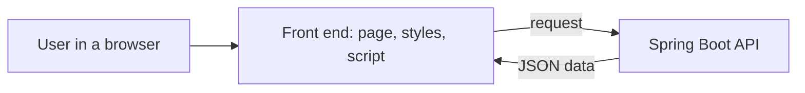
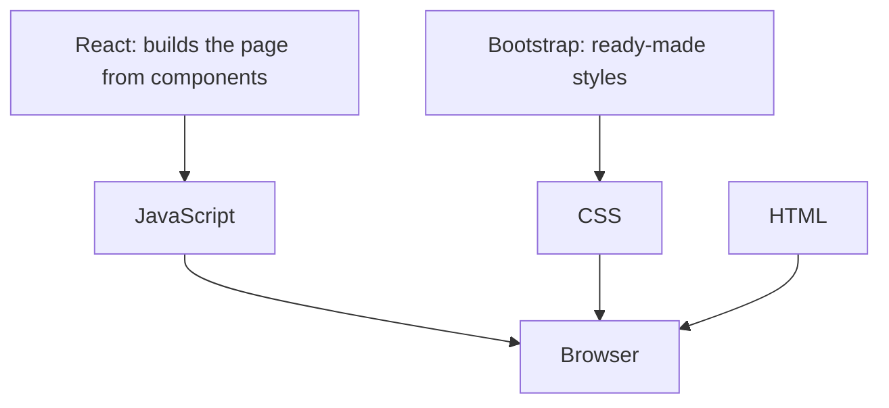

# The Front End: HTML, CSS, Bootstrap, JavaScript and React

**Time: about 45 minutes**

## What you will learn

- What the front end is, and what the browser does with it.
- The job of HTML, CSS, Bootstrap and JavaScript, each in one sentence.
- Where React fits, and why it does not replace the other four.

You will also build one small page that uses all four, so each role is visible.

---

## The ideas

### The front end is what the user sees

Your Spring Boot API sends data. It does not draw anything. The **front end** is the part that runs in the user's **browser** (Chrome, Edge, Firefox). It shows the data and sends the user's actions back to the API.



**How to read it:** the user clicks on the page. The page asks the API for data. The API answers with JSON (plain text data). The page shows it.

A browser understands only three things: **HTML**, **CSS** and **JavaScript**. Everything else in this note (Bootstrap, React) is built from those three.

### The four basic parts

Think of a house.

| Part | House | Job | Example |
|---|---|---|---|
| **HTML** | The walls and rooms | Says **what is on the page**: headings, text, buttons, forms | `<button>Save</button>` |
| **CSS** | The paint and layout | Says **how it looks**: colours, sizes, spacing, position | `button { color: white; }` |
| **Bootstrap** | Ready-made furniture | A set of **CSS classes someone else wrote**, so you do not style everything yourself | `<button class="btn btn-primary">` |
| **JavaScript** | The electricity | Says **what happens**: a click, a message, a call to the API | `button.addEventListener("click", ...)` |

Each part has one job. If something looks wrong, check CSS. If something is missing, check HTML. If something does not react to a click, check JavaScript.

### Bootstrap is CSS, not a new language

Bootstrap is a file of ready-made CSS. You add class names to your HTML, and the file does the styling. You write less CSS.

Keep the Bootstrap file inside your project folder. Do not link to it on the internet, because the machine may not reach it.

### Where React stands

React is a **JavaScript library**. It is not a fourth language and it does not replace HTML, CSS or JavaScript.

A plain page is one long HTML file that you change by hand with JavaScript. React lets you build the page from **small reusable pieces** called components (a `TicketCard`, a `Navbar`). React then keeps the screen in step with your data.



**How to read it:** React sits on top of JavaScript. Bootstrap sits on top of CSS. The browser still receives HTML, CSS and JavaScript in the end.

| | Plain page | React |
|---|---|---|
| Good for | One or two pages, a first look | Many screens that share parts (login, list, form) |
| You write | HTML, CSS, JavaScript | Components that produce HTML, plus CSS (or Bootstrap) |
| Learned on | Day 9 | Days 10 and 11 |

Learn the four basic parts first. React makes sense only when you know what it is producing.

---

## Build steps

You will build a page with a heading, a message and a button. Create a folder `hello-frontend/`.

### 1. HTML: the content

Create `index.html`:

```html
<!DOCTYPE html>
<html lang="en">
<head>
  <meta charset="UTF-8">
  <title>Support Assistant</title>
</head>
<body>
  <h1>Support Assistant</h1>
  <p id="message">No ticket loaded.</p>
  <button id="load">Load ticket</button>
</body>
</html>
```

The `id` gives an element a name, so CSS and JavaScript can find it later.

Open the file in your browser (double-click it, or drag it into the browser window).

**Check:** you see a heading, a line of text and a button. The page is plain black on white, and the button does nothing.

### 2. CSS: the look

Create `style.css` next to `index.html`:

```css
body { font-family: sans-serif; margin: 2rem; }
h1 { color: #1a5276; }
#message { padding: 0.5rem; background: #eaf2f8; }
```

Link it inside `<head>`, below the `<title>`:

```html
<link rel="stylesheet" href="style.css">
```

Refresh the browser.

**Check:** the heading is dark blue, and the message has a light blue background.

### 3. JavaScript: the behaviour

Create `app.js` next to `index.html`:

```javascript
const button = document.getElementById("load");
const message = document.getElementById("message");

button.addEventListener("click", function () {
  message.textContent = "Ticket 1: Printer not working";
});
```

`document.getElementById` finds an element by its `id`. `addEventListener` says "run this code when the button is clicked".

Add the script just before `</body>`:

```html
<script src="app.js"></script>
```

Refresh the browser and click the button.

**Check:** the message changes to `Ticket 1: Printer not working`.

### 4. Bootstrap: ready-made styles

1. Download Bootstrap from the Bootstrap website and copy `bootstrap.min.css` into a new folder `hello-frontend/css/`. (If the download is blocked, check the proxy notes from Day 1.)
2. Link it in `<head>`, **above** your own `style.css`, so your rules win when the two disagree:

```html
<link rel="stylesheet" href="css/bootstrap.min.css">
<link rel="stylesheet" href="style.css">
```

3. Add Bootstrap classes to the button and wrap the body content in a container:

```html
<body>
  <div class="container mt-4">
    <h1>Support Assistant</h1>
    <p id="message">No ticket loaded.</p>
    <button id="load" class="btn btn-primary">Load ticket</button>
  </div>
  <script src="app.js"></script>
</body>
```

**Check:** the button is blue with rounded corners, and the page content is centred with space around it. The click still works, because JavaScript did not change.

Your folder now looks like this:

```text
hello-frontend/
├── index.html
├── style.css
├── app.js
└── css/
    └── bootstrap.min.css
```

### 5. Look at where React would go

You do not write React today. Read the folder above and answer: if the page had ten different tickets, which file would you copy-paste ten times? React removes that copying: you write the ticket once as a component and use it ten times.

**Check:** you can say in one sentence what React adds that HTML, CSS and JavaScript alone do not.

---

## Common mistakes

> **Warning: the script runs before the page is ready.** If `<script src="app.js">` is in `<head>`, the button does not exist yet. The Console shows `Cannot read properties of null`. Put the script just before `</body>`.

> **Warning: the file is not found.** A style or script does not apply, and nothing else tells you why. Open the browser's developer tools (press `F12`), then the **Network** tab. A red line with `404` shows the wrong file name or folder in `href` or `src`.

> **Warning: your CSS is overridden by Bootstrap.** You linked `style.css` above Bootstrap. Move your link below it.

> **Warning: the page does not change after an edit.** You edited the file but did not save it, or did not refresh the browser. Save, then press `Ctrl+R` (`Cmd+R` on Mac).

When something fails in JavaScript, look in the **Console** tab of the developer tools first. It prints the error and the line number.

---

## Practice

1. Change the message text in `app.js` so that the button shows a different ticket. **Result:** the new text appears after a click.
2. Add a second button with the class `btn btn-success` and the text `Clear`. Make it set the message back to `No ticket loaded.` **Result:** Load and Clear switch the message back and forth.
3. Add one rule to `style.css` that changes the message background to light yellow, and use the browser developer tools (**Elements** tab) to find which rule is applied. **Result:** the background turns yellow, and you can point to the rule in the tools.

---

## Recap

- **HTML** is the content, **CSS** is the look, **JavaScript** is the behaviour.
- **Bootstrap** is a ready-made CSS file. You use it by adding class names.
- **React** is a JavaScript library that builds a page from reusable components. It sits on top of the other parts and does not replace them.
- On Day 9 your page will call the Spring Boot API with `fetch`. A page opened from a different address than the API needs CORS to be allowed. You will meet that then.
