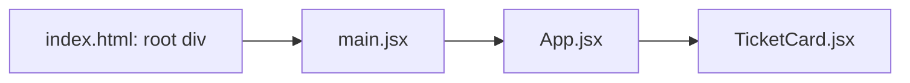

# React Project: Files and Folders

**Time: about 30 minutes**

You need the `hello-react` project from [Setting Up Node.js and React](02-setting-up-react.md).

## What you will learn

- What each file and folder in a new React project is for, and which ones you edit.
- The rules for naming and importing a component file.
- Where new files go as the project grows.

---

## The ideas

### Files you edit and files tools manage

Open `hello-react` in your editor. At the top level you see these items.

| Item | What it is | You edit it? | Commit it? |
|---|---|---|---|
| `index.html` | The one page. Holds an empty `<div id="root">` | Rarely (the page title) | Yes |
| `package.json` | Libraries and commands, like `pom.xml` | Through `npm install` | Yes |
| `package-lock.json` | The exact version of every library that was installed | No | Yes |
| `vite.config.js` | Settings for Vite | Not now | Yes |
| `.oxlintrc.json` | Rules for `npm run lint`, which warns about mistakes such as an unused import | No | Yes |
| `.gitignore` | Files that Git must skip | No | Yes |
| `README.md` | Text written by Vite | Replace with your own | Yes |
| `public/` | Files served as they are (the icon) | When you add a plain file | Yes |
| `src/` | **Your code** | **Yes, all the time** | Yes |
| `node_modules/` | Downloaded libraries | Never | **No** |
| `dist/` | Output of `npm run build` | Never | **No** |

`node_modules/` and `dist/` are in `.gitignore` already. You can delete either folder at any time: `npm install` brings back the first, and `npm run build` brings back the second.

### Inside `src/`

A new project has these files in `src/`:

```text
src/
├── main.jsx       # starting point: puts <App /> into the root div
├── App.jsx        # the first component
├── index.css      # styles for the whole page
├── App.css        # styles for App
└── assets/        # images that your code imports
```

The page is built in a chain. Each link hands over to the next.



**How to read it:** the browser loads `index.html`. It runs `main.jsx`, which puts `App` into the root div. `App` uses `TicketCard`, and so on down the chain. A new component joins the chain by being used by another one.

### The rules for a component file

- **One component per file.** The file name is the component name: `TicketCard.jsx` holds `TicketCard`.
- **Capital first letter** for the name (`TicketCard`, not `ticketCard`). React treats a lower-case name as an ordinary HTML tag.
- **End the name in `.jsx`** when the file contains HTML-like text.
- **End the file with `export default`** and the component name. Without it, no other file can import the component.
- **Import with a path** that starts with `./` (this folder) or `../` (the folder above): `import TicketCard from './components/TicketCard.jsx'`.
- **Styles are imported from code.** `main.jsx` has `import './index.css'`. That line is what loads the CSS file.

### `public/` or `src/assets/`?

| | `public/` | `src/assets/` |
|---|---|---|
| How you use it | By its address, for example `/favicon.svg` | By `import` in a `.jsx` file |
| What the build does | Copies it unchanged | Gives it a new name and bundles it |
| Use it for | The icon, files that other systems link to | Images that a component shows |

### Where new files go

React does not force a layout. This course uses the one below, and creates a folder only when the first file for it exists.

| Folder in `src/` | What goes in it | Examples (Days 10 and 11) |
|---|---|---|
| `components/` | Small pieces that screens reuse | `Navbar`, `TicketCard`, `TicketList`, `TicketForm`, `ProtectedRoute` |
| `pages/` | One component per screen | `LoginPage` |
| `context/` | Data shared by many components | `AuthContext` |
| `services/` | Code that calls the Spring Boot API | `ticketService.js` |

A file in `services/` returns no HTML, so it ends in `.js`, not `.jsx`.

---

## Build steps

Work in `hello-react`. Start the dev server with `npm run dev` and keep it running.

### 1. Read the starting chain

Open `index.html` and find `<div id="root"></div>` and the line `<script type="module" src="/src/main.jsx"></script>`. Then open `src/main.jsx` and find `createRoot(document.getElementById('root')).render(`.

**Check:** you can say which line in `index.html` loads `main.jsx`, and which line in `main.jsx` finds the root div.

### 2. Create a component in its own folder

Replace everything in `src/App.jsx` with:

```jsx
function App() {
  return <h1>Support Assistant</h1>
}

export default App
```

Create the folder `src/components/`, and in it the file `TicketCard.jsx`:

```jsx
function TicketCard() {
  return (
    <div>
      <h2>Ticket 1</h2>
      <p>Printer not working</p>
    </div>
  )
}

export default TicketCard
```

**Check:** the browser still shows only the heading. The new file is not used by anything yet, so it is not part of the chain.

### 3. Use the component twice

Change `src/App.jsx` to:

```jsx
import TicketCard from './components/TicketCard.jsx'

function App() {
  return (
    <div>
      <h1>Support Assistant</h1>
      <TicketCard />
      <TicketCard />
    </div>
  )
}

export default App
```

A component returns **one** outer element, so the heading and the two cards sit inside one `<div>`.

**Check:** the browser shows the heading and two identical cards, `Ticket 1 / Printer not working`.

### 4. Run the lint check

Open a second terminal in `hello-react` and run:

```bash
npm run lint
```

**Check:** the command prints nothing but its own header. Now add the line `import Unused from './components/TicketCard.jsx'` at the top of `App.jsx` and run it again. You see a warning: `Identifier 'Unused' is imported but never used`. Remove the line.

---

## Common mistakes

> **Warning: forgetting the import.** The page goes blank. The browser Console (press `F12`) shows `TicketCard is not defined`. Add the `import` line to the file that uses the component.

> **Warning: a lower-case name.** `<ticketCard />` does not fail. The page loads, but the cards are missing, because React treated `ticketCard` as an HTML tag. Start the name with a capital letter.

> **Warning: no `export default`.** The build stops with `"default" is not exported by "src/components/TicketCard.jsx"`. Add `export default TicketCard` at the end of the file.

> **Warning: a wrong path.** The build stops with `Could not resolve './component/TicketCard.jsx'`. Compare the folder name in the path with the folder on disk (`component` is not `components`).

> **Warning: committing `node_modules/`.** It has thousands of files. If `git status` lists it, `.gitignore` was changed or deleted. Restore it.

---

## Practice

1. Add a third `<TicketCard />` to `App.jsx`. **Result:** three cards appear.
2. Create `src/components/Navbar.jsx` that shows the text `Support Assistant` in an `<h1>`. Remove the heading from `App.jsx` and use `<Navbar />` instead. **Result:** the page looks the same, and the heading now comes from its own file.
3. Show the icon with `` inside `Navbar`. **Result:** the icon appears. Say why the address starts with `/` and not with `./public/`.

---

## Recap

- You edit `src/`. Tools manage `node_modules/`, `dist/` and `package-lock.json`. Never commit the first two.
- The page is a chain: `index.html` → `main.jsx` → `App.jsx` → your components.
- One component per file, a capital first letter, `.jsx` at the end, `export default`, and an import path that starts with `./`.
- Plain files go in `public/`. Images that code imports go in `src/assets/`.
- New folders (`components/`, `pages/`, `context/`, `services/`) are created when the first file for them exists.

> **Not verified:** the project, steps 2 to 4 and the error messages above were run on Node.js 22.19.0 with Vite 8.3.5 and React 19.3.1. The `Unused` warning comes from `npm run lint`. The Console message `TicketCard is not defined` is the standard JavaScript error for an unknown name. It was not read from the browser Console: only the blank page was checked. Practice tasks 2 and 3 were not run.
