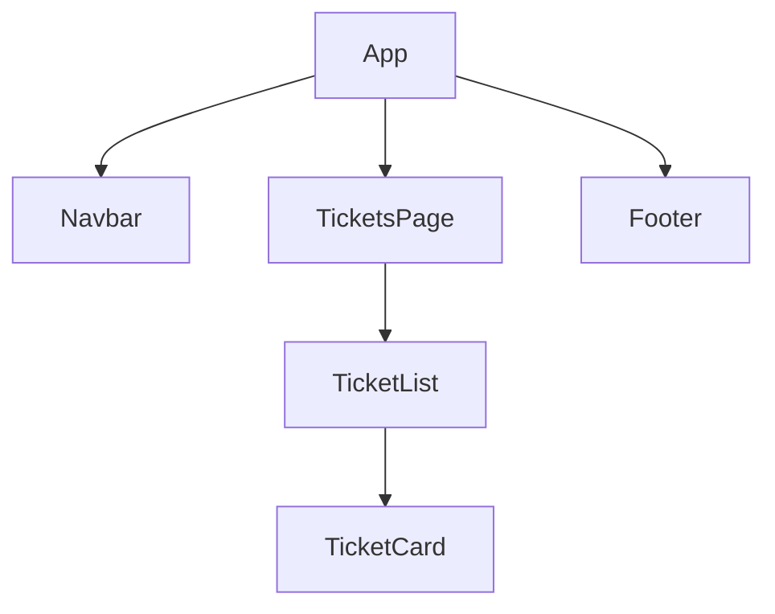

# React Components and the Support Assistant Layout

**Time: about 45 minutes**

You need the `hello-react` project from [Setting Up Node.js and React](02-setting-up-react.md), and the file rules from [React Project: Files and Folders](04-react-project-structure.md).

## What you will build

- A page for the Support Assistant with a **navigation bar** at the top, a **content area** in the middle and a **footer** at the bottom.
- A small tree of components: each one has one job.
- A way to decide which pieces to make a component, for any screen you design later.

The page shows fixed text. Showing different data in each component comes in later notes.

---

## The ideas

### A component is a piece of the screen

A **component** is a function that returns a piece of the screen. You write it once and use it as a tag: `<Navbar />`. A component can use other components, so a screen is built like boxes inside boxes.

A comparison: a form in a paper office has a letterhead, a body and a stamp at the bottom. The letterhead is printed the same on every form. Components work the same way: write the letterhead once, and use it everywhere.

### Decide the pieces with three questions

Look at the screen you want, and ask:

| Question | For the Support Assistant | Becomes |
|---|---|---|
| What is on **every** screen? | The top bar with the app name and links. The footer | `Navbar`, `Footer` |
| What **changes** from screen to screen? | The middle: the ticket list, the form, the login | A **page** component (`TicketsPage`, later `LoginPage`) |
| What **repeats** inside a screen? | One ticket in a list of tickets | `TicketCard`, inside `TicketList` |

Write a piece as its own component when it repeats, or when it is the same on many screens, or when the file becomes hard to read.

### Header or navbar?

Many guides show both a `Header` and a `Navbar`. This course uses **one**: the `Navbar` is the top bar. It holds the app name on the left and the links on the right. Add a separate `Header` only when you need a banner or title area above the menu.

### The regions of the page

| Region | Component | What it holds |
|---|---|---|
| Top | `Navbar` | The name `Support Assistant`, and links: Tickets, New Ticket, Login |
| Middle | `TicketsPage` | The heading `My Tickets` and the list of tickets |
| Bottom | `Footer` | One line of text |

The middle region is the only one that changes. On Day 11 a router (a tool that swaps the middle region when the address changes) puts `LoginPage` or the form there. `Navbar` and `Footer` never change.

### The component tree

`App` is the top component. It places the pieces on the page. This is the layout.



**How to read it:** an arrow means "uses". `App` uses three pieces. `TicketsPage` uses `TicketList`, which uses `TicketCard`. `Navbar` and `Footer` use nothing.

### Tags that name the regions

HTML has tags that say what a region is: `<nav>` for the navigation bar, `<main>` for the main content, `<footer>` for the footer, `<section>` for a part of the content. They look the same as `<div>` until you add styles, but they describe the page better. Use them where they fit.

### Where each file goes

Use the folders from note 04.

```text
src/
├── App.jsx                    # the layout
├── index.css                  # styles for the whole page
├── components/
│   ├── Navbar.jsx
│   ├── Footer.jsx
│   ├── TicketList.jsx
│   └── TicketCard.jsx
└── pages/
    └── TicketsPage.jsx
```

---

## Build steps

Work in `hello-react` with the dev server running (`npm run dev`). Create the files with the `rfce` snippet from note 03, or by hand.

### 1. Write the page styles

Replace everything in `src/index.css` with:

```css
body { margin: 0; font-family: sans-serif; }

.app { min-height: 100vh; display: flex; flex-direction: column; }

.navbar { display: flex; justify-content: space-between; align-items: center; padding: 0.75rem 1.5rem; background: #1a5276; color: white; }
.navbar a { color: white; margin-left: 1rem; text-decoration: none; }

.content { flex: 1; padding: 1.5rem; }

.footer { padding: 1rem; text-align: center; background: #eaf2f8; color: #555; }

.card { border: 1px solid #ccc; border-radius: 6px; padding: 0.75rem 1rem; margin-bottom: 0.75rem; }
```

`main.jsx` already imports this file. The `.app` rule makes the page at least as tall as the browser window and stacks its parts in a column. The `flex: 1` on `.content` makes the middle region take all the spare space, which pushes the footer to the bottom.

**Check:** the page still shows what it showed before. Only the look changes.

### 2. The `Navbar` component

Create `src/components/Navbar.jsx`:

```jsx
function Navbar() {
  return (
    <nav className="navbar">
      <strong>Support Assistant</strong>
      <div>
        <a href="#">Tickets</a>
        <a href="#">New Ticket</a>
        <a href="#">Login</a>
      </div>
    </nav>
  )
}

export default Navbar
```

In JSX the word for a CSS class is `className`, because `class` is a reserved word in JavaScript. The links do not go anywhere yet. React Router makes them work on Day 11.

**Check:** the file exists. Nothing changes in the browser, because no component uses `Navbar` yet.

### 3. The `Footer` component

Create `src/components/Footer.jsx`:

```jsx
function Footer() {
  return (
    <footer className="footer">
      <small>Support Assistant - training project</small>
    </footer>
  )
}

export default Footer
```

**Check:** the file exists. The browser is unchanged.

### 4. The ticket pieces

Replace `src/components/TicketCard.jsx` with:

```jsx
function TicketCard() {
  return (
    <div className="card">
      <h3>Ticket 1</h3>
      <p>Printer not working</p>
    </div>
  )
}

export default TicketCard
```

Create `src/components/TicketList.jsx`:

```jsx
import TicketCard from './TicketCard.jsx'

function TicketList() {
  return (
    <div>
      <TicketCard />
      <TicketCard />
      <TicketCard />
    </div>
  )
}

export default TicketList
```

The three cards look the same for now. Showing a different ticket in each one comes in a later note.

**Check:** both files exist, and the import path in `TicketList.jsx` starts with `./` because `TicketCard.jsx` is in the same folder.

### 5. The page component

Create the folder `src/pages/`, and in it `TicketsPage.jsx`:

```jsx
import TicketList from '../components/TicketList.jsx'

function TicketsPage() {
  return (
    <section>
      <h2>My Tickets</h2>
      <TicketList />
    </section>
  )
}

export default TicketsPage
```

The path starts with `../` because `components` is one folder up from `pages`.

**Check:** the file exists, and you can say why the path begins with `../`.

### 6. Put the layout together in `App`

Replace everything in `src/App.jsx` with:

```jsx
import Navbar from './components/Navbar.jsx'
import Footer from './components/Footer.jsx'
import TicketsPage from './pages/TicketsPage.jsx'

function App() {
  return (
    <div className="app">
      <Navbar />
      <main className="content">
        <TicketsPage />
      </main>
      <Footer />
    </div>
  )
}

export default App
```

**Check:** the browser shows a dark blue bar with `Support Assistant` on the left and three links on the right, the heading `My Tickets` with three bordered cards, and a light blue footer at the very bottom of the window. Make the browser window taller: the footer stays at the bottom.

`App` now only arranges the pieces. It has no ticket text of its own.

### 7. Run the checks

```bash
npm run lint
npm run build
```

**Check:** `npm run lint` prints nothing but its own header, and `npm run build` ends with `✓ built in …`.

---

## Common mistakes

> **Warning: `class` instead of `className`.** The page still loads, but the style is missing. The browser Console (`F12`) shows ``Invalid DOM property `class`. Did you mean `className`?``. Use `className`.

> **Warning: the footer floats up.** The page is short, and a white gap appears below the footer. The `flex: 1` rule on `.content`, or the `min-height: 100vh` rule on `.app`, is missing. Put them back.

> **Warning: two elements side by side.** A component returns **one** outer element. Two elements at the same level stop the build with `Adjacent JSX elements must be wrapped in an enclosing tag`. Put them inside one `<div>`.

> **Warning: a component that does too much.** If `App.jsx` holds the bar, the list and the footer in one file, you cannot reuse any of them. Split it by the three questions above.

---

## Practice

1. Add a fourth link, `Help`, to the `Navbar`. **Result:** it appears on the right of the bar.
2. Create `src/pages/NewTicketPage.jsx` that shows the heading `Raise a Ticket`. In `App.jsx`, put `<NewTicketPage />` in the main area in place of `<TicketsPage />`. **Result:** the bar and the footer stay the same, and only the middle changes. Put `TicketsPage` back afterwards.
3. Change the colour of the bar and the footer in `index.css` to a colour of your choice. **Result:** both change, and you did not edit any `.jsx` file.

---

## Recap

- A **component** is a function that returns a piece of the screen. You use it as a tag.
- Decide the pieces with three questions: what is on every screen (`Navbar`, `Footer`), what changes (a page), what repeats (`TicketCard`).
- `App` is the layout. It arranges `Navbar`, the page in `<main>`, and `Footer`. Pages go in `pages/`, the other pieces in `components/`.
- In JSX, write `className` and return one outer element.

**What the later notes add to this layout:** showing different data in each `TicketCard`, a `Navbar` that changes after login, and a middle region that swaps between pages. Each has its own note.

> **Not verified:** every file above was built (`npm run build`), checked with `npm run lint`, and rendered in headless Chrome with Node.js 22.19.0, Vite 8.3.5 and React 19.3.1. The first three mistakes were each tried, and the quoted messages are what appeared. The practice tasks were not run, and the layout was checked only in Chrome.
