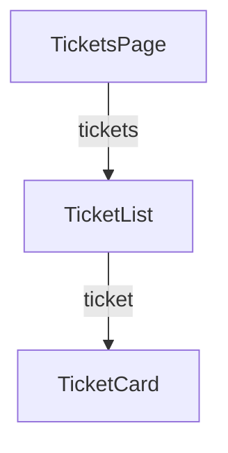

# React Props: Sending Data from Parent to Child

**Time: about 45 minutes**

You need the layout from [React Components and the Support Assistant Layout](05-components-and-layout.md): `App`, `Navbar`, `Footer`, `TicketsPage`, `TicketList` and `TicketCard`.

## What you will build

- A `TicketCard` that shows the title, priority and status it is **given**, instead of fixed text.
- A list of tickets kept in `TicketsPage` and sent down to `TicketList`, which shows **one card per ticket**.
- A page where adding one ticket to the list adds one card, with no change to any component.

---

## The ideas

### Props are the inputs of a component

A component is a function. **Props** (short for properties) are the values a parent gives it, like the parameters of a Java method. The parent fills them in, and the child shows them.

A comparison: a form letter has blanks for the name and the date. The letter is written once, and each copy gets different values in the blanks. `TicketCard` is the letter, and the props are the blanks.

Two rules:

- Data goes **one way**: from the parent to the child.
- The child **reads** its props and does not change them.



**How to read it:** `TicketsPage` owns the list of tickets and sends it to `TicketList`. `TicketList` sends one ticket to each `TicketCard`.

### Sending a prop

The parent writes props like attributes on a tag:

```jsx
<TicketCard title="Printer not working" status="OPEN" />
```

Text goes in quotes. Anything else (a number, a variable, a list) goes in curly braces: `id={1}` or `tickets={tickets}`. Curly braces in JSX mean "run this JavaScript and put the result here".

### Receiving a prop

The child lists the names it expects in curly braces in its parameter list, and then shows each value with curly braces:

```jsx
function TicketCard({ title, status }) {
  return <h3>{title} ({status})</h3>
}
```

The curly braces in the parameter list pick values out **by name**. This is plain JavaScript, not React:

```javascript
const ticket = { id: 1, title: 'Printer not working' }
const { title } = ticket
console.log(title)
```

```text
Printer not working
```

The names in the child must match the names the parent wrote, letter for letter.

### A list of tickets

A list of things is an **array**, written with square brackets. One ticket is an **object**, written with curly braces and named fields:

```javascript
const tickets = [
  { id: 1, title: 'Printer not working', priority: 'HIGH', status: 'OPEN' },
  { id: 2, title: 'Cannot log in to email', priority: 'MEDIUM', status: 'IN_PROGRESS' },
]
```

This is the same shape as the JSON that the Spring Boot API sends. Later, the API fills this list.

### Many values? Send the whole ticket

A ticket has several fields. Sending one prop for each field gets long. Send the **whole ticket** as **one prop** instead:

```jsx
<TicketCard ticket={ticket} />
```

The card reads the fields from it with a dot:

```jsx
function TicketCard({ ticket }) {
  return <h3>{ticket.title}</h3>
}
```

The fields of the object are the structure of a ticket, like the fields of a Java `TicketResponse` record. In JavaScript you do not write a class for it: the object in the data is the structure.

This has two benefits:

- When a ticket gets a new field, the components in between do not change.
- An object that comes from the API can be sent on as it is.

Build steps 1 and 2 use one prop for each field, so you see how props work. Step 3 changes to the whole ticket.

### Turning a list into cards with `map`

`map` goes through an array and builds a new array, with one result for each item. The part in parentheses says what to do with one item. `(n) => n * 2` is a short way to write a function: the parameter, an arrow, and the result.

```javascript
const numbers = [1, 2, 3]
const doubled = numbers.map((n) => n * 2)
console.log(doubled)
```

```text
[ 2, 4, 6 ]
```

In a component, the result is a list of cards instead of numbers:

```jsx
{tickets.map((ticket) => (
  <TicketCard key={ticket.id} ticket={ticket} />
))}
```

### The `key`

Each item in a list needs a `key` that is **different for every item**. React uses it to tell the items apart. Use the id of the ticket. Do not use the position in the list.

### Who holds the data?

The **page** holds the list, because the page is the screen that needs it. `TicketList` and `TicketCard` only show what they are given, so you can use them with any list.

---

## Build steps

Work in `hello-react` with the dev server running.

### 1. Give `TicketCard` its values

Replace `src/components/TicketCard.jsx` with:

```jsx
function TicketCard({ title, priority, status }) {
  return (
    <div className="card">
      <h3>{title}</h3>
      <p>Priority: {priority} | Status: {status}</p>
    </div>
  )
}

export default TicketCard
```

In `src/components/TicketList.jsx`, send each card its own values:

```jsx
<TicketCard title="Printer not working" priority="HIGH" status="OPEN" />
<TicketCard title="Cannot log in to email" priority="MEDIUM" status="IN_PROGRESS" />
<TicketCard title="Request a second monitor" priority="LOW" status="OPEN" />
```

These three lines replace the three `<TicketCard />` lines. The rest of the file stays the same.

**Check:** the browser shows three cards, each with a different title, priority and status.

### 2. Keep the tickets in `TicketsPage`

Replace `src/pages/TicketsPage.jsx` with:

```jsx
import TicketList from '../components/TicketList.jsx'

// Later this list comes from the Spring Boot API
const tickets = [
  { id: 1, title: 'Printer not working', priority: 'HIGH', status: 'OPEN' },
  { id: 2, title: 'Cannot log in to email', priority: 'MEDIUM', status: 'IN_PROGRESS' },
  { id: 3, title: 'Request a second monitor', priority: 'LOW', status: 'OPEN' },
]

function TicketsPage() {
  return (
    <section>
      <h2>My Tickets</h2>
      <p>{tickets.length} tickets</p>
      <TicketList tickets={tickets} />
    </section>
  )
}

export default TicketsPage
```

`tickets.length` is the number of items in the array. `tickets={tickets}` sends the whole array to `TicketList`.

**Check:** the line `3 tickets` appears under the heading. The cards are unchanged, because `TicketList` does not use the list yet.

### 3. Show one card per ticket, and send the whole ticket

Replace `src/components/TicketList.jsx` with:

```jsx
import TicketCard from './TicketCard.jsx'

function TicketList({ tickets }) {
  return (
    <div>
      {tickets.map((ticket) => (
        <TicketCard key={ticket.id} ticket={ticket} />
      ))}
    </div>
  )
}

export default TicketList
```

`TicketList` now sends one prop, `ticket`, in place of three. `TicketCard` must read it. Replace `src/components/TicketCard.jsx` with:

```jsx
function TicketCard({ ticket }) {
  return (
    <div className="card">
      <h3>{ticket.title}</h3>
      <p>Priority: {ticket.priority} | Status: {ticket.status}</p>
    </div>
  )
}

export default TicketCard
```

**Check:** the browser shows the same three cards as before. They now come from the array in `TicketsPage`, and each card receives one whole ticket.

### 4. Add a ticket to the data

In `TicketsPage.jsx`, add a fourth object to the array, after the third:

```jsx
  { id: 4, title: 'VPN keeps disconnecting', priority: 'HIGH', status: 'RESOLVED' },
```

**Check:** the text changes to `4 tickets` and a fourth card, `VPN keeps disconnecting`, appears. You did not edit `TicketList` or `TicketCard`.

### 5. Run the checks

```bash
npm run lint
npm run build
```

**Check:** `npm run lint` prints nothing but its own header, and `npm run build` ends with `✓ built in …`.

---

## Common mistakes

> **Warning: no `key` in the list.** The page works, but the Console (`F12`) shows `Each child in a list should have a unique "key" prop.` Add `key={ticket.id}` to the card inside `map`.

> **Warning: the list is not sent.** The page goes blank. The Console shows `Uncaught TypeError: Cannot read properties of undefined (reading 'map')`. A prop that the parent did not send is `undefined`. Check that `TicketsPage` has `tickets={tickets}`.

> **Warning: the names do not match.** In step 1, if the parent writes `titel="…"` and the child expects `title`, there is no error, and the title is empty. In step 3, `{ticket.titel}` shows nothing in the same way, because that field does not exist. Compare the names with the fields in the data.

> **Warning: no curly braces.** `<h3>title</h3>` shows the word `title`. Write `<h3>{title}</h3>` to show the value.

> **Warning: curly braces after the arrow, with no `return`.** `tickets.map((ticket) => { <TicketCard … /> })` shows an empty list and no error, because the function gives back nothing. Use parentheses right after the arrow, as in step 3, or write `return`.

---

## Practice

1. Add a fifth ticket, `Reset my password` with priority `MEDIUM` and status `OPEN`. **Result:** the page says `5 tickets` and shows five cards.
2. Add a field `raisedBy` to each ticket (use `Meera` or `Karan`), and show `Raised by: …` in each card. **Result:** every card shows a name. You do not need to edit `TicketList`.
3. Change the array in `TicketsPage` to an empty list, `[]`. **Result:** the page says `0 tickets` and shows no cards, with no error. Put the tickets back afterwards.

---

## Recap

- **Props** are the inputs of a component. The parent sends them as attributes, and the child receives them by name in curly braces.
- Data goes from parent to child. The child reads its props and does not change them.
- Curly braces in JSX run JavaScript: `{title}`, `{tickets.length}`, `tickets={tickets}`.
- Send a whole object as one prop (`ticket={ticket}`), and read its fields with a dot (`ticket.title`).
- `array.map(...)` turns an array into a list of components. Each item needs a `key`, such as the id.
- The page holds the list. `TicketList` and `TicketCard` show what they are given.

**What the next notes add:** data that changes while the page is open, and tickets that come from the Spring Boot API instead of a fixed array. Each has its own note.

> **Not verified:** every file above was built (`npm run build`), checked with `npm run lint`, and rendered in headless Chrome with Node.js 22.19.0, Vite 8.3.5 and React 19.3.1. The two plain JavaScript examples were run in Node. The five mistakes were each tried, and the quoted messages are what appeared. The step 3 version (the whole ticket as one prop) was built and rendered, and the wrong field name `ticket.titel` was tried and shows an empty title. Practice 2 was tried only as far as adding a `raisedBy` field to the data and showing it in the card (the card showed `Raised by: Meera`). The other practice tasks were not run.
