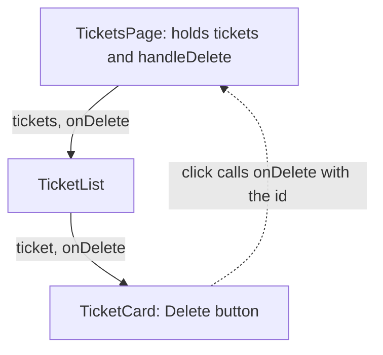

# React State: Data That Changes

**Time: about 55 minutes**

You need the project from [React Props: Sending Data from Parent to Child](06-props-and-lists.md): `TicketsPage` with an array of tickets, `TicketList` and `TicketCard`.

## What you will build

- A small counter that shows why a plain variable is not enough.
- The list of tickets held in **state**, so that the screen changes when the list changes.
- A **Delete** button on each `TicketCard` that removes the ticket, by calling a function that `TicketsPage` sends down.

> **Note:** the real Support Assistant API has no delete. A ticket moves through `OPEN`, `IN_PROGRESS`, `RESOLVED` and `CLOSED`. In this note, Delete only removes a card from the screen, so that you can practise state. Refresh the page and all the tickets come back.

---

## The ideas

### State is what a component remembers

**State** is data that a component keeps, and that can change while the page is open. When the state changes, React **redraws** the component (React calls this *rendering*), so the screen shows the new value.

You have met props. State is the other source of data in a component.

| | Props | State |
|---|---|---|
| Where it comes from | The parent sends it | The component keeps it |
| Can the component change it? | No, it only reads it | Yes, through an updater function |
| Example | `title` in `TicketCard` | The list of tickets in `TicketsPage` |

### A plain variable is not state

`tickets` in `TicketsPage` is a plain variable. You can change a plain variable, but React is **not told**, so it does not redraw. The screen keeps showing the old value.

| | Plain variable | State |
|---|---|---|
| You change it | `count = count + 1` | `setCount(count + 1)` |
| React redraws the screen | No | Yes |
| Kept between redraws | A variable inside a component is created again every time the component is redrawn | Yes, React keeps the value |

You will see this yourself in build steps 1 and 2.

### `useState()`

`useState` gives a component a piece of state. It is called a **hook**: a function that React provides, with a name that starts with `use`.

```jsx
import { useState } from 'react'

const [count, setCount] = useState(0)
```

- `0` is the **starting value**. React uses it only the first time.
- `useState` returns a pair: the **current value** (`count`) and the **updater function** (`setCount`) that changes it.
- By habit the names are `thing` and `setThing`.

Square brackets on the left of `=` pick the pair apart **by position**. This is plain JavaScript, not React:

```javascript
const pair = ['Printer', 'OPEN']
const [first, second] = pair
console.log(first, second)
```

```text
Printer OPEN
```

Call `useState` at the top of the component function, never inside an `if` or a loop.

### Updating state

Call the updater function with the **new** value:

```jsx
setCount(count + 1)
```

React puts the new value in place, redraws the component, and the screen shows it.

For a list, the new value must be a **new array**. Do not change the old array. `filter` builds a new array that keeps only the items that pass a test:

```javascript
const kept = [1, 2, 3, 4].filter((n) => n !== 2)
console.log(kept)
```

```text
[ 1, 3, 4 ]
```

Deleting a ticket keeps every ticket whose id is not the deleted one:

```jsx
setTickets(tickets.filter((ticket) => ticket.id !== id))
```

### Data goes down, actions go up

`TicketsPage` holds the state. The Delete button is two levels down, in `TicketCard`. A child cannot change its parent's state directly. So the parent sends the child a **function** as a prop, and the child calls it when the button is clicked.



**How to read it:** the solid arrows show data and the function going down. The dotted arrow shows the click going back up: `TicketCard` calls the function it was given, and the function runs in `TicketsPage`, where the state is.

Three rules for the function:

- **The state and the function that changes it live in the same component.** Here that is `TicketsPage`. The function is called `handleDelete`.
- **Name the prop `onDelete`.** The habit is `handle…` for the function in the owner, and `on…` for the prop that carries it.
- **Pass the function, do not call it.** Write `onDelete={handleDelete}`, with no parentheses after `handleDelete`.

In the button, `onClick={() => onDelete(ticket.id)}` wraps the call in a small arrow function. The call then waits until the click. The card already has the whole `ticket`, so it passes `ticket.id` to say which ticket to delete.

---

## Build steps

Work in `hello-react` with the dev server running.

### 1. See a plain variable fail

Create `src/components/Counter.jsx`:

```jsx
let count = 0

function Counter() {
  return (
    <button onClick={() => { count = count + 1; console.log(count) }}>
      Clicked {count} times
    </button>
  )
}

export default Counter
```

In `src/pages/TicketsPage.jsx`, add `import Counter from '../components/Counter.jsx'` below the other import, and put `<Counter />` above the `<h2>`.

Click the button three times. Open the Console (`F12`).

**Check:** the button still says `Clicked 0 times`, but the Console prints `1`, `2`, `3`. The variable changed, and the screen did not.

### 2. Make it state

Replace `src/components/Counter.jsx` with:

```jsx
import { useState } from 'react'

function Counter() {
  const [count, setCount] = useState(0)

  return (
    <button onClick={() => setCount(count + 1)}>
      Clicked {count} times
    </button>
  )
}

export default Counter
```

**Check:** click the button three times. It says `Clicked 1 times`, then `2`, then `3`.

### 3. Remove the counter, and put the tickets in state

Delete `Counter.jsx`, and remove its import and its tag from `TicketsPage.jsx`.

Then replace `src/pages/TicketsPage.jsx` with:

```jsx
import { useState } from 'react'
import TicketList from '../components/TicketList.jsx'

// Later this list comes from the Spring Boot API
const initialTickets = [
  { id: 1, title: 'Printer not working', priority: 'HIGH', status: 'OPEN' },
  { id: 2, title: 'Cannot log in to email', priority: 'MEDIUM', status: 'IN_PROGRESS' },
  { id: 3, title: 'Request a second monitor', priority: 'LOW', status: 'OPEN' },
  { id: 4, title: 'VPN keeps disconnecting', priority: 'HIGH', status: 'RESOLVED' },
]

function TicketsPage() {
  const [tickets, setTickets] = useState(initialTickets)

  return (
    <section>
      <h2>My Tickets</h2>
      <p>{tickets.length} tickets</p>
      <TicketList tickets={tickets} />
    </section>
  )
}

export default TicketsPage
```

The array is now called `initialTickets`, and it is only the starting value. The list that the page uses is `tickets`, from `useState`.

**Check:** the page looks the same as before: `4 tickets` and four cards.

### 4. Write the delete function and send it down

In `TicketsPage.jsx`, add `handleDelete` above the `return`, and send it to `TicketList`:

```jsx
  function handleDelete(id) {
    setTickets(tickets.filter((ticket) => ticket.id !== id))
  }

  return (
    <section>
      <h2>My Tickets</h2>
      <p>{tickets.length} tickets</p>
      <TicketList tickets={tickets} onDelete={handleDelete} />
    </section>
  )
```

In `src/components/TicketList.jsx`, receive `onDelete` and pass it on to each card, next to the `ticket`:

```jsx
function TicketList({ tickets, onDelete }) {
  return (
    <div>
      {tickets.map((ticket) => (
        <TicketCard key={ticket.id} ticket={ticket} onDelete={onDelete} />
      ))}
    </div>
  )
}
```

**Check:** the page looks the same. The function is on its way down, and nothing uses it yet.

### 5. Add the Delete button to `TicketCard`

Replace `src/components/TicketCard.jsx` with:

```jsx
function TicketCard({ ticket, onDelete }) {
  return (
    <div className="card">
      <h3>{ticket.title}</h3>
      <p>Priority: {ticket.priority} | Status: {ticket.status}</p>
      <button onClick={() => onDelete(ticket.id)}>Delete</button>
    </div>
  )
}

export default TicketCard
```

**Check:** each card has a **Delete** button. Click the one on `Printer not working`. That card disappears, and the count changes to `3 tickets`. Click another one: `2 tickets`.

### 6. Refresh, then run the checks

Refresh the browser.

**Check:** all four tickets are back. State lives in the memory of the open page. Saving a change in the database through the API comes in a later note.

```bash
npm run lint
npm run build
```

**Check:** `npm run lint` prints nothing but its own header, and `npm run build` ends with `✓ built in …`.

---

## Common mistakes

> **Warning: a plain variable instead of state.** The data changes and the screen does not (step 1). Use `useState`, and change it with the updater function.

> **Warning: changing the old array.** `tickets.splice(0, 1); setTickets(tickets)` does not update the screen, because React is given the same array that it already has. Give it a new array, as `filter` does.

> **Warning: calling the function while the card is drawn.** `onClick={onDelete(ticket.id)}` runs `onDelete` as soon as the card is drawn, and not on the click. The Console shows ``Cannot update a component (`TicketsPage`) while rendering a different component (`TicketCard`)``. Write `onClick={() => onDelete(ticket.id)}`.

> **Warning: the function is not passed on at every level.** If `TicketList` does not send `onDelete` to the card, a click gives `Uncaught TypeError: onDelete is not a function`. Check each file between the owner and the button.

> **Warning: no import for `useState`.** The page goes blank. The Console shows `Uncaught ReferenceError: useState is not defined`. Add `import { useState } from 'react'`.

> **Warning: `useState` inside an `if`.** `npm run lint` reports an error: ``React Hook "useState" is called conditionally``. Move the call to the top of the component.

---

## Practice

1. In `TicketsPage`, add a button `Reset` that restores all four tickets. It needs one line, using `initialTickets`. **Result:** after deleting some cards, Reset brings them all back.
2. Add a button `Clear all` that empties the list. **Result:** the page says `0 tickets` and shows no cards, with no error.
3. Under the count, show how many `HIGH` priority tickets are in the list, for example `2 high priority`. Do **not** add a second state for it. **Result:** the number drops when you delete a `HIGH` ticket.

---

## Recap

- **State** is data that a component keeps. When it changes, React redraws the component. Props come from the parent, and state belongs to the component.
- A plain variable can change without the screen changing. State changes through its updater function, and the screen follows.
- `const [tickets, setTickets] = useState(initialTickets)` gives the current value and the updater. Call it at the top of the component.
- Give the updater a **new** value. For a list, use `filter` to build a new array without the deleted item.
- The owner of the state writes the function (`handleDelete`) and sends it down as a prop (`onDelete`). The child calls it, for example `() => onDelete(ticket.id)`.

**What the next notes add:** adding a ticket from a form, and loading the tickets from the Spring Boot API instead of a fixed array. Each has its own note.

> **Not verified:** every file above was built (`npm run build`), checked with `npm run lint`, and rendered in headless Chrome with Node.js 22.19.0, Vite 8.3.5 and React 19.3.1. The clicks (counter and Delete) were made by a script in headless Chrome, not by hand. The two plain JavaScript examples were run in Node. The six mistakes were each tried, and the quoted messages are what appeared. After the card was changed to receive the whole `ticket`, the final code was built, linted and tested again with scripted clicks (two deletes left two tickets), and the "function is not passed on" and "called while drawn" mistakes were tried again against it. The other mistakes do not depend on the card. The practice tasks were not run. For the "calling the function while the card is drawn" mistake, the note quotes only the start of the Console message. The message is longer. The row in the table about a variable inside a component being created again on every redraw is standard React behaviour, and was not shown by a test.
