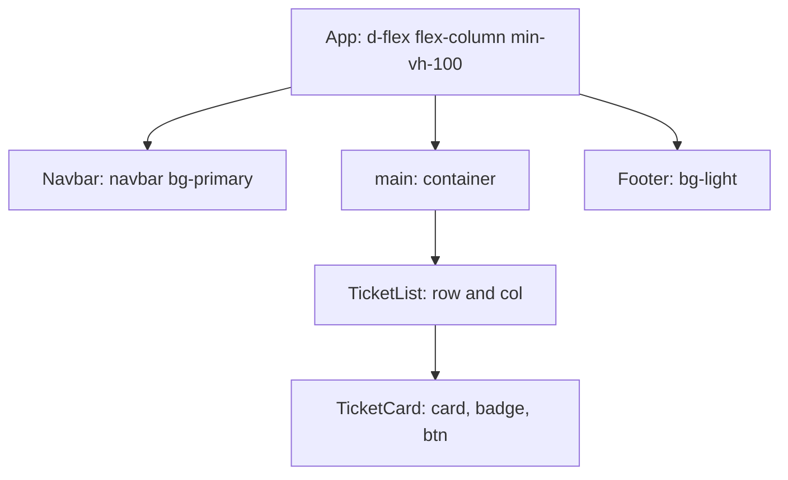

# Styling React with Bootstrap and React-Bootstrap

**Time: about 60 minutes**

You need the project from [React State: Data That Changes](07-state.md): the layout, the list of tickets in state, and the Delete button. This note changes only how the project **looks**. The state and the Delete button keep working.

## What you will build

- **Part A:** the Support Assistant screen styled with Bootstrap **classes**: a blue navigation bar, a footer, a count badge, and ticket cards in a grid that shows two columns on a wide window and one on a narrow window.
- **Part B:** the same screen built with **React-Bootstrap** components (`Navbar`, `Card`, `Button`), which adds a menu that collapses into a button on a narrow window.

---

## The ideas

### Bootstrap in a React project

Bootstrap is a file of ready-made CSS classes. You used it with plain HTML on Day 9. In a React project you install it with `npm`, and import its CSS file **once**. The file stays inside your project, so the page does not need the internet to look right.



**How to read it:** each component gets the Bootstrap classes that fit its job. The text after the colon is the main class (or classes) it uses.

### The classes you will use

A class name tells you what it does. In `mb-3`, `m` is margin, `b` is bottom, and `3` is the size.

| Class | What it does |
|---|---|
| `container` | Centres the content and gives it a maximum width |
| `row`, `col` | A grid: a row holds columns |
| `row-cols-1 row-cols-md-2` | One column on a small window, two from a medium window (768 pixels) up |
| `g-3` | A gap between the columns and rows |
| `mb-3`, `ms-2`, `me-2` | Space below, at the start (left), at the end (right) |
| `py-4` | Space above and below inside an element |
| `ms-auto` | Pushes an element to the right |
| `d-flex flex-column min-vh-100` | Stacks the page parts, and makes the page at least as tall as the window |
| `flex-grow-1` | Takes all spare space, which pushes the footer down |
| `navbar`, `navbar-brand`, `nav-link` | The navigation bar and its parts |
| `card`, `card-body`, `card-title` | A card and its parts |
| `badge text-bg-danger` | A small coloured label |
| `btn btn-outline-danger btn-sm` | A small button with a red outline |

### Colour from a lookup table

Each priority gets its own colour: `HIGH` red, `MEDIUM` blue, `LOW` grey. An object can work as a **lookup table**: give it a key, and it gives back the value. The `+` joins pieces of text, as in Java.

```javascript
const color = { HIGH: 'danger', MEDIUM: 'primary', LOW: 'secondary' }
console.log('badge text-bg-' + color['HIGH'])
```

```text
badge text-bg-danger
```

### Two ways to use Bootstrap in React

| | Bootstrap classes (Part A) | React-Bootstrap (Part B) |
|---|---|---|
| What you write | `<button className="btn btn-outline-danger btn-sm">` | `<Button variant="outline-danger" size="sm">` |
| What you install | `bootstrap` | `bootstrap` and `react-bootstrap` |
| Where the look comes from | The same Bootstrap CSS file | The same Bootstrap CSS file |
| Menus that open and close (hamburger menu, dropdown, pop-up window) | Need JavaScript that you would have to add yourself | Built in: they are React components |
| Use it for | Simple parts: cards, badges, buttons, the grid | Parts that open and close, or that you prefer to write as components |

React-Bootstrap does not replace Bootstrap. It is a set of React components that produce the same Bootstrap classes, so you still import the Bootstrap CSS file. You can mix both ways in one project.

---

## Part A: Bootstrap classes

Work in `hello-react` with the dev server running. If `npm install` fails on your network, see the proxy steps in [Setting Up Node.js and React](02-setting-up-react.md).

### A1. Install Bootstrap

```bash
npm install bootstrap
```

**Check:** `package.json` now lists `"bootstrap"` under `dependencies`.

### A2. Import it, and remove the old styles

The styles you wrote in note 05 use class names such as `navbar` and `card`, which Bootstrap also uses. The two sets of rules would mix. Remove the old ones.

1. In `src/main.jsx`, replace the line `import './index.css'` with:

   ```jsx
   import 'bootstrap/dist/css/bootstrap.min.css'
   ```

2. Delete the file `src/index.css`.

**Check:** the page looks different, and some parts look unfinished. The next steps give each component its Bootstrap classes.

### A3. The page layout and the footer

Replace `src/App.jsx` with:

```jsx
import Navbar from './components/Navbar.jsx'
import Footer from './components/Footer.jsx'
import TicketsPage from './pages/TicketsPage.jsx'

function App() {
  return (
    <div className="d-flex flex-column min-vh-100">
      <Navbar />
      <main className="container py-4 flex-grow-1">
        <TicketsPage />
      </main>
      <Footer />
    </div>
  )
}

export default App
```

Replace `src/components/Footer.jsx` with:

```jsx
function Footer() {
  return (
    <footer className="bg-light text-center text-muted py-3 border-top">
      <small>Support Assistant - training project</small>
    </footer>
  )
}

export default Footer
```

**Check:** the footer is a light grey strip with a thin line above it, at the bottom of the window.

### A4. The navigation bar

Replace `src/components/Navbar.jsx` with:

```jsx
function Navbar() {
  return (
    <nav className="navbar navbar-expand bg-primary px-3" data-bs-theme="dark">
      <span className="navbar-brand">Support Assistant</span>
      <ul className="navbar-nav ms-auto">
        <li className="nav-item"><a className="nav-link" href="#">Tickets</a></li>
        <li className="nav-item"><a className="nav-link" href="#">New Ticket</a></li>
        <li className="nav-item"><a className="nav-link" href="#">Login</a></li>
      </ul>
    </nav>
  )
}

export default Navbar
```

`bg-primary` makes the bar blue. `data-bs-theme="dark"` makes its text light. `ms-auto` pushes the links to the right.

**Check:** a blue bar with `Support Assistant` on the left and three links on the right.

### A5. The heading with a count badge

In `src/pages/TicketsPage.jsx`, replace the `<h2>` and the `<p>` that shows the count with:

```jsx
      <h2 className="mb-3">
        My Tickets
        <span className="badge text-bg-secondary ms-2">{tickets.length}</span>
      </h2>
```

Everything else in the file stays the same.

**Check:** the heading `My Tickets` has a small grey badge with the number `4` next to it.

### A6. The ticket cards in a grid

Replace `src/components/TicketList.jsx` with:

```jsx
import TicketCard from './TicketCard.jsx'

function TicketList({ tickets, onDelete }) {
  return (
    <div className="row row-cols-1 row-cols-md-2 g-3">
      {tickets.map((ticket) => (
        <div className="col" key={ticket.id}>
          <TicketCard ticket={ticket} onDelete={onDelete} />
        </div>
      ))}
    </div>
  )
}

export default TicketList
```

The `key` now sits on the outer `div`, because that is the element that `map` returns.

Replace `src/components/TicketCard.jsx` with:

```jsx
const priorityColor = { HIGH: 'danger', MEDIUM: 'primary', LOW: 'secondary' }

function TicketCard({ ticket, onDelete }) {
  return (
    <div className="card h-100">
      <div className="card-body">
        <h5 className="card-title">{ticket.title}</h5>
        <p className="card-text">
          <span className={'badge me-2 text-bg-' + priorityColor[ticket.priority]}>
            {ticket.priority}
          </span>
          <span className="badge text-bg-light border">{ticket.status}</span>
        </p>
        <button className="btn btn-outline-danger btn-sm" onClick={() => onDelete(ticket.id)}>
          Delete
        </button>
      </div>
    </div>
  )
}

export default TicketCard
```

`h-100` makes the cards in one row the same height. The constant `priorityColor` sits above the component, so it is created once.

**Check:** four cards in two columns, each with a title, a coloured priority badge, a status badge and a red **Delete** button. Make the browser window narrow (under 768 pixels wide, or use the responsive mode in the developer tools): the cards stack in one column.

### A7. Check the behaviour

Click **Delete** on a card.

**Check:** the card disappears and the badge number goes down. Then run:

```bash
npm run lint
npm run build
```

`npm run lint` prints nothing but its own header, and `npm run build` ends with `✓ built in …`.

---

## Part B: React-Bootstrap

Part B builds the same screen with components. You change three files and keep the rest.

### B1. Install React-Bootstrap

```bash
npm install react-bootstrap
```

**Check:** `package.json` lists both `"bootstrap"` and `"react-bootstrap"`. The `import 'bootstrap/dist/css/bootstrap.min.css'` line in `main.jsx` stays: React-Bootstrap still needs the CSS file.

### B2. The navigation bar as components

Replace `src/components/Navbar.jsx` with:

```jsx
import BsNavbar from 'react-bootstrap/Navbar'
import Container from 'react-bootstrap/Container'
import Nav from 'react-bootstrap/Nav'

function Navbar() {
  return (
    <BsNavbar expand="md" bg="primary" data-bs-theme="dark">
      <Container>
        <BsNavbar.Brand href="#">Support Assistant</BsNavbar.Brand>
        <BsNavbar.Toggle aria-controls="main-nav" />
        <BsNavbar.Collapse id="main-nav">
          <Nav className="ms-auto">
            <Nav.Link href="#">Tickets</Nav.Link>
            <Nav.Link href="#">New Ticket</Nav.Link>
            <Nav.Link href="#">Login</Nav.Link>
          </Nav>
        </BsNavbar.Collapse>
      </Container>
    </BsNavbar>
  )
}

export default Navbar
```

Each import names one component: `import Name from 'react-bootstrap/Name'`, with no curly braces. The React-Bootstrap navigation bar is also called `Navbar`, which is the name of your own component, so it is imported as `BsNavbar`. A default import can have any name.

Some components hold others: `BsNavbar.Brand`, `Nav.Link`. A property such as `expand="md"` replaces a class name.

**Check:** on a wide window the bar looks the same as in Part A. Make the window narrower than 768 pixels: the links disappear and a button with three lines (a hamburger button) appears. Click it, and the links open below the bar. Click it again, and they close.

### B3. The cards as components

Replace `src/components/TicketList.jsx` with:

```jsx
import Row from 'react-bootstrap/Row'
import Col from 'react-bootstrap/Col'
import TicketCard from './TicketCard.jsx'

function TicketList({ tickets, onDelete }) {
  return (
    <Row xs={1} md={2} className="g-3">
      {tickets.map((ticket) => (
        <Col key={ticket.id}>
          <TicketCard ticket={ticket} onDelete={onDelete} />
        </Col>
      ))}
    </Row>
  )
}

export default TicketList
```

`xs={1} md={2}` is the same as `row-cols-1 row-cols-md-2`.

Replace `src/components/TicketCard.jsx` with:

```jsx
import Card from 'react-bootstrap/Card'
import Badge from 'react-bootstrap/Badge'
import Button from 'react-bootstrap/Button'

const priorityColor = { HIGH: 'danger', MEDIUM: 'primary', LOW: 'secondary' }

function TicketCard({ ticket, onDelete }) {
  return (
    <Card className="h-100">
      <Card.Body>
        <Card.Title>{ticket.title}</Card.Title>
        <Card.Text>
          <Badge bg={priorityColor[ticket.priority]} className="me-2">
            {ticket.priority}
          </Badge>
          <Badge bg="light" text="dark" className="border">
            {ticket.status}
          </Badge>
        </Card.Text>
        <Button variant="outline-danger" size="sm" onClick={() => onDelete(ticket.id)}>
          Delete
        </Button>
      </Card.Body>
    </Card>
  )
}

export default TicketCard
```

Compare it with Part A. `className="btn btn-outline-danger btn-sm"` became `variant="outline-danger" size="sm"`, and `className="badge text-bg-danger"` became `bg="danger"`. The `onClick` is the same.

**Check:** the screen looks the same as in Part A: two columns on a wide window, one on a narrow one. Click **Delete**: the card disappears and the badge number goes down, because `TicketsPage` and its state did not change.

### B4. Run the checks

```bash
npm run lint
npm run build
```

**Check:** `npm run lint` prints nothing but its own header, and `npm run build` ends with `✓ built in …`.

---

## Common mistakes

> **Warning: the Bootstrap CSS is not imported.** The page loads, but looks plain: no colours, no spacing, and the grid is gone. Check that `main.jsx` has `import 'bootstrap/dist/css/bootstrap.min.css'`. React-Bootstrap needs it too.

> **Warning: the old styles are still imported.** If `import './index.css'` stays in `main.jsx`, nothing fails, but the old rules apply on top of Bootstrap's: the cards get extra space inside, and the link colours change. Delete `index.css` and its import.

> **Warning: React-Bootstrap is not installed.** The build stops with `Rolldown failed to resolve import "react-bootstrap/Row"`. Run `npm install react-bootstrap`.

> **Warning: curly braces on a React-Bootstrap import.** `import { Button } from 'react-bootstrap/Button'` leaves the page empty. The Console (`F12`) shows ``Uncaught SyntaxError: The requested module … does not provide an export named 'Button'``. Write `import Button from 'react-bootstrap/Button'`.

> **Warning: the `key` is on the wrong element.** In a grid, put `key` on the outer element that `map` returns (`div className="col"` or `Col`). On the card inside it, the Console shows `Each child in a list should have a unique "key" prop.`

> **Warning: `class` instead of `className`.** Bootstrap styles do not apply, and the Console warns about `class`. In JSX, write `className`.

---

## Practice

1. Change the colour of the navigation bar to dark: `bg-dark` in Part A, or `bg="dark"` in Part B. **Result:** the bar turns dark grey.
2. Give each **status** its own colour, with a second lookup table like `priorityColor`. **Result:** `OPEN`, `IN_PROGRESS`, `RESOLVED` and `CLOSED` show in different colours.
3. Show three cards in a row on a large window. Add `row-cols-lg-3` in Part A, or `lg={3}` in Part B. **Result:** three cards per row on a wide window, two on a medium one, one on a narrow one.

---

## Recap

- Install Bootstrap with `npm install bootstrap`, and import its CSS file once in `main.jsx`. Nothing is loaded from the internet.
- Bootstrap class names describe the job: `container`, `row`, `col`, `card`, `badge`, `btn`, and spacing such as `mb-3`.
- A grid class such as `row-cols-md-2` changes the number of columns with the window width.
- **React-Bootstrap** gives you the same parts as React components (`Navbar`, `Card`, `Button`). Properties such as `variant="outline-danger"` replace class names. It needs the Bootstrap CSS file too.
- Use plain classes for simple parts, and React-Bootstrap for parts that open and close, such as the collapsing menu.
- Styling changes the look only. The state, the props and the Delete button did not change.

> **Not verified:** both parts were built (`npm run build`) and checked with `npm run lint` using Bootstrap 5.3.8, React-Bootstrap 2.10.10, Node.js 22.19.0, Vite 8.3.5 and React 19.3.1. Both were rendered in headless Chrome at a wide (1100 pixel) and a narrow (520 pixel) window, and the screenshots were looked at. The Delete click and the hamburger button click were made by a script, not by hand. The mistakes about the missing CSS import, the old `index.css`, the missing install, the curly-brace import and the `key` were each tried. The step A2 intermediate page (old components with the new CSS) was not looked at. The statement that menus which open and close need extra JavaScript in the class-only way comes from the documentation of the two libraries and was not tested. The practice tasks were not run, and only Chrome was used.
