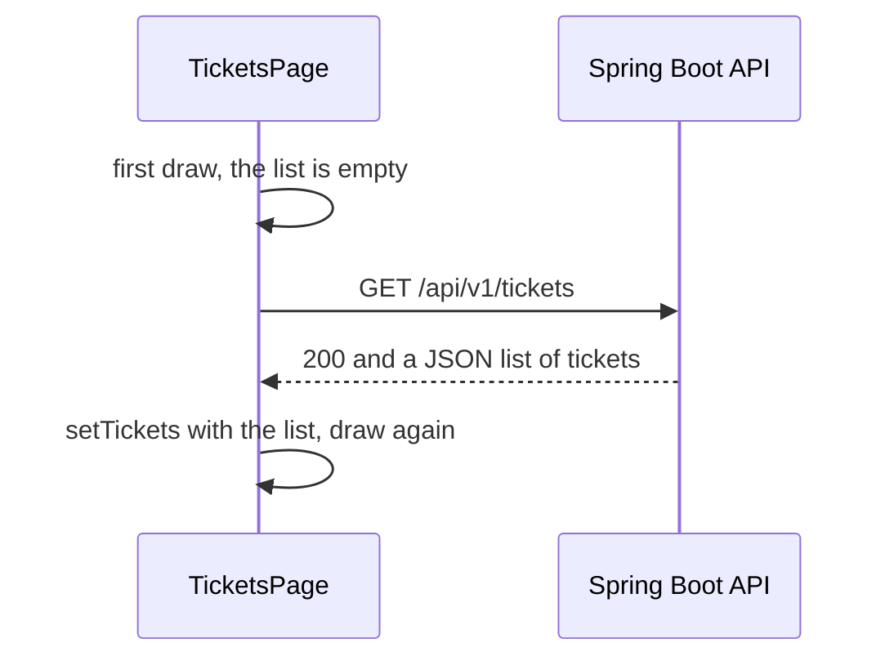

# Reading Data from the Backend with fetch

**Time: about 60 minutes**

You need the project from [React State: Data That Changes](07-state.md): `TicketsPage` with `useState`, `TicketList` and `TicketCard`. The Bootstrap look from [note 08](08-bootstrap-and-react-bootstrap.md) is optional. The steps work with or without it.

You also need the Support Assistant API running on your machine. Step 1 starts it.

## What you will build

- A call from the browser to the Spring Boot API, with the built-in `fetch` function.
- A `TicketsPage` that loads its tickets from the API when it appears, in place of the fixed array.
- A **Loading** message while the answer is on its way, and an **error** message when the call fails.

---

## The ideas

### The browser calls the API

Until now the tickets were typed into `TicketsPage`. Now the page asks the API for them. The browser sends a **GET** request to the address of the API, and the API answers with a list of tickets written as JSON.



**How to read it:** time runs from top to bottom. The page draws itself once with an empty list, then asks the API. When the answer arrives, the page puts it in state, and React draws the page again with the tickets.

One ticket in the answer looks like this:

```json
{ "id": 7, "title": "Printer is jammed", "description": "Second floor", "status": "OPEN",
  "priority": "HIGH", "createdAt": "2026-11-04T10:30:00", "dueBy": "2026-11-05T10:30:00" }
```

It has the same fields as the objects you typed in note 06, plus a few more. `TicketCard` already reads `title`, `priority` and `status`, so it needs no change.

### `fetch` and `await`

`fetch(url)` sends a request. The answer does not come back at once, because it travels over the network. So `fetch` gives back a **promise**: a receipt that says "the answer will arrive later". The word `await` waits at that line until the answer is there.

```javascript
const response = await fetch('http://localhost:8080/api/v1/tickets')
const tickets = await response.json()
```

There are two waits:

1. `await fetch(...)` waits for the **answer to start**. You get a `response` with the status.
2. `await response.json()` waits for the **body** and turns the JSON text into JavaScript: here, an array of objects.

A function that uses `await` must be marked `async`: `async function loadTickets() { … }`.

### `fetch` does not fail on `404` or `500`

`fetch` raises an error only when no answer arrives at all: the server is off, or the network is down. When the server answers with `404` (not found) or `500` (server error), `fetch` counts that as an answer, and carries on.

So check `response.ok`. It is `true` for a status from `200` to `299`, and `false` otherwise. If it is `false`, throw an error yourself and let `catch` handle it:

```javascript
try {
  const response = await fetch(API_URL)
  if (!response.ok) {
    throw new Error('The server answered ' + response.status)
  }
  // ... read the list
} catch (err) {
  // runs for a thrown error, and when no answer arrived
}
```

`try` runs the code. If anything inside throws an error, the code jumps to `catch`. `finally`, which you will use in step 4, runs after both.

### `useEffect`: run code after the screen is drawn

Where does the `fetch` call go? **Not** in the body of the component: the body runs on every draw, and a `fetch` there would start a new request each time. When the answer arrives it changes the state, which draws the component again, which calls `fetch` again, and so on without end. You will see this in the common mistakes.

`useEffect` is the hook for work that happens **outside** the screen, such as a call to a server. React runs the function you give it **after** the component has been drawn.

```jsx
useEffect(() => {
  // runs after the draw
}, [])
```

The `[]` at the end is the **dependency list**. It says which values the effect depends on. An empty list means "depends on nothing, so run once, after the first draw".

Two rules:

- Import it: `import { useState, useEffect } from 'react'`.
- The function you give to `useEffect` must **not** be `async`. Put an `async` function inside it, and call that.

> **Note:** while you develop, `main.jsx` wraps the app in `<StrictMode>`. It draws every component twice on purpose, to help find mistakes, so your effect runs **twice** and the API gets **two** requests. This happens only with `npm run dev`. The built app makes one request.

### Three situations, three pieces of state

A call to a server has three outcomes, and the page should show each one:

| Situation | State | The page shows |
|---|---|---|
| The answer has not arrived | `loading` is `true` | `Loading tickets...` |
| The call failed | `error` has a message | The message |
| The answer arrived | `tickets` has the list | The list |

### Why the browser allows this call

The React page is at `http://localhost:5173` and the API is at `http://localhost:8080`. These are different addresses, and a browser blocks a page from calling a different address unless that server allows it. This rule is called **CORS**. The API projects have a `CorsConfig` class that allows `http://localhost:5173` for `GET`, `POST` and `PATCH` calls under `/api/`. You do not write anything in React for this. You will see what happens without it in the common mistakes.

---

## Build steps

### 1. Start the API and look at its answer

Start one of the two projects. They both listen on port **8080**, so run one at a time.

| Project | What it needs |
|---|---|
| `support-assistant-plsql` | The Oracle database, with the scripts in `db/oracle/` already run. Follow its README. |
| `support-assistant-jpa-h2` | Nothing. It keeps six sample tickets in memory. |

In the project folder, run:

```bash
mvn spring-boot:run
```

When the log says that the application has started, open `http://localhost:8080/api/v1/tickets` in a browser tab.

**Check:** you see JSON that starts with `[{"id":1,"title":…`, one object for each ticket. If you see `[]`, the list is empty. Open `http://localhost:8080/swagger-ui.html`, create a ticket with `POST /api/v1/tickets`, and reload the tab.

### 2. Try `fetch` in the browser Console

In `hello-react`, start the dev server if it is not running (`npm run dev`), and open `http://localhost:5173/`. Press `F12` and open the **Console** tab. Type these lines one at a time, and press Enter after each:

```javascript
const response = await fetch('http://localhost:8080/api/v1/tickets')
response.status
response.ok
const data = await response.json()
data.length
data[0].title
```

**Check:** the Console prints `200`, `true`, the number of tickets, and the title of the first one.

Now ask for an address that does not exist (it has `ticket`, not `tickets`):

```javascript
const bad = await fetch('http://localhost:8080/api/v1/ticket')
bad.status
bad.ok
```

**Check:** the Console prints `404` and `false`. `fetch` did **not** raise an error for the missing page. This is why the code needs `response.ok`.

### 3. Load the tickets in `TicketsPage`

Replace `src/pages/TicketsPage.jsx` with:

```jsx
import { useState, useEffect } from 'react'
import TicketList from '../components/TicketList.jsx'

const API_URL = 'http://localhost:8080/api/v1/tickets'

function TicketsPage() {
  const [tickets, setTickets] = useState([])

  useEffect(() => {
    async function loadTickets() {
      const response = await fetch(API_URL)
      const data = await response.json()
      setTickets(data)
    }
    loadTickets()
  }, [])

  function handleDelete(id) {
    setTickets(tickets.filter((ticket) => ticket.id !== id))
  }

  return (
    <section>
      <h2>My Tickets</h2>
      <p>{tickets.length} tickets</p>
      <TicketList tickets={tickets} onDelete={handleDelete} />
    </section>
  )
}

export default TicketsPage
```

What changed from note 07:

- The fixed array `initialTickets` is gone. The list starts as `[]`, and the API fills it.
- `API_URL` holds the address in one place. If your API uses another port, change it here.
- `loadTickets` is an `async` function **inside** the effect. The effect calls it once.

> **Note:** if you did note 08, keep your own heading in the `return`, with the count badge. Only the lines above the `return` change.

**Check:** the page shows the tickets from the API. The count matches what you saw in step 1. The Console (`F12`) has no red errors.

### 4. Show loading and error messages

Replace `src/pages/TicketsPage.jsx` with:

```jsx
import { useState, useEffect } from 'react'
import TicketList from '../components/TicketList.jsx'

const API_URL = 'http://localhost:8080/api/v1/tickets'

function TicketsPage() {
  const [tickets, setTickets] = useState([])
  const [loading, setLoading] = useState(true)
  const [error, setError] = useState('')

  useEffect(() => {
    async function loadTickets() {
      try {
        const response = await fetch(API_URL)
        if (!response.ok) {
          throw new Error('The server answered ' + response.status)
        }
        const data = await response.json()
        setTickets(data)
      } catch (err) {
        setError('Could not load the tickets. ' + err.message)
      } finally {
        setLoading(false)
      }
    }
    loadTickets()
  }, [])

  function handleDelete(id) {
    setTickets(tickets.filter((ticket) => ticket.id !== id))
  }

  if (loading) return <p>Loading tickets...</p>
  if (error) return <p>{error}</p>

  return (
    <section>
      <h2>My Tickets</h2>
      <p>{tickets.length} tickets</p>
      <TicketList tickets={tickets} onDelete={handleDelete} />
    </section>
  )
}

export default TicketsPage
```

What changed:

- `loading` starts as `true`, and `finally` sets it to `false` once the call is over, whether it worked or not.
- A failure sets `error`. A **thrown** error and a **missing answer** both end up in `catch`.
- The two `if` lines stop early, with `return`, and show a short message in place of the page. They sit **after** all the hooks. Hooks must always be called before any `return`.

**Check:** the page shows the tickets, as in step 3. The `Loading tickets...` line appears too briefly to see.

Now make the call fail, one way at a time. Save the file after each change and look at the browser:

1. Change `8080` to `9999` in `API_URL`. **Check:** the page shows `Could not load the tickets. Failed to fetch`. No server answers at that port.
2. Change the address back to `8080`, and change `tickets` to `ticket` at the end. **Check:** the page shows `Could not load the tickets. The server answered 404`.
3. Put the address back as it was. **Check:** the tickets are back.

### 5. Delete still works on the screen only

Click **Delete** on a card.

**Check:** the card disappears and the count goes down. Refresh the page: every ticket from the API comes back. Delete changes only the list in the page. The API has no delete, and the page does not call it.

### 6. Run the checks

```bash
npm run lint
npm run build
```

**Check:** `npm run lint` prints nothing but its own header, and `npm run build` ends with `✓ built in …`.

---

## Common mistakes

> **Warning: no `await` before `response.json()`.** The page goes blank. The Console (`F12`) shows `Uncaught TypeError: tickets.map is not a function`. Without `await`, `data` is a promise and not a list. Write `await response.json()`.

> **Warning: no `response.ok` check, and a wrong address.** The page goes blank with the same message, `tickets.map is not a function`. The `404` answer is a JSON **object** (`{"timestamp":…,"status":404,"error":"Not Found",…}`), and `map` works only on a list. Add the `response.ok` check from step 4, and fix the address.

> **Warning: `fetch` in the body of the component, or `useEffect` with no `[]`.** The page seems to work, but the Network tab (`F12`) fills with requests that never stop: in a test, about 600 requests in three seconds. Each answer sets the state, which draws the component again, which sends another request. Put the call in `useEffect`, and end it with `[]`.

> **Warning: an `async` function given to `useEffect`.** Writing `useEffect(async () => { … }, [])` makes the page blank. The Console shows `useEffect must not return anything besides a function, which is used for clean-up.`, and then `Uncaught TypeError: destroy is not a function`. `npm run lint` also warns about it. Keep the effect function plain, and call an inner `async` function, as in step 3.

> **Warning: the page is not on port 5173.** If another dev server already uses 5173, Vite moves to 5174, and the browser blocks the call. The page shows `Failed to fetch`, and the Console shows ``Access to fetch at 'http://localhost:8080/api/v1/tickets' from origin 'http://localhost:5174' has been blocked by CORS policy: No 'Access-Control-Allow-Origin' header is present on the requested resource.`` Stop the other dev server so that React uses 5173, or add the new address to `allowedOrigins` in `CorsConfig`.

> **Warning: `Failed to fetch` has two causes.** The API is not running (or `API_URL` has the wrong port), or the browser blocked the call because of CORS. Both give the same message in the page. Open the Console: a CORS block names `CORS policy`. Otherwise, open `http://localhost:8080/api/v1/tickets` in a tab, as in step 1. If that tab shows no JSON, the API is not running at that address.

---

## Practice

1. Change `API_URL` to `'http://localhost:8080/api/v1/tickets?status=OPEN'`. **Result:** the page shows only tickets with status `OPEN`, and the count is lower. Put it back afterwards.
2. When the list is empty, show `No tickets to show.` in place of the empty list. Test it with a filter that matches no ticket, for example `?status=OPEN&priority=LOW` on a list with no such ticket. **Result:** the page shows the message, with no error.
3. Show the due date on each card, using the `dueBy` field of the ticket. **Result:** every card shows a date and time.

---

## Recap

- `fetch(url)` sends a request and gives back a promise. `await` waits for it. Two waits are needed: one for the response, one for `response.json()`.
- `fetch` raises an error only when no answer arrives. Check `response.ok` for `404` and `500`.
- Put the call in `useEffect(..., [])`, so that it runs once after the first draw. Do not make the effect function `async`: call an inner `async` function.
- Keep three pieces of state for a call: the data (`tickets`), `loading` and `error`. Show a message for each case.
- The browser allows the call because the API's `CorsConfig` allows the address of the React page.

**What the next notes add:** sending data to the API (a form that creates a ticket), and a shorter way to make calls with Axios. Each has its own note.

> **Not verified:** the code in steps 3 and 4 was linted, built (`npm run build`), and run in headless Chrome with Node.js 22.19.0, Vite 8.3.5 and React 19.3.1, against `support-assistant-jpa-h2` on port 8080. The page showed six tickets, and a script that clicked **Delete** twice left four. The step 4 failures (port `9999` and the path `ticket`) gave the two messages quoted. The page also loaded with the note 08 Bootstrap look, with a count badge in the heading. The lines of step 2 were run as page code (they use the same `await` at the top of a module) and not typed into the Console by hand. The six common mistakes were each tried, and the quoted messages are what appeared. The `useEffect` message is longer than the start that is quoted, and the "request count" was measured in headless Chrome with a test server that only counted requests. A server that was switched off was imitated with a port where nothing listens, so the Console line for a refused connection is not quoted. Two requests for each page load (the `StrictMode` note) were counted in the same way. The statement that the built app makes one request comes from the React documentation, and was not tried. `support-assistant-plsql` was **not** run, because it needs the Oracle database: its answer has the same fields in its README, but its list was not fetched. The `?status=OPEN` filter in practice 1 and the empty list in practice 2 were checked with `curl` against the H2 project, and not in the page. The practice tasks were not run in React. Only Chrome was used.
