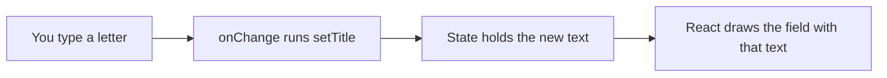

# React Forms: Reading a New Ticket

**Time: about 50 minutes**

You need the project from [Reading Data from the Backend with fetch](09-reading-data-with-fetch.md): `TicketsPage` loads the tickets from the API. The Bootstrap look from [note 08](08-bootstrap-and-react-bootstrap.md) is optional.

## What you will build

- A `TicketForm` component with three fields: a title, a description and a priority.
- A form that **keeps what you type in state**, one piece of state for each field.
- A **Create ticket** button that collects the three values into one ticket object and prints it in the browser Console.

The form does **not** send anything to the API yet. The new ticket will not appear in the list. Sending it is the next note.

---

## The ideas

### A form field and its state

A text box keeps its own text. React also keeps a copy of it in state. When the two are tied together, the field is called a **controlled** field: React state is the single source of the value.

Two props tie them together:

- `value={title}`: the field shows what is in state.
- `onChange={(event) => setTitle(event.target.value)}`: when you type, React calls this function. `event.target.value` is the text now in the field, and `setTitle` puts it in state.



**How to read it:** each letter goes round the loop once. The field shows state, so state always has the latest text, and the form can read it at any moment.

### One kind of field, three ways to write it

| Field | Tag | Reads its text with |
|---|---|---|
| One line of text | `<input value={title} … />` | `event.target.value` |
| Several lines | `<textarea value={description} … />` | `event.target.value` |
| A choice from a list | `<select value={priority} …>` with `<option>` tags | `event.target.value` |

In React, `<textarea>` and `<select>` take their value from the `value` prop, the same as `<input>`.

### Label each field

A `<label>` names a field. Connect them with `htmlFor` on the label and the same text as `id` on the field. Clicking the label then puts the cursor in the field. In JSX it is `htmlFor`, because `for` is a reserved word in JavaScript, in the same way as `className` and `class`.

```jsx
<label htmlFor="title">Title</label>
<input id="title" … />
```

### Submitting: `onSubmit` and `preventDefault`

A `<form>` has a **submit** event. It happens when you click a button of type `submit`, or press Enter inside a text box. Give the form an `onSubmit` function:

```jsx
<form onSubmit={handleSubmit}>
```

By default, the browser **reloads the page** when a form is submitted, and everything in state is lost. `event.preventDefault()` stops that. Call it on the first line of the function.

### Collecting the values into one ticket

The three pieces of state become one object, with the same field names that the API expects (`title`, `description`, `priority`):

```jsx
const newTicket = { title, description, priority }
```

When a value is in a variable with the **same name** as the field, you can write the name once. This is plain JavaScript, not React:

```javascript
const title = 'Printer'
const priority = 'HIGH'
const ticket = { title: title, priority: priority }
const same = { title, priority }
console.log(ticket)
console.log(same)
```

```text
{ title: 'Printer', priority: 'HIGH' }
{ title: 'Printer', priority: 'HIGH' }
```

### Required fields

Add the word `required` to a field. The browser then refuses to submit while the field is empty, and shows its own message, such as `Please fill out this field.` Your `handleSubmit` is not called at all.

---

## Build steps

Work in `hello-react` with the dev server running (`npm run dev`) and the API running, as in note 09.

### 1. One field, and its state

Create `src/components/TicketForm.jsx`:

```jsx
import { useState } from 'react'

function TicketForm() {
  const [title, setTitle] = useState('')

  return (
    <form>
      <h2>Raise a Ticket</h2>
      <label htmlFor="title">Title</label>
      <br />
      <input
        id="title"
        value={title}
        onChange={(event) => setTitle(event.target.value)}
      />
      <p>You typed: {title}</p>
    </form>
  )
}

export default TicketForm
```

In `src/pages/TicketsPage.jsx`, add `import TicketForm from '../components/TicketForm.jsx'` below the other imports, and put `<TicketForm />` as the first line inside `<section>`, above the `<h2>`.

**Check:** the page shows a `Raise a Ticket` form above `My Tickets`. Type in the Title box: the line under it, `You typed: …`, shows each letter as you type.

### 2. Add the description and the priority

Replace `src/components/TicketForm.jsx` with:

```jsx
import { useState } from 'react'

function TicketForm() {
  const [title, setTitle] = useState('')
  const [description, setDescription] = useState('')
  const [priority, setPriority] = useState('MEDIUM')

  return (
    <form>
      <h2>Raise a Ticket</h2>

      <div>
        <label htmlFor="title">Title</label>
        <br />
        <input
          id="title"
          value={title}
          onChange={(event) => setTitle(event.target.value)}
          required
        />
      </div>

      <div>
        <label htmlFor="description">Description</label>
        <br />
        <textarea
          id="description"
          value={description}
          onChange={(event) => setDescription(event.target.value)}
        />
      </div>

      <div>
        <label htmlFor="priority">Priority</label>
        <br />
        <select
          id="priority"
          value={priority}
          onChange={(event) => setPriority(event.target.value)}
        >
          <option value="HIGH">HIGH</option>
          <option value="MEDIUM">MEDIUM</option>
          <option value="LOW">LOW</option>
        </select>
      </div>

      <p>Preview: {title} | {description} | {priority}</p>
    </form>
  )
}

export default TicketForm
```

The priority starts as `'MEDIUM'`, which is one of the option values. The `<p>` at the bottom is a temporary line, so that you can see all three pieces of state.

**Check:** the preview line starts as `Preview:  |  | MEDIUM`. Type a title and a description, and choose `LOW`: the preview shows all three, for example `Preview: Printer | Floor 2 | LOW`.

### 3. Submit and print the ticket

Replace `src/components/TicketForm.jsx` with the final version. Compared with step 2, it adds `handleSubmit` and the `onSubmit` prop, a **Create ticket** button, and drops the preview line:

```jsx
import { useState } from 'react'

function TicketForm() {
  const [title, setTitle] = useState('')
  const [description, setDescription] = useState('')
  const [priority, setPriority] = useState('MEDIUM')

  function handleSubmit(event) {
    event.preventDefault()
    const newTicket = { title, description, priority }
    console.log(newTicket)
  }

  return (
    <form onSubmit={handleSubmit}>
      <h2>Raise a Ticket</h2>

      <div>
        <label htmlFor="title">Title</label>
        <br />
        <input
          id="title"
          value={title}
          onChange={(event) => setTitle(event.target.value)}
          required
        />
      </div>

      <div>
        <label htmlFor="description">Description</label>
        <br />
        <textarea
          id="description"
          value={description}
          onChange={(event) => setDescription(event.target.value)}
        />
      </div>

      <div>
        <label htmlFor="priority">Priority</label>
        <br />
        <select
          id="priority"
          value={priority}
          onChange={(event) => setPriority(event.target.value)}
        >
          <option value="HIGH">HIGH</option>
          <option value="MEDIUM">MEDIUM</option>
          <option value="LOW">LOW</option>
        </select>
      </div>

      <button type="submit">Create ticket</button>
    </form>
  )
}

export default TicketForm
```

Open the Console (`F12`). Fill in the form, for example `Printer is jammed`, `Second floor` and `HIGH`, and click **Create ticket**.

**Check:** the Console prints an object like `{title: 'Printer is jammed', description: 'Second floor', priority: 'HIGH'}`. The page does not reload, the typed text stays in the form, and the list of tickets is unchanged.

Now leave the title empty and click **Create ticket**.

**Check:** the browser shows `Please fill out this field.` next to the title, and the Console prints nothing.

### 4. Run the checks

```bash
npm run lint
npm run build
```

**Check:** `npm run lint` prints nothing but its own header, and `npm run build` ends with `✓ built in …`.

> **Note:** the form sits inside the same `if` structure as the list. If the page shows `Loading tickets...` or an error message, the form is not shown. A later note gives the form its own place.

### If you did note 08: the Bootstrap look

Bootstrap has classes for form fields. In `TicketForm.jsx`, change only the tags and classes. The state and `handleSubmit` stay the same:

```jsx
    <form onSubmit={handleSubmit} className="mb-4">
      <h2 className="h4 mb-3">Raise a Ticket</h2>

      <div className="mb-3">
        <label htmlFor="title" className="form-label">Title</label>
        <input id="title" className="form-control" … />
      </div>
```

Give the `<textarea>` the class `form-control`, the `<select>` the class `form-select`, and the button `className="btn btn-primary"`. Wrap each field in `<div className="mb-3">`, and give each `<label>` the class `form-label`. The `…` stands for the `value`, `onChange` and `required` lines that you already have.

---

## Common mistakes

> **Warning: `value` without `onChange`.** You cannot type in the field. The Console shows ``You provided a `value` prop to a form field without an `onChange` handler. This will render a read-only field.…``. Add the `onChange` line.

> **Warning: no `event.preventDefault()`.** When you click **Create ticket**, the Console prints the ticket, and then the page reloads. The address bar ends with a `?`, and the form is empty again. Add `event.preventDefault()` as the first line of `handleSubmit`.

> **Warning: calling the function in place of passing it.** `onSubmit={handleSubmit()}` runs `handleSubmit` while the form is being drawn, with no event. The page goes blank, and the Console shows `Uncaught TypeError: Cannot read properties of undefined (reading 'preventDefault')`. Write `onSubmit={handleSubmit}`, with no parentheses.

> **Warning: the select starts with an empty text.** With `useState('')` for the priority, the box shows `HIGH` (the first option), but the state is still `''`. If you submit without touching it, the ticket has `priority: ''`. Start with a real option value, such as `'MEDIUM'`.

> **Warning: `for` in place of `htmlFor`.** The page still works, but the Console shows ``Invalid DOM property `for`. Did you mean `htmlFor`?``. Use `htmlFor`.

---

## Practice

1. After the ticket is printed, clear the form: call `setTitle('')`, `setDescription('')` and `setPriority('MEDIUM')` at the end of `handleSubmit`. **Result:** after you click **Create ticket**, the fields are empty again, and the Console still shows the ticket.
2. Add `maxLength={100}` to the title field. **Result:** you cannot type more than 100 characters in it.
3. Add a `console.log` of `newTicket.title.length` after the ticket is printed. **Result:** the Console shows the number of letters in the title next to the ticket.

---

## Recap

- A **controlled** field has two props: `value` shows the state, and `onChange` puts what you type back in state. `<input>`, `<textarea>` and `<select>` all work this way.
- Use one piece of state for each field, and connect each label with `htmlFor` and `id`.
- `onSubmit` runs when the form is submitted. Call `event.preventDefault()` first, to stop the page from reloading.
- Collect the state values into one object, with the field names the API expects: `{ title, description, priority }`.
- `required` makes the browser refuse an empty field before your function runs.

**What the next note adds:** sending the ticket to the API with a `POST` request, and showing it in the list.

> **Not verified:** the files in steps 1, 2 and 3 (and the form with the Bootstrap classes) were linted, built (`npm run build`), and run in headless Chrome with Node.js 22.19.0, Vite 8.3.5 and React 19.3.1, next to the loading code from note 09, with the API from `support-assistant-jpa-h2`. The typing, the select and the submit were done by a script that sets the field values and submits the form, not by hand. The script showed the preview line change, the ticket `{"title":"Printer is jammed","description":"Second floor","priority":"HIGH"}` printed once with the address unchanged and six cards still in the list, and the `required` check refusing an empty title with the message `Please fill out this field.` (the wording is Chrome's, and other browsers word it differently). The script prints objects as text, so the object format shown in the step 3 check (`{title: …}` with single quotes) is how the browser's Console normally shows an object, and was not seen by eye. The five common mistakes were each tried, and the quoted messages are what appeared. The `value` without `onChange` message is longer than the part quoted. The select mistake was shown with `priority: ""` in the printed ticket. The Bootstrap form was rendered and a screenshot looked right. The `Delete` button and the list were not changed. The statements that the typed text stays in the form after a submit, and that Enter inside a text box submits the form, are standard behaviour and were not tried. The practice tasks were not run, and only Chrome was used. The plain JavaScript example was run in Node.
