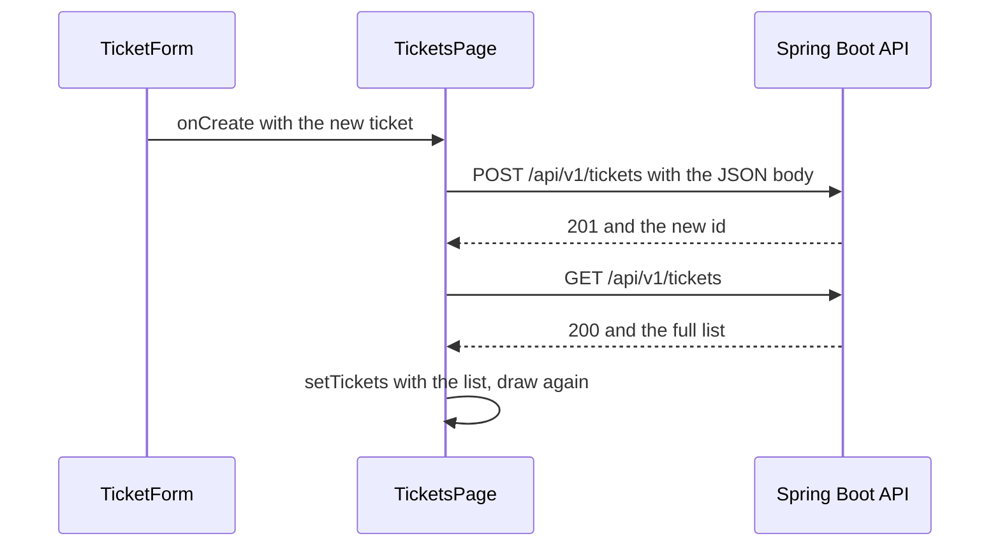

# Sending Data to the Backend with a POST Request

**Time: about 55 minutes**

You need the project from [React Forms: Reading a New Ticket](10-forms-reading-a-ticket.md): `TicketForm` prints the new ticket in the Console, and `TicketsPage` loads the list with `fetch` (note 09). The Bootstrap look from [note 08](08-bootstrap-and-react-bootstrap.md) is optional.

The Support Assistant API must be running, as in step 1 of note 09.

## What you will build

- A `POST` request, first typed by hand in the browser Console, then sent by the form.
- A **Create ticket** button that sends the new ticket to the API and shows it in the list.
- An error message in the form when the API refuses the ticket.

---

## The ideas

### GET reads, POST creates

You have used `fetch` to **read** with a `GET` request. A `POST` request **sends** data. The API's create endpoint is:

| Method and path | Body you send | Answer on success |
|---|---|---|
| `POST /api/v1/tickets` | `{ "title": "…", "description": "…", "priority": "HIGH" }` | `201`, and `{ "id": 7 }` |

`201` means "created". The answer holds only the **id** of the new ticket. The API fills in the other fields (the status `OPEN`, the dates).

### `fetch` with options

`fetch` takes a second argument: an object of options. A `POST` needs three:

```javascript
const response = await fetch(API_URL, {
  method: 'POST',
  headers: { 'Content-Type': 'application/json' },
  body: JSON.stringify(newTicket),
})
```

| Option | What it does |
|---|---|
| `method` | The kind of request. Without it, `fetch` sends a `GET`. |
| `headers` | Extra information about the request. `Content-Type: application/json` tells the API that the body is JSON. |
| `body` | The data to send. It must be **text**. |

`JSON.stringify` turns a JavaScript object into JSON text. It is the opposite of `response.json()`. This is plain JavaScript:

```javascript
const ticket = { title: 'Printer', priority: 'HIGH' }
console.log(JSON.stringify(ticket))
console.log(typeof JSON.stringify(ticket))
```

```text
{"title":"Printer","priority":"HIGH"}
string
```

### Check the answer

As in note 09, `fetch` does not fail on `400` or `404`, so check `response.ok`. The API describes its errors in a JSON body, with a `message`:

```json
{ "status": 400, "error": "Bad Request", "message": "Title is required", "timestamp": "2026-11-04T10:31:00" }
```

The code reads that `message` and throws it as an error, so the form can show it. Some errors have no `message` field (for example `415`, "unsupported media type"). For those, the code falls back to the status. The `||` between the two means "use the left side, or the right side if the left one is empty":

```javascript
throw new Error(problem.message || 'The server answered ' + response.status)
```

### Who sends the request?

The same rule as in note 07: **data goes down, actions go up**. `TicketsPage` owns the list, so `TicketsPage` writes the function that sends the ticket and updates the list. It is called `handleCreate`. The form gets it as a prop, `onCreate`, and calls it with the new ticket.



**How to read it:** the form hands the ticket to the page. The page sends the `POST`. Because the answer holds only an id, the page then asks for the whole list again, so the new ticket appears with every field the API filled in.

### Reloading the list: `fetchTickets`

Both the first load (note 09) and the reload after a `POST` need the same `GET` code. Write it once, as a function **outside** the component, and call it from both places. Step 2 does this.

### Showing an error only when there is one

```jsx
{error && <p>{error}</p>}
```

`&&` means "and". When `error` is an empty text, nothing is shown. When it holds a message, the `<p>` is shown.

### Why the browser allows a POST

A `POST` with a JSON body is not a simple request, so the browser first sends a small question to the API: "may this page send a `POST` with this header?" (This question is called a **preflight**, and it uses the method `OPTIONS`.) The `CorsConfig` in the API allows `POST` and `OPTIONS` from `http://localhost:5173`, so the answer is yes. You write no React code for this. Note 09 explained CORS.

---

## Build steps

Work in `hello-react` with the dev server and the API running.

### 1. Send a POST from the Console

Open `http://localhost:5173/`, press `F12`, and open the **Console**. Type these two lines, one at a time. The second one is long, so type it on one line:

```javascript
const ticket = { title: 'Test from the Console', description: 'Typed by hand', priority: 'LOW' }
const response = await fetch('http://localhost:8080/api/v1/tickets', { method: 'POST', headers: { 'Content-Type': 'application/json' }, body: JSON.stringify(ticket) })
```

Then:

```javascript
response.status
await response.json()
```

**Check:** the Console prints `201`, and an object with the new id, for example `{id: 7}`. Open `http://localhost:8080/api/v1/tickets` in a tab: the last ticket in the JSON is `Test from the Console`. This request really added a ticket to the API.

Now send a ticket with an empty title:

```javascript
const bad = await fetch('http://localhost:8080/api/v1/tickets', { method: 'POST', headers: { 'Content-Type': 'application/json' }, body: JSON.stringify({ title: '', description: '', priority: 'LOW' }) })
bad.status
(await bad.json()).message
```

**Check:** the Console prints `400` and `Title is required`.

### 2. Move the loading into a function

In `src/pages/TicketsPage.jsx`, add `fetchTickets` below `API_URL`, and use it in the effect. Replace the whole file with:

```jsx
import { useState, useEffect } from 'react'
import TicketList from '../components/TicketList.jsx'
import TicketForm from '../components/TicketForm.jsx'

const API_URL = 'http://localhost:8080/api/v1/tickets'

async function fetchTickets() {
  const response = await fetch(API_URL)
  if (!response.ok) {
    throw new Error('The server answered ' + response.status)
  }
  return response.json()
}

function TicketsPage() {
  const [tickets, setTickets] = useState([])
  const [loading, setLoading] = useState(true)
  const [error, setError] = useState('')

  useEffect(() => {
    async function loadTickets() {
      try {
        setTickets(await fetchTickets())
      } catch (err) {
        setError('Could not load the tickets. ' + err.message)
      } finally {
        setLoading(false)
      }
    }
    loadTickets()
  }, [])

  function handleDelete(id) {
    setTickets(tickets.filter((ticket) => ticket.id !== id))
  }

  if (loading) return <p>Loading tickets...</p>
  if (error) return <p>{error}</p>

  return (
    <section>
      <TicketForm />
      <h2>My Tickets</h2>
      <p>{tickets.length} tickets</p>
      <TicketList tickets={tickets} onDelete={handleDelete} />
    </section>
  )
}

export default TicketsPage
```

> **Note:** if you did note 08, keep your own heading, with the count badge, in the `return`.

**Check:** the page works as before: the tickets from the API, including the one you created in step 1, and the form above them.

### 3. Write `handleCreate` in `TicketsPage`

Add this function above `handleDelete`:

```jsx
  async function handleCreate(newTicket) {
    const response = await fetch(API_URL, {
      method: 'POST',
      headers: { 'Content-Type': 'application/json' },
      body: JSON.stringify(newTicket),
    })
    if (!response.ok) {
      const problem = await response.json()
      throw new Error(problem.message || 'The server answered ' + response.status)
    }
    setTickets(await fetchTickets())
  }
```

Then send it to the form. Change `<TicketForm />` to:

```jsx
      <TicketForm onCreate={handleCreate} />
```

The function does not catch the error. It lets the error travel up to the caller, the form, which decides what to show.

**Check:** the page looks the same. The function is on its way to the form, and nothing uses it yet.

### 4. Make the form use it

In `src/components/TicketForm.jsx`, replace everything from `function TicketForm() {` down to the end of `handleSubmit` with:

```jsx
function TicketForm({ onCreate }) {
  const [title, setTitle] = useState('')
  const [description, setDescription] = useState('')
  const [priority, setPriority] = useState('MEDIUM')
  const [error, setError] = useState('')

  async function handleSubmit(event) {
    event.preventDefault()
    setError('')
    const newTicket = { title, description, priority }
    try {
      await onCreate(newTicket)
      setTitle('')
      setDescription('')
      setPriority('MEDIUM')
    } catch (err) {
      setError('Could not create the ticket. ' + err.message)
    }
  }
```

Then, on the line above `<button type="submit">`, add:

```jsx
      {error && <p>{error}</p>}
```

What changed:

- `handleSubmit` is now `async`, because it waits for `onCreate`.
- `await onCreate(newTicket)` waits until the ticket is sent and the list is reloaded. Only then does the code **clear the form**. If it throws, the code jumps to `catch`, the fields keep what you typed, and the message is shown.
- `console.log` is gone.

> **Note:** with the Bootstrap look, write the message as `<p className="text-danger">{error}</p>`.

**Check:** the page looks the same. Nothing is sent until you submit.

### 5. Create a ticket

Fill in the form, for example `Keyboard is broken`, `Letter E is stuck` and `HIGH`, and click **Create ticket**.

**Check:** a new card appears at the end of the list, the count goes up by one, and the form is empty again. Refresh the page: the ticket is still there, because it is stored by the API. This is the difference from **Delete**, which still changes only the screen.

Now type three spaces in the Title box, and click **Create ticket**.

**Check:** the form shows `Could not create the ticket. Title is required`. The spaces stay in the box, and no card is added. The browser's `required` check passes, because the box is not empty, so the **API** is the one that refuses.

> **Note:** after a create, the list is read from the API again. A ticket you removed with **Delete** (on the screen only) comes back.

### 6. Run the checks

```bash
npm run lint
npm run build
```

**Check:** `npm run lint` prints nothing but its own header, and `npm run build` ends with `✓ built in …`.

---

## Common mistakes

> **Warning: no `Content-Type` header.** The ticket is not created. The form shows `Could not create the ticket. The server answered 415`. Without the header, `fetch` sends the body as plain text, and the API refuses it. Add `headers: { 'Content-Type': 'application/json' }`.

> **Warning: no `JSON.stringify`.** With `body: newTicket`, the browser sends the text `[object Object]`. The form shows `Could not create the ticket. The request body is missing or is not valid JSON`. Write `body: JSON.stringify(newTicket)`.

> **Warning: no `method: 'POST'`.** Without a method, `fetch` makes a `GET`, and a `GET` cannot have a body. The form shows ``Could not create the ticket. Failed to execute 'fetch' on 'Window': Request with GET/HEAD method cannot have body.`` Add `method: 'POST'`.

> **Warning: the list is not read again.** If `handleCreate` does not end with `setTickets(await fetchTickets())`, the ticket **is** created, but the page shows no new card. Refresh the page, and it appears. The `POST` answer holds only the id, so ask for the list again.

> **Warning: no `await` before `onCreate`.** The form clears at once, whether or not the API accepted the ticket. For the three-space title, the box empties, no error is shown, and no ticket appears. The Console shows `Uncaught (in promise) Error: Title is required`. Write `await onCreate(newTicket)` inside `try`.

---

## Practice

1. Stop a double click from creating two tickets. Add `const [sending, setSending] = useState(false)` to the form, set it to `true` before `await onCreate(…)` and to `false` afterwards, and write `disabled={sending}` on the button. **Result:** the button is greyed out while the request is on its way.
2. Show the text `Ticket created.` under the form after a ticket is created, and clear it when you submit again. **Result:** the message appears after a good create, and not after a refused one.
3. Create a ticket with the priority `HIGH` and the title `Server is down`. Open `http://localhost:8080/api/v1/tickets?priority=HIGH` in a tab. **Result:** your ticket is in the JSON.

---

## Recap

- A `POST` is `fetch(url, { method: 'POST', headers: …, body: … })`. The header `Content-Type: application/json` and a body made with `JSON.stringify` are both needed.
- The create endpoint answers `201` and the new `id`. Check `response.ok`, and read `message` from an error body.
- The owner of the list writes `handleCreate` and sends it down as `onCreate`. The form calls it with the new ticket, and shows the error if it throws.
- After a create, read the list again so that the new ticket appears with every field the API filled in.
- Put the shared `GET` code in one function, `fetchTickets`, and call it from both places.

**What the next notes add:** changing a ticket's status with a `PATCH` request, and a shorter way to make calls with Axios. Each has its own note.

> **Not verified:** the code in steps 2, 3 and 4 (and the Bootstrap form with the changes of step 4) was linted, built (`npm run build`), and run in headless Chrome with Node.js 22.19.0, Vite 8.3.5 and React 19.3.1. It ran against a private copy of `support-assistant-jpa-h2`, started on port 8081 with its own in-memory data, so that no ticket was added to your own running API. The code in the files says `8080`, and the tests used `8081`. The typing and the submit were done by a script, not by hand. The script showed a new card at the end of the list, the count going up by one, and the form emptying. It also showed the `Title is required` message for a title of spaces, with the spaces left in the box. The page also worked with the note 08 Bootstrap look. The lines of step 1 were run as page code and printed `201`, `{"id":8}`, `400` and the `Title is required` body, and were not typed into the Console by hand. The five common mistakes were each tried, and the quoted messages are what appeared. The `415` answer was checked with `curl` first: its body has no `message`, which is why the code falls back to the status. The preflight answer was checked with `curl`, and not seen in the browser. `support-assistant-plsql` was **not** run, because it needs the Oracle database: its create endpoint has the same path, body and answer in its README, but it was not called. The statement that refresh keeps the ticket is true only while the API keeps its data: the H2 project forgets everything when it stops. The practice tasks were not run, and only Chrome was used. The two plain JavaScript examples were run in Node.
