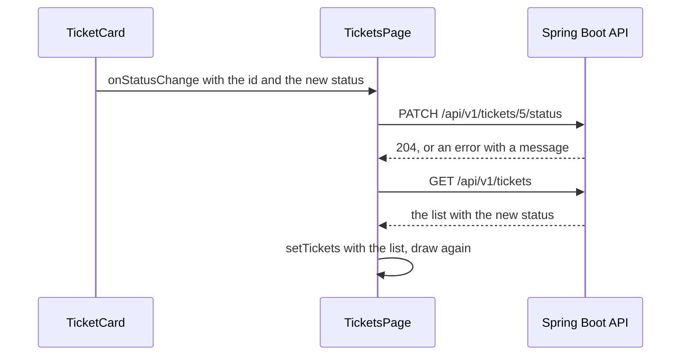

# Changing Data with a PATCH Request

**Time: about 50 minutes**

You need the project from [Sending Data to the Backend with a POST Request](11-sending-data-with-post.md): `TicketsPage` has `fetchTickets` and `handleCreate`. The Bootstrap look from [note 08](08-bootstrap-and-react-bootstrap.md) is optional.

The Support Assistant API must be running, as in step 1 of note 09.

## What you will build

- A `PATCH` request, first typed by hand in the browser Console, then sent from the page.
- A **Status** drop-down on each ticket card. Choosing a status sends it to the API, and the card shows the new status.
- An error message when the API refuses the change, for example when a step is skipped.

---

## The ideas

### The HTTP methods

You have used two methods: `GET` to read and `POST` to create. This table shows all the common ones, and which of them this API uses:

| Method | What it means | In the Support Assistant API |
|---|---|---|
| `GET` | Read | The list of tickets, the open count |
| `POST` | Create, or start an action | Create a ticket, change several tickets at once (`/bulk-status`) |
| `PATCH` | Change **part** of something | Change the status of one ticket |
| `PUT` | Replace the **whole** thing | Not used |
| `DELETE` | Remove | Not used. A ticket is moved to `CLOSED`, and is never deleted |

The API has no delete, which is why the **Delete** button in your page still removes a card from the screen only.

### The status change endpoint

| Method and path | Body you send | Answer on success |
|---|---|---|
| `PATCH /api/v1/tickets/7/status` | `{ "status": "IN_PROGRESS" }` | `204`, **no body** |

The id of the ticket is **in the address**. `7` is an example: for ticket `id`, the address is `API_URL + '/' + id + '/status'`.

`204` means "done, and there is nothing to send back". Because there is no body, do **not** call `response.json()` on a `204`. There is nothing to read.

### The API decides, the page asks

A ticket moves one step at a time: `OPEN`, `IN_PROGRESS`, `RESOLVED`, `CLOSED`. A `CLOSED` ticket cannot change. These rules belong to the API. The page does **not** repeat them. It shows the four statuses as choices, sends the one you pick, and shows the answer. If the API refuses, it explains why:

```json
{ "status": 409, "error": "Conflict", "message": "Ticket 7 is OPEN. The next status is IN_PROGRESS", "timestamp": "2026-11-05T10:31:00" }
```

| Status | When |
|---|---|
| `409` | The change is not allowed: a step is skipped, or the ticket is `CLOSED` |
| `404` | The ticket does not exist |

### Where the request is sent from

The same pattern as note 07 and note 11, **data goes down, actions go up**:



**How to read it:** the card tells the page which ticket and which status. The page sends the `PATCH`. If it worked, the page reads the list again, so every card shows what the API holds. The function is passed down two levels, `TicketsPage` to `TicketList` to `TicketCard`, as `onDelete` was.

This time the error is shown by the **page**, not by the form, because the drop-down is in a card and the page is where the list lives. So `handleStatusChange` has its own `try` and `catch`, and keeps its own piece of state, `actionError`.

### A drop-down that follows the data

The drop-down uses `value={ticket.status}`. The card always shows the status that the API reported. When you pick a new one and the API refuses, the list is not changed, so the drop-down goes back to the old status. This is what you want: the screen shows the truth.

### Why the browser allows a PATCH

Like a `POST` with a JSON body, a `PATCH` triggers the browser's preflight question (note 11). The API's `CorsConfig` lists `PATCH` on purpose, because a method that is not listed is refused.

---

## Build steps

Work in `hello-react` with the dev server and the API running.

### 1. Send a PATCH from the Console

Open `http://localhost:5173/`, press `F12`, and open the **Console**. Look at `http://localhost:8080/api/v1/tickets` in another tab and pick the `id` of a ticket whose status is `OPEN`. Use it in place of `5` below. Type the two lines, one at a time. The second one is long, so type it on one line:

```javascript
const url = 'http://localhost:8080/api/v1/tickets/5/status'
const response = await fetch(url, { method: 'PATCH', headers: { 'Content-Type': 'application/json' }, body: JSON.stringify({ status: 'IN_PROGRESS' }) })
```

Then:

```javascript
response.status
await response.text()
```

**Check:** the Console prints `204`, and then an empty text (`''`). There is no body. Reload the tab with the list: that ticket is `IN_PROGRESS`.

Now try to skip a step. The ticket is `IN_PROGRESS`, so ask for `CLOSED`:

```javascript
const bad = await fetch(url, { method: 'PATCH', headers: { 'Content-Type': 'application/json' }, body: JSON.stringify({ status: 'CLOSED' }) })
bad.status
(await bad.json()).message
```

**Check:** the Console prints `409` and a message such as `Ticket 5 is IN_PROGRESS. The next status is RESOLVED`.

### 2. Write `handleStatusChange` in `TicketsPage`

In `src/pages/TicketsPage.jsx`, add a piece of state for the message, below the other `useState` lines:

```jsx
  const [actionError, setActionError] = useState('')
```

Add this function above `handleDelete`:

```jsx
  async function handleStatusChange(id, status) {
    setActionError('')
    try {
      const response = await fetch(API_URL + '/' + id + '/status', {
        method: 'PATCH',
        headers: { 'Content-Type': 'application/json' },
        body: JSON.stringify({ status }),
      })
      if (!response.ok) {
        const problem = await response.json()
        throw new Error(problem.message || 'The server answered ' + response.status)
      }
      setTickets(await fetchTickets())
    } catch (err) {
      setActionError('Could not change the status. ' + err.message)
    }
  }
```

Then replace the `<TicketList … />` line in the `return` with the message and a `TicketList` that gets the function:

```jsx
      {actionError && <p>{actionError}</p>}
      <TicketList
        tickets={tickets}
        onDelete={handleDelete}
        onStatusChange={handleStatusChange}
      />
```

`{ status }` is the short way to write `{ status: status }`, as in note 10. `setActionError('')` at the start clears the message of an earlier try.

> **Note:** if you did note 08, keep your own heading, and write the message as `<p className="text-danger">{actionError}</p>`.

**Check:** the page looks the same. The function is not sent anywhere yet.

### 3. Pass it through `TicketList`

Replace `src/components/TicketList.jsx` with:

```jsx
import TicketCard from './TicketCard.jsx'

function TicketList({ tickets, onDelete, onStatusChange }) {
  return (
    <div>
      {tickets.map((ticket) => (
        <TicketCard
          key={ticket.id}
          ticket={ticket}
          onDelete={onDelete}
          onStatusChange={onStatusChange}
        />
      ))}
    </div>
  )
}

export default TicketList
```

> **Note:** if you did note 08, your `TicketList` has the `row` and `col` tags. Keep them, and add only `onStatusChange` to the parameters and to the `<TicketCard>` tag.

**Check:** the page looks the same.

### 4. Add the drop-down to `TicketCard`

Replace `src/components/TicketCard.jsx` with:

```jsx
const statuses = ['OPEN', 'IN_PROGRESS', 'RESOLVED', 'CLOSED']

function TicketCard({ ticket, onDelete, onStatusChange }) {
  return (
    <div className="card">
      <h3>{ticket.title}</h3>
      <p>Priority: {ticket.priority}</p>
      <label>
        Status:{' '}
        <select
          value={ticket.status}
          onChange={(event) => onStatusChange(ticket.id, event.target.value)}
        >
          {statuses.map((status) => (
            <option key={status} value={status}>{status}</option>
          ))}
        </select>
      </label>
      <button onClick={() => onDelete(ticket.id)}>Delete</button>
    </div>
  )
}

export default TicketCard
```

The `Status:` text is now the drop-down itself. `statuses.map(…)` builds the four `<option>` tags, with a `key`, as in note 06. The `{' '}` puts a space between the label text and the box.

> **Note:** if you did note 08, add the same `<select>` to your card, in place of the status badge. Give it the classes `form-select form-select-sm w-auto d-inline-block me-2`.

**Check:** every card has a **Status** drop-down that shows the ticket's status.

### 5. Change a status

Choose a ticket that is `OPEN`, and pick `IN_PROGRESS`.

**Check:** the drop-down shows `IN_PROGRESS` and there is no message. Reload the page: the status is still `IN_PROGRESS`, because the API holds it.

Now pick a status that skips a step. For an `OPEN` ticket, pick `CLOSED`.

**Check:** a message appears above the list: `Could not change the status. Ticket … is OPEN. The next status is IN_PROGRESS`. The drop-down goes back to `OPEN`.

Last, pick any other status on a `CLOSED` ticket.

**Check:** the message is `Could not change the status. Ticket … is CLOSED and cannot change`.

### 6. Run the checks

```bash
npm run lint
npm run build
```

**Check:** `npm run lint` prints nothing but its own header, and `npm run build` ends with `✓ built in …`.

---

## Common mistakes

> **Warning: reading a body from a `204`.** If you add `await response.json()` after the `ok` check, the status **does** change on the server, but the page shows `Could not change the status. Failed to execute 'json' on 'Response': Unexpected end of JSON input`. A `204` has no body. Remove the line.

> **Warning: `method: 'patch'` in lower case.** `fetch` fixes the case of `GET`, `POST`, `PUT` and `DELETE`, but **not** of `PATCH`. The browser sends a method that the API does not allow. The page shows `Could not change the status. Failed to fetch`, and the Console shows ``Access to fetch at '…/tickets/5/status' from origin 'http://localhost:5173' has been blocked by CORS policy: Response to preflight request doesn't pass access control check…``. Write `'PATCH'` in capitals.

> **Warning: the list is not read again.** If `handleStatusChange` does not end with `setTickets(await fetchTickets())`, the API **does** change the status, but the drop-down jumps back to the old one, because `value={ticket.status}` still holds the old list. Refresh the page, and the new status is there.

> **Warning: the id is missing from the address.** The address must hold the ticket id: `API_URL + '/' + id + '/status'`. Without it, the API cannot tell which ticket to change.

---

## Practice

1. The check `if (!response.ok) { … throw … }` is now written twice, in `handleCreate` and in `handleStatusChange`. Move it into one function, `checkResponse(response)`, outside the component, and call it from both. **Result:** creating a ticket and changing a status work as before, and a refused change shows the same message.
2. Open Swagger UI (`http://localhost:8080/swagger-ui.html`) and move a ticket one step with `PATCH /api/v1/tickets/{id}/status`. Then reload the React page. **Result:** the drop-down shows the status that you set in Swagger UI.
3. While a status change is on its way, the drop-down can be changed again. Add a piece of state, `busy`, to `TicketsPage` that is `true` during the request, and show the text `Saving...` in place of the message. **Result:** the text shows briefly after each change, and is gone afterwards.

---

## Recap

- `GET` reads, `POST` creates, and `PATCH` changes part of something. This API has no `DELETE`: a ticket is closed, not removed.
- A `PATCH` request is `fetch(url, { method: 'PATCH', headers: …, body: … })`. Write `'PATCH'` in capitals. The id of the ticket is part of the address.
- A `204` answer has no body, so do not call `response.json()` on it.
- The API owns the status rules. The page sends the choice, shows the `message` of a refusal, and reads the list again after a success.
- The function that sends the request lives where the list lives, and is passed down as `onStatusChange`.

**What the next notes add:** filtering the list with a query in the address (`?status=OPEN`), and a shorter way to make all these calls with Axios. Each has its own note.

> **Not verified:** the code in steps 2, 3 and 4 (and the Bootstrap card with the `<select>`) was linted, built (`npm run build`), and run in headless Chrome with Node.js 22.19.0, Vite 8.3.5 and React 19.3.1. It ran against a private copy of `support-assistant-jpa-h2` started on port 8081 with its own in-memory data, so no ticket in your own running API was changed. The code in the files says `8080`, and the tests used `8081`. The changes were made by a script that sets the drop-down value, not by hand. The script showed an `OPEN` ticket becoming `IN_PROGRESS` with no message, a skipped step giving `Ticket … is OPEN. The next status is IN_PROGRESS` with the drop-down staying on `OPEN`, and a `CLOSED` ticket giving `Ticket … is CLOSED and cannot change`. The three mistakes about `204`, the lower-case method and the list not read again were each tried, and the quoted messages are what appeared. The `409` bodies and the `204` were also checked with `curl`. The CORS message for the lower-case method is longer than the part that is quoted. The mistake about the id missing from the address was **not** tried. The Console lines of step 1 were not typed by hand, because the same calls were made by `curl` and by the page. The Bootstrap look was checked with plain Bootstrap classes only, and not with the React-Bootstrap version of the card. `support-assistant-plsql` was **not** run, because it needs the Oracle database: its README describes the same endpoint and errors, but the change was not called there. The statement about the `CorsConfig` listing `PATCH` is from reading the file, and a missing `PATCH` in it was not tried. The practice tasks were not run, and only Chrome was used. The `/bulk-status` and `open-count` endpoints are not used in this note.
