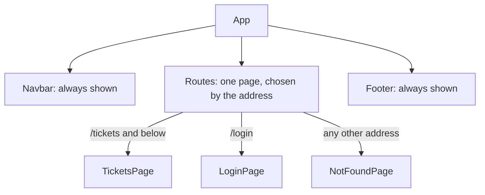
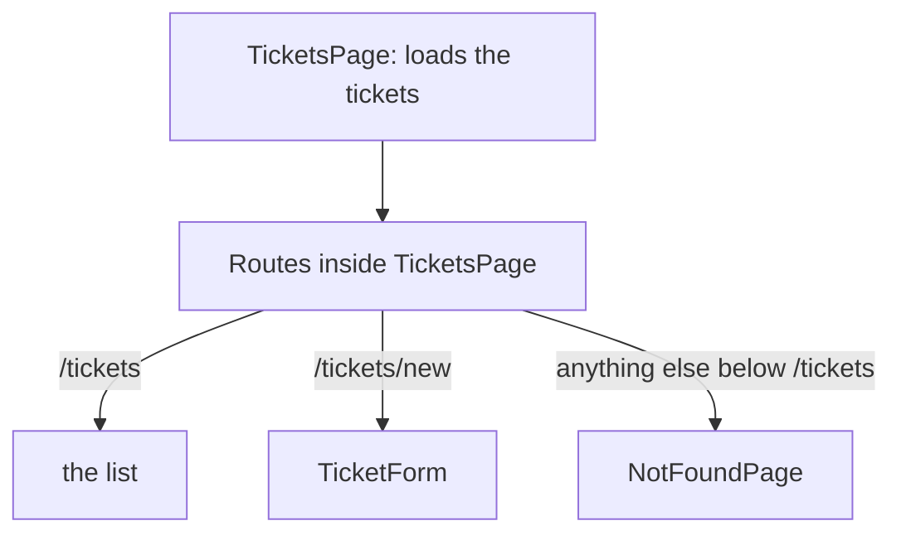

# Navigation with React Router

**Time: about 50 minutes**

You need the project from [Using .env Files](13-environment-variables.md): the API address comes from `.env`. The Bootstrap look from [note 08](08-bootstrap-and-react-bootstrap.md) is optional.

The Support Assistant API must be running, as in step 1 of note 09.

Right now, your whole app is one screen: the form and the list sit on the same page, and the links in the navigation bar (`Tickets`, `New Ticket`, `Login`) go nowhere. In this note each link opens its own page, with its own address.

## What you will build

- Addresses that show different pages: `/tickets` (the list), `/tickets/new` (the form) and `/login` (a placeholder). The address `/` moves to `/tickets`.
- A navigation bar whose links change the page without reloading it, and which marks the page you are on.
- A message for an address that does not exist.
- A form page that returns you to the list after a ticket is created.

---

## The ideas

### Pages in a React app

A React app is one HTML page. Without help, the address bar never changes and the **Back** button does not work. **React Router** is a library that fixes this. It watches the address in the browser, and shows the component that matches it. You still write each "page" as a normal component, like `TicketsPage`.

### The pieces

| Piece | What it does |
|---|---|
| `BrowserRouter` | Turns routing on. You wrap your app in it once |
| `Routes` and `Route` | A list of `path` and `element` pairs: "at this address, show this component" |
| `Link` and `NavLink` | A link that changes the address without reloading the page. `NavLink` also gives the link the class `active` when its address is the current one |
| `Navigate` | Moves to another address as soon as it is shown. You use it to send `/` to `/tickets` |
| `useNavigate` | Gives you a function to change the address from code, for example after a form is saved |
| `path="*"` | Matches any address that no other `Route` matched. Use it for a "page not found" page |

### Where the pages go

The navigation bar and the footer stay on the screen. Only the middle part changes:



**How to read it:** `Routes` looks at the address and picks one page. The `Navbar` and `Footer` are outside `Routes`, so they do not change.

### Routes inside a page

The list (`/tickets`) and the form (`/tickets/new`) belong together. Both use the list of tickets that `TicketsPage` loads, and the form must reload that list after it saves. So both stay inside `TicketsPage`, and `TicketsPage` has its own `Routes` for the two views:



**How to read it:** `App` sends every address that starts with `/tickets` to `TicketsPage`. `TicketsPage` then picks the list or the form.

Two rules make this work:

- In `App`, the path of the parent route ends with `/*`: `path="/tickets/*"`. It means "`/tickets` and anything after it". Without it, the `Routes` inside `TicketsPage` never see the rest of the address.
- Inside `TicketsPage`, the paths are **relative** to the parent. The form is `path="new"`, not `path="/tickets/new"`. The list has no path of its own. It is the `index` route: the one shown at `/tickets` itself.

### Installing it

You install React Router with `npm install react-router`. Depending on your Node.js version, npm installs version 7 or version 8. The code in this note is the same for both.

---

## Build steps

Work in `hello-react` with the dev server running (`npm run dev`) and the API running.

### 1. Install it and turn it on

In a second terminal, in the `hello-react` folder, run:

```bash
npm install react-router
```

In `src/main.jsx`, import `BrowserRouter` and put it around `<App />`:

```jsx
import { StrictMode } from 'react'
import { createRoot } from 'react-dom/client'
import { BrowserRouter } from 'react-router'
import './index.css'
import App from './App.jsx'

createRoot(document.getElementById('root')).render(
  <StrictMode>
    <BrowserRouter>
      <App />
    </BrowserRouter>
  </StrictMode>,
)
```

If your `main.jsx` has other `import` lines, such as the Bootstrap CSS from note 08, keep them.

**Check:** `package.json` lists `"react-router"`, and the page looks the same as before. If the page shows an error about `react-router` after the install, stop `npm run dev` with `Ctrl+C` and start it again.

### 2. Two small pages and the routes

Create `src/pages/LoginPage.jsx`:

```jsx
function LoginPage() {
  return (
    <section>
      <h2>Login</h2>
      <p>The login form comes in a later note.</p>
    </section>
  )
}

export default LoginPage
```

Create `src/pages/NotFoundPage.jsx`:

```jsx
import { Link } from 'react-router'

function NotFoundPage() {
  return (
    <section>
      <h2>Page not found</h2>
      <p>There is no page at this address.</p>
      <Link to="/tickets">Back to the tickets</Link>
    </section>
  )
}

export default NotFoundPage
```

`Link` is a link for use inside your app. It has `to` in place of `href`.

Replace `src/App.jsx` with:

```jsx
import { Routes, Route, Navigate } from 'react-router'
import Navbar from './components/Navbar.jsx'
import Footer from './components/Footer.jsx'
import TicketsPage from './pages/TicketsPage.jsx'
import LoginPage from './pages/LoginPage.jsx'
import NotFoundPage from './pages/NotFoundPage.jsx'

function App() {
  return (
    <div className="app">
      <Navbar />
      <main className="content">
        <Routes>
          <Route path="/" element={<Navigate to="/tickets" replace />} />
          <Route path="/tickets/*" element={<TicketsPage />} />
          <Route path="/login" element={<LoginPage />} />
          <Route path="*" element={<NotFoundPage />} />
        </Routes>
      </main>
      <Footer />
    </div>
  )
}

export default App
```

`element` takes a component **with its tags**, like `<TicketsPage />`. `<Navigate to="/tickets" replace />` sends `/` to `/tickets`. The word `replace` means the `/` is not kept in the history, so **Back** does not bring you to `/` again.

**Check:** type each address in the browser's address bar. `http://localhost:5173/` changes to `http://localhost:5173/tickets` and shows the tickets. `http://localhost:5173/login` shows `Login`, and `http://localhost:5173/anything` shows `Page not found`.

### 3. Links in the navigation bar

Replace `src/components/Navbar.jsx` with:

```jsx
import { NavLink } from 'react-router'

function Navbar() {
  return (
    <nav className="navbar">
      <strong>Support Assistant</strong>
      <div>
        <NavLink to="/tickets" end>Tickets</NavLink>
        <NavLink to="/tickets/new">New Ticket</NavLink>
        <NavLink to="/login">Login</NavLink>
      </div>
    </nav>
  )
}

export default Navbar
```

A `NavLink` counts as the current link when the address **starts with** its `to`. The address `/tickets/new` starts with `/tickets`, so without `end` both `Tickets` and `New Ticket` would be marked. The word `end` on `Tickets` means "only when the address is exactly `/tickets`".

Add one rule at the end of `src/index.css`, to show which page you are on:

```css
.navbar a.active { font-weight: bold; text-decoration: underline; }
```

**Check:** click `Login`. The page changes to `Login`, the address bar shows `/login`, and only the `Login` link is bold and underlined. Click the browser's **Back** button: you return to the tickets. (`New Ticket` shows the same page as `Tickets` for now. The next step gives it its own content.)

To see that the page is **not reloaded**, open the Console (`F12`), type `window.x = 1` and press Enter. Click a link in the navigation bar. Then type `window.x` and press Enter.

**Check:** the Console prints `1`. A page that reloaded would print `undefined`.

### 4. The form as a child route of `TicketsPage`

Until now, `TicketsPage` showed the form above the list. Give each its own address, inside `TicketsPage`. Make these changes in `src/pages/TicketsPage.jsx`.

First, add two imports below the others:

```jsx
import NotFoundPage from './NotFoundPage.jsx'
import { Routes, Route, useNavigate } from 'react-router'
```

Add this as the first line inside `function TicketsPage() {`:

```jsx
  const navigate = useNavigate()
```

Add one line at the end of `handleCreate`, below `setTickets(await fetchTickets())`:

```jsx
    navigate('/tickets')
```

When the ticket is saved and the list is read again, the address changes back to `/tickets`, and the list is shown. The `TicketForm` component does not change.

Last, replace everything from `if (loading) return …` down to the closing `}` of the function with:

```jsx
  // The list shows its own loading and error messages. If they came before
  // the Routes, a failed load would hide the form as well.
  let list = (
    <>
      <h2>My Tickets</h2>
      <p>{tickets.length} tickets</p>
      {actionError && <p>{actionError}</p>}
      <TicketList
        tickets={tickets}
        onDelete={handleDelete}
        onStatusChange={handleStatusChange}
      />
    </>
  )
  if (loading) list = <p>Loading tickets...</p>
  if (error) list = <p>{error}</p>

  return (
    <section>
      <Routes>
        <Route index element={list} />
        <Route path="new" element={<TicketForm onCreate={handleCreate} />} />
        <Route path="*" element={<NotFoundPage />} />
      </Routes>
    </section>
  )
}
```

`<>` and `</>` group several tags without adding a tag to the page. The `index` route is the list. The `path="*"` route inside is the "not found" page for an address such as `/tickets/abc`.

> **Note:** if you did note 08, keep your own heading and count badge inside `list`.

**Check:** the tickets page no longer shows the form. Click `New Ticket`: the form opens, the address bar shows `/tickets/new`, and only `New Ticket` is bold. Fill in the form, for example `Router test`, `Made from the form page` and `LOW`, and click **Create ticket**. You return to `/tickets`, and `Router test` is the last card in the list. Typing `http://localhost:5173/tickets/new` in the address bar opens the form directly, and `http://localhost:5173/tickets/abc` shows `Page not found`, with the navigation bar and the footer still in place.

### 5. Run the checks

```bash
npm run lint
npm run build
```

**Check:** `npm run lint` prints nothing but its own header, and `npm run build` ends with `✓ built in …`.

### If you did note 08: the Bootstrap look

Keep the Bootstrap classes, and replace each `<a>` in `Navbar.jsx` with a `NavLink`. Add `import { NavLink } from 'react-router'` at the top.

**Plain Bootstrap classes (part A):** keep the `className="nav-link"` on each one, and add `end` to the first:

```jsx
<li className="nav-item"><NavLink className="nav-link" to="/tickets" end>Tickets</NavLink></li>
<li className="nav-item"><NavLink className="nav-link" to="/tickets/new">New Ticket</NavLink></li>
```

**React-Bootstrap components (part B):** tell `Nav.Link` to use `NavLink` with the `as` prop:

```jsx
<Nav.Link as={NavLink} to="/tickets" end>Tickets</Nav.Link>
<Nav.Link as={NavLink} to="/tickets/new">New Ticket</Nav.Link>
```

Do this for all three links. Bootstrap already styles a link with the class `active`, so you do not need the CSS rule from step 3.

**Check:** the links work as before, and only the link of the current page is brighter than the others.

---

## Common mistakes

> **Warning: a plain `<a href="/tickets/new">` in place of `NavLink`.** It works, but the browser loads the whole page again each time: the page flashes, `Loading tickets...` shows again, and `window.x` from the check in step 3 prints `undefined`. Use `Link` or `NavLink` with `to`.

> **Warning: no `BrowserRouter`.** The page goes blank, and the Console shows `Uncaught Error: useLocation() may be used only in the context of a <Router> component.` Wrap `<App />` in `<BrowserRouter>` in `main.jsx`.

> **Warning: `path="/tickets"` in `App`, with no `/*`.** The list opens, but `/tickets/new` shows `Page not found`, because the `Routes` inside `TicketsPage` never get the address. Write `path="/tickets/*"`.

> **Warning: the full address in the child route.** With `<Route path="/tickets/new" …>` inside `TicketsPage`, the form never opens, and `/tickets/new` shows `Page not found`. Paths inside `TicketsPage` are relative to `/tickets`. Write `path="new"`.

> **Warning: no `end` on the `Tickets` link.** On `/tickets/new`, both `Tickets` and `New Ticket` are bold. Add `end` to the `Tickets` link.

> **Warning: `if (error) return …` above the `Routes`.** When the API is not running, `/tickets/new` shows `Could not load the tickets. Failed to fetch` in place of the form. Put the loading and error messages inside the list, as in step 4.

> **Warning: `async` on the function you give to `useEffect`.** Write `useEffect(() => { … }, [])`, with the `async` function inside, as in note 09. With `useEffect(async () => { … }, [])` the page goes blank. The Console shows `Uncaught TypeError: destroy is not a function`, and a warning that `useEffect must not return anything besides a function, which is used for clean-up.` An `async` function returns a Promise, and React tries to call what the function returns when the page is left.

---

## Practice

1. Add an `/about` page: create `AboutPage.jsx` with a heading and one sentence, add a `Route` in `App.jsx`, and add a `NavLink` to the navigation bar. **Result:** the new link opens the page, and is bold while you are on it.
2. Change the text `Support Assistant` in the navigation bar into a `Link` to `/tickets`. **Result:** clicking it from any page returns you to the list of tickets.
3. In `LoginPage.jsx`, add a **Cancel** button that calls `navigate('/tickets')` when clicked. **Result:** the button takes you back to the tickets page.

---

## Recap

- React Router shows the component that matches the address, and keeps the Back button working. Install it with `npm install react-router`.
- Wrap `<App />` in `BrowserRouter` once. List the pages with `Routes` and `Route`, each with a `path` and an `element`.
- A page that has `Routes` of its own needs a parent path that ends in `/*`. The paths inside it are relative, and the first view is the `index` route.
- Use `Link` or `NavLink` with `to`, in place of `<a href>`, so the page is not reloaded. `NavLink` adds the class `active` to the current link. Add `end` when the link is also the start of other addresses.
- Use `useNavigate` to change the address from code, for example `navigate('/tickets')` after a ticket is created.
- Add `path="*"` as the last route, for addresses that do not exist.

> **Not verified:** the steps were run on macOS with Node.js 22.19.0, Vite 8.3.5, React 19.3.1 and `react-router` 7.18.5, next to the code from note 13 (rebuilt from the code in notes 09 to 13), with the API from `support-assistant-jpa-h2` on port 8080 and headless Chrome. The Chrome that ran the script had its cross-address check turned off, because the test page was on a different port from the one the API allows. Version 8.5.1 was not tried again for this version of the note (the previous version of the note ran on both with the same code). A script clicked the links, pressed Back, filled in the form and submitted it. The addresses `/`, `/login`, `/anything`, `/tickets`, `/tickets/new` and `/tickets/abc` gave the pages and the active links described above, a value set on `window` survived the link clicks, and after the submit the list had one card more than before, with `Router test` last. `npm run build` ended with `✓ built in …`, and `npx oxlint src` printed nothing. Each common mistake was tried, and the quoted messages are what appeared. The message of the `async` effect was read in the dev server (the built site shows `l is not a function`, because the names are shortened), and the page went blank in the dev server at once, with `StrictMode` on. The mistake with the missing `/*` was tried with the `*` route in `App`, which gives `Page not found`, and without that route it was not tried. The Bootstrap navigation bars (part A and part B) were built with `end` and marked only the current link, but not looked at on a screenshot this time. The practice tasks were not run, and neither was each intermediate state of steps 2 and 3 with the Bootstrap page. A built site on a real server (such as nginx) must answer every address with `index.html`, or a reload on `/tickets/new` fails: this was not tried. `support-assistant-plsql` was not run, because it needs Oracle. Only Chrome was used.
