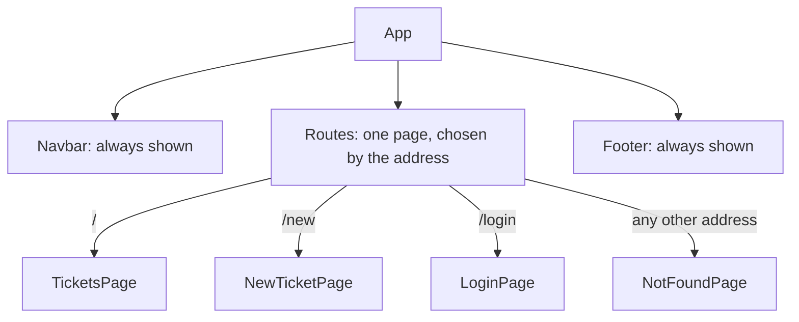

# Navigation with React Router

**Time: about 50 minutes**

You need the project from [Using .env Files](13-environment-variables.md): the API address comes from `.env`. The Bootstrap look from [note 08](08-bootstrap-and-react-bootstrap.md) is optional.

The Support Assistant API must be running, as in step 1 of note 09.

Right now, your whole app is one screen: the form and the list sit on the same page, and the links in the navigation bar (`Tickets`, `New Ticket`, `Login`) go nowhere. In this note each link opens its own page, with its own address.

## What you will build

- Three addresses that show three pages: `/` (the tickets), `/new` (the form) and `/login` (a placeholder).
- A navigation bar whose links change the page without reloading it, and which marks the page you are on.
- A message for an address that does not exist.
- A form page that returns you to the list after a ticket is created.

---

## The ideas

### Pages in a React app

A React app is one HTML page. Without help, the address bar never changes and the **Back** button does not work. **React Router** is a library that fixes this. It watches the address in the browser, and shows the component that matches it. You still write each "page" as a normal component, like `TicketsPage`.

### The pieces

| Piece | What it does |
|---|---|
| `BrowserRouter` | Turns routing on. You wrap your app in it once |
| `Routes` and `Route` | A list of `path` and `element` pairs: "at this address, show this component" |
| `Link` and `NavLink` | A link that changes the address without reloading the page. `NavLink` also gives the link the class `active` when its address is the current one |
| `useNavigate` | Gives you a function to change the address from code, for example after a form is saved |
| `path="*"` | Matches any address that no other `Route` matched. Use it for a "page not found" page |

### Where the pages go

The navigation bar and the footer stay on the screen. Only the middle part changes:



**How to read it:** `Routes` looks at the address and picks one page. The `Navbar` and `Footer` are outside `Routes`, so they do not change.

### Installing it

You install React Router with `npm install react-router`. Depending on your Node.js version, npm installs version 7 or version 8. The code in this note is the same for both.

---

## Build steps

Work in `hello-react` with the dev server running (`npm run dev`) and the API running.

### 1. Install it and turn it on

In a second terminal, in the `hello-react` folder, run:

```bash
npm install react-router
```

In `src/main.jsx`, import `BrowserRouter` and put it around `<App />`:

```jsx
import { StrictMode } from 'react'
import { createRoot } from 'react-dom/client'
import { BrowserRouter } from 'react-router'
import './index.css'
import App from './App.jsx'

createRoot(document.getElementById('root')).render(
  <StrictMode>
    <BrowserRouter>
      <App />
    </BrowserRouter>
  </StrictMode>,
)
```

If your `main.jsx` has other `import` lines, such as the Bootstrap CSS from note 08, keep them.

**Check:** `package.json` lists `"react-router"`, and the page looks the same as before. If the page shows an error about `react-router` after the install, stop `npm run dev` with `Ctrl+C` and start it again.

### 2. Two small pages and the routes

Create `src/pages/LoginPage.jsx`:

```jsx
function LoginPage() {
  return (
    <section>
      <h2>Login</h2>
      <p>The login form comes in a later note.</p>
    </section>
  )
}

export default LoginPage
```

Create `src/pages/NotFoundPage.jsx`:

```jsx
import { Link } from 'react-router'

function NotFoundPage() {
  return (
    <section>
      <h2>Page not found</h2>
      <p>There is no page at this address.</p>
      <Link to="/">Back to the tickets</Link>
    </section>
  )
}

export default NotFoundPage
```

`Link` is a link for use inside your app. It has `to` in place of `href`.

Replace `src/App.jsx` with:

```jsx
import { Routes, Route } from 'react-router'
import Navbar from './components/Navbar.jsx'
import Footer from './components/Footer.jsx'
import TicketsPage from './pages/TicketsPage.jsx'
import LoginPage from './pages/LoginPage.jsx'
import NotFoundPage from './pages/NotFoundPage.jsx'

function App() {
  return (
    <div className="app">
      <Navbar />
      <main className="content">
        <Routes>
          <Route path="/" element={<TicketsPage />} />
          <Route path="/login" element={<LoginPage />} />
          <Route path="*" element={<NotFoundPage />} />
        </Routes>
      </main>
      <Footer />
    </div>
  )
}

export default App
```

`element` takes a component **with its tags**, like `<TicketsPage />`.

**Check:** type each address in the browser's address bar. `http://localhost:5173/` shows the tickets, `http://localhost:5173/login` shows `Login`, and `http://localhost:5173/anything` shows `Page not found`.

### 3. Links in the navigation bar

Replace `src/components/Navbar.jsx` with:

```jsx
import { NavLink } from 'react-router'

function Navbar() {
  return (
    <nav className="navbar">
      <strong>Support Assistant</strong>
      <div>
        <NavLink to="/">Tickets</NavLink>
        <NavLink to="/new">New Ticket</NavLink>
        <NavLink to="/login">Login</NavLink>
      </div>
    </nav>
  )
}

export default Navbar
```

Add one rule at the end of `src/index.css`, to show which page you are on:

```css
.navbar a.active { font-weight: bold; text-decoration: underline; }
```

**Check:** click `Login`. The page changes to `Login`, the address bar shows `/login`, and the `Login` link is bold and underlined. Click the browser's **Back** button: you return to the tickets. (`New Ticket` shows `Page not found` for now. The next step adds it.)

To see that the page is **not reloaded**, open the Console (`F12`), type `window.x = 1` and press Enter. Click a link in the navigation bar. Then type `window.x` and press Enter.

**Check:** the Console prints `1`. A page that reloaded would print `undefined`.

### 4. The form on its own page

Until now, `TicketsPage` showed the form above the list. Move the form to its own page.

First, the address of the API is now needed in two files. Create `src/api.js` with one line:

```jsx
export const API_URL = import.meta.env.VITE_API_URL + '/api/v1/tickets'
```

Create `src/pages/NewTicketPage.jsx`:

```jsx
import { useNavigate } from 'react-router'
import TicketForm from '../components/TicketForm.jsx'
import { API_URL } from '../api.js'

function NewTicketPage() {
  const navigate = useNavigate()

  async function handleCreate(newTicket) {
    const response = await fetch(API_URL, {
      method: 'POST',
      headers: { 'Content-Type': 'application/json' },
      body: JSON.stringify(newTicket),
    })
    if (!response.ok) {
      const problem = await response.json()
      throw new Error(problem.message || 'The server answered ' + response.status)
    }
    navigate('/')
  }

  return (
    <section>
      <TicketForm onCreate={handleCreate} />
    </section>
  )
}

export default NewTicketPage
```

`useNavigate()` gives you a function. `navigate('/')` changes the address to `/`, like a click on a link, so `TicketsPage` is shown and loads the list again. The `TicketForm` component does not change.

In `src/pages/TicketsPage.jsx`, make four changes:

1. Delete the line `import TicketForm from '../components/TicketForm.jsx'`.
2. Replace the line `const API_URL = import.meta.env.VITE_API_URL + '/api/v1/tickets'` with `import { API_URL } from '../api.js'`, and move it up with the other `import` lines.
3. Delete the whole `handleCreate` function.
4. Delete the line `<TicketForm onCreate={handleCreate} />`.

In `src/App.jsx`, add the import `import NewTicketPage from './pages/NewTicketPage.jsx'` with the other page imports, and this line inside `<Routes>`, below the `/` route:

```jsx
<Route path="/new" element={<NewTicketPage />} />
```

**Check:** the tickets page no longer shows the form. Click `New Ticket`: the form opens, and the address bar shows `/new`. Fill in the form, for example `Router test`, `Made from the form page` and `LOW`, and click **Create ticket**. You return to the tickets page, and `Router test` is the last card in the list. Typing `http://localhost:5173/new` in the address bar also opens the form directly.

### 5. Run the checks

```bash
npm run lint
npm run build
```

**Check:** `npm run lint` prints nothing but its own header, and `npm run build` ends with `✓ built in …`.

### If you did note 08: the Bootstrap look

Keep the Bootstrap classes, and replace each `<a>` in `Navbar.jsx` with a `NavLink`. Add `import { NavLink } from 'react-router'` at the top.

**Plain Bootstrap classes (part A):** keep the `className="nav-link"` on each one:

```jsx
<li className="nav-item"><NavLink className="nav-link" to="/new">New Ticket</NavLink></li>
```

**React-Bootstrap components (part B):** tell `Nav.Link` to use `NavLink` with the `as` prop:

```jsx
<Nav.Link as={NavLink} to="/new">New Ticket</Nav.Link>
```

Do this for all three links. Bootstrap already styles a link with the class `active`, so you do not need the CSS rule from step 3.

**Check:** the links work as before, and the link of the current page is brighter than the others.

---

## Common mistakes

> **Warning: a plain `<a href="/new">` in place of `NavLink`.** It works, but the browser loads the whole page again each time: the page flashes, `Loading tickets...` shows again, and `window.x` from the check in step 3 prints `undefined`. Use `Link` or `NavLink` with `to`.

> **Warning: no `BrowserRouter`.** The page goes blank, and the Console shows `Uncaught Error: useLocation() may be used only in the context of a <Router> component.` Wrap `<App />` in `<BrowserRouter>` in `main.jsx`.

> **Warning: `element={TicketsPage}` without the tags.** The middle of the page stays empty, and the Console shows `Functions are not valid as a React child.` Write `element={<TicketsPage />}`.

> **Warning: no `path="*"` route.** An address that does not exist shows an empty middle, with the navigation bar and the footer only. The Console shows `No routes matched location "/anything"`. Add the `*` route with a `NotFoundPage`.

---

## Practice

1. Add an `/about` page: create `AboutPage.jsx` with a heading and one sentence, add a `Route`, and add a `NavLink` to the navigation bar. **Result:** the new link opens the page, and is bold while you are on it.
2. Change the text `Support Assistant` in the navigation bar into a `Link` to `/`. **Result:** clicking it from any page returns you to the list of tickets.
3. In `LoginPage.jsx`, add a **Cancel** button that calls `navigate('/')` when clicked. **Result:** the button takes you back to the tickets page.

---

## Recap

- React Router shows the component that matches the address, and keeps the Back button working. Install it with `npm install react-router`.
- Wrap `<App />` in `BrowserRouter` once. List the pages with `Routes` and `Route`, each with a `path` and an `element`.
- Use `Link` or `NavLink` with `to`, in place of `<a href>`, so the page is not reloaded. `NavLink` adds the class `active` to the current link.
- Use `useNavigate` to change the address from code, for example `navigate('/')` after a ticket is created.
- Add `path="*"` as the last route, for addresses that do not exist.

> **Not verified:** the steps were run on macOS with Node.js 22.19.0, Vite 8.3.5 and React 19.3.1, next to the code from note 13, with the API from `support-assistant-jpa-h2` on port 8080. npm installed `react-router` 7.18.5 on this Node version. Version 8.5.1, which needs Node.js 22.22 or higher, was also installed by name (npm warned about the engine) and the same code gave the same results. That npm picks version 8 on Node.js 22.22 or higher was not tried. The addresses `/`, `/new`, `/login`, `/anything` and `/tickets/7` were loaded in headless Chrome. A script clicked the links, pressed Back, filled in the form and submitted it. The path changed each time, a value set on `window` survived the link clicks, the active link had the class `active`, and after the submit the list had one card more than before. The plain `<a href>` was built and served, and loaded the whole page again. The four common mistakes were each tried, and the quoted messages are what appeared. The `Console` check with `window.x` was done by the script, not by hand. The bold and underlined style was seen in a screenshot. The Bootstrap navigation bars (part A and part B) were built and showed the `active` class and a brighter link on a screenshot. The rest of the Bootstrap page (the form and the cards) was not tried with the router. The practice tasks were not run, and neither was each intermediate state of steps 2 to 4 (the final files were run). Whether the dev server needs a restart after `npm install react-router` was not tried. A built site on a real server (such as nginx) must answer every address with `index.html`, or a reload on `/new` fails: this was not tried, and `npm run preview` did answer `/new`. `support-assistant-plsql` was not run, because it needs Oracle. Only Chrome was used.
