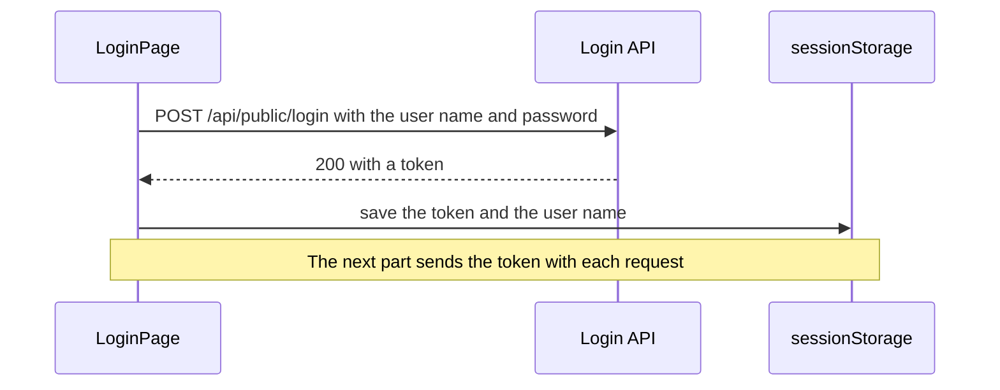

# Login: Getting a Token and Keeping It in Session Storage

**Time: about 55 minutes**

You need the project from [Navigation with React Router](14-navigation-with-react-router.md): it has a `/login` address that shows a placeholder.

The login in this note is done by a different API from the one in notes 09 to 12. Its code and its steps to run are in [support-assistant-security-database](../support-assistant-security-database/README.md). Read the sections "What is a JWT?" and "Before you build or run" there.

## What you will build

- A **login form** that sends a user name and a password to the API, and gets a **token** back.
- A place to **keep the token** in the browser, so that it is still there after a reload.
- A navigation bar that shows `Logged in as meera` and a **Logout** button.

The token is not sent with any request yet. That is the next part.

---

## The ideas

### The login, and the token

You log in once. The API checks the user name and password, and answers with a **token**: a long text that proves who you are. Later requests will show the token in place of the password.

A token is called a **JWT** (JSON Web Token). It is three pieces of text separated by dots. The middle piece holds the user name and the time when the token stops working. The last piece is a signature, which the API uses to know that nobody changed the token. Anyone can read the middle piece, so a token never holds a password.



**How to read it:** the password travels once, in the first request. The page keeps the token it gets back.

### The login URL

| Method and path | Body you send | Answer on success |
|---|---|---|
| `POST /api/public/login` | `{ "username": "meera", "password": "meera123" }` | `200` and `{ "token": "eyJ…" }` |

The users are `meera` (password `meera123`) and `karan` (password `karan123`). A wrong user name or a wrong password gives `401` with **no body**. As with the `204` in note 12, there is nothing to read, so do not call `response.json()` on a `401`.

### Where to keep the token

A value in React state is lost when you reload the page. The browser has two small stores for text that survive a reload:

| Store | How long the text stays |
|---|---|
| `sessionStorage` | Until you close the **tab**. Each tab has its own |
| `localStorage` | Until your code removes it, even after you close the browser |

This note uses `sessionStorage`. It has three functions, and it stores text only:

```javascript
sessionStorage.setItem('token', 'abc')    // save
sessionStorage.getItem('token')           // read: 'abc', or null when there is nothing
sessionStorage.removeItem('token')        // delete
```

> **Warning: every script in your page can read what is in `sessionStorage`.** Keep only the token there. Never keep a password.

### Show one thing or the other

The navigation bar should show a **Login** link when nobody is logged in, and the user name with a **Logout** button when someone is. JSX has a short way to choose between two things, the question mark and the colon:

```jsx
{username ? <p>Hello {username}</p> : <p>Please log in</p>}
```

If `username` has a value, the first part is shown. If it is empty (`null`), the second part is shown.

---

## Build steps

### 1. Start the login API

Follow "Before you build or run" and "Build, test, and run" in the README of [support-assistant-security-database](../support-assistant-security-database/README.md): run the two SQL scripts, set `DB_USERNAME`, `DB_PASSWORD` and `JWT_SECRET` (a text of your own with at least 32 characters), and start the API. Stop any other API that uses port `8080` first (`Ctrl+C` in its terminal), because both use the same port. Keep `npm run dev` running in `hello-react`.

**Check:** open `http://localhost:8080/api/public/ping` in the browser. It shows `{"status":"up"}`.

### 2. Try the login from the Console

Open your React page, then the Console (`F12`). Paste this and press Enter. The Console accepts `await` here:

```javascript
const response = await fetch('http://localhost:8080/api/public/login', {
  method: 'POST',
  headers: { 'Content-Type': 'application/json' },
  body: JSON.stringify({ username: 'meera', password: 'meera123' }),
})
const data = await response.json()
data
```

**Check:** the Console shows an object with one property, `token`, a long text that starts with `eyJ`.

To look inside the token, paste this. It reads the middle piece. It is for looking only:

```javascript
JSON.parse(atob(data.token.split('.')[1]))
```

**Check:** the Console shows `{sub: 'meera', iat: …, exp: …}`. `sub` is the user name. `iat` is the time the token was made, and `exp` is the time it stops working (30 minutes later), both as seconds since 1970.

Now a wrong password. Paste the same `fetch` with `password: 'nope'`, and then:

```javascript
response.status
```

**Check:** the Console shows `401`.

### 3. Try `sessionStorage` in the Console

```javascript
sessionStorage.setItem('token', 'abc')
sessionStorage.getItem('token')
```

**Check:** the second line shows `'abc'`. Reload the page and run `sessionStorage.getItem('token')` again: it still shows `'abc'`. In Chrome, open the **Application** tab of the developer tools and open **Session Storage** on the left: you see the key `token` with the value `abc`.

```javascript
sessionStorage.removeItem('token')
sessionStorage.getItem('token')
```

**Check:** the last line shows `null`.

### 4. Helper functions for the session

Four small functions will keep the storage code in one place. The next part reuses `getToken`. Create `src/session.js`:

```javascript
export function saveSession(token, username) {
  sessionStorage.setItem('token', token)
  sessionStorage.setItem('username', username)
}

export function getToken() {
  return sessionStorage.getItem('token')
}

export function getUsername() {
  return sessionStorage.getItem('username')
}

export function clearSession() {
  sessionStorage.removeItem('token')
  sessionStorage.removeItem('username')
}
```

Two files now need an address from the API: `TicketsPage` and `LoginPage`. Keep the addresses in one file. Create `src/api.js`:

```javascript
export const API_URL = import.meta.env.VITE_API_URL + '/api/v1/tickets'
export const LOGIN_URL = import.meta.env.VITE_API_URL + '/api/public/login'
```

In `src/pages/TicketsPage.jsx`, delete the line `const API_URL = import.meta.env.VITE_API_URL + '/api/v1/tickets'`, and add `import { API_URL } from '../api.js'` with the other imports.

**Check:** the page looks the same as before, and the tickets still load.

### 5. The login form

Replace `src/pages/LoginPage.jsx` with:

```jsx
import { useState } from 'react'
import { useNavigate } from 'react-router'
import { LOGIN_URL } from '../api.js'

function LoginPage({ onLogin }) {
  const navigate = useNavigate()
  const [username, setUsername] = useState('')
  const [password, setPassword] = useState('')
  const [error, setError] = useState('')

  async function handleSubmit(event) {
    event.preventDefault()
    setError('')
    try {
      const response = await fetch(LOGIN_URL, {
        method: 'POST',
        headers: { 'Content-Type': 'application/json' },
        body: JSON.stringify({ username, password }),
      })
      if (response.status === 401) {
        throw new Error('Wrong user name or password.')
      }
      if (!response.ok) {
        throw new Error('The server answered ' + response.status)
      }
      const data = await response.json()
      onLogin(data.token, username)
      navigate('/tickets')
    } catch (err) {
      setError('Could not log in. ' + err.message)
    }
  }

  return (
    <section>
      <form onSubmit={handleSubmit}>
        <h2>Login</h2>

        <div>
          <label htmlFor="username">User name</label>
          <br />
          <input
            id="username"
            value={username}
            onChange={(event) => setUsername(event.target.value)}
            required
          />
        </div>

        <div>
          <label htmlFor="password">Password</label>
          <br />
          <input
            id="password"
            type="password"
            value={password}
            onChange={(event) => setPassword(event.target.value)}
            required
          />
        </div>

        {error && <p>{error}</p>}
        <button type="submit">Log in</button>
      </form>
    </section>
  )
}

export default LoginPage
```

This is the form from note 10 with two fields, and the request from note 11. The new parts are:

- `type="password"` shows dots in place of the letters.
- The `401` check comes **before** `response.ok`, so that a wrong login gets its own message and `.json()` is never called on it.
- The page does not save anything itself. It calls `onLogin(data.token, username)`, a function that `App` gives it, in the same "data down, actions up" way as note 12. Then `navigate('/tickets')` shows the tickets page.

In `src/App.jsx`, make three changes:

1. Add the import `import { saveSession } from './session.js'` with the other imports.
2. Add this function inside `App`, above the `return`:

   ```jsx
   function handleLogin(token, name) {
     saveSession(token, name)
   }
   ```

3. Change the login route to `<Route path="/login" element={<LoginPage onLogin={handleLogin} />} />`.

**Check:** go to `http://localhost:5173/login`. Type `meera` and `nope` and click **Log in**: the form shows `Could not log in. Wrong user name or password.` Now type `meera123` and click **Log in**. You move to the tickets page. It shows `Could not load the tickets. The server answered 401`. That is correct for now: this API shows tickets only to a logged-in user, and the next part sends the token. Open the **Application** tab and **Session Storage**: you see `token` (a long text starting with `eyJ`) and `username` with the value `meera`.

### 6. Show who is logged in, and log out

The navigation bar needs to change when you log in, so `App` keeps the user name in state. Replace `src/App.jsx` with:

```jsx
import { useState } from 'react'
import { Routes, Route, Navigate, useNavigate } from 'react-router'
import Navbar from './components/Navbar.jsx'
import Footer from './components/Footer.jsx'
import TicketsPage from './pages/TicketsPage.jsx'
import LoginPage from './pages/LoginPage.jsx'
import NotFoundPage from './pages/NotFoundPage.jsx'
import { saveSession, getUsername, clearSession } from './session.js'

function App() {
  const navigate = useNavigate()
  const [username, setUsername] = useState(getUsername())

  function handleLogin(token, name) {
    saveSession(token, name)
    setUsername(name)
  }

  function handleLogout() {
    clearSession()
    setUsername(null)
    navigate('/login')
  }

  return (
    <div className="app">
      <Navbar username={username} onLogout={handleLogout} />
      <main className="content">
        <Routes>
          <Route path="/" element={<Navigate to="/tickets" replace />} />
          <Route path="/tickets/*" element={<TicketsPage />} />
          <Route path="/login" element={<LoginPage onLogin={handleLogin} />} />
          <Route path="*" element={<NotFoundPage />} />
        </Routes>
      </main>
      <Footer />
    </div>
  )
}

export default App
```

`useState(getUsername())` starts with the user name from `sessionStorage`, or `null` when there is none. That is why you stay logged in after a reload.

Replace `src/components/Navbar.jsx` with:

```jsx
import { NavLink } from 'react-router'

function Navbar({ username, onLogout }) {
  return (
    <nav className="navbar">
      <strong>Support Assistant</strong>
      <div>
        <NavLink to="/tickets" end>Tickets</NavLink>
        <NavLink to="/tickets/new">New Ticket</NavLink>
        {username ? (
          <span>
            Logged in as {username}{' '}
            <button onClick={onLogout}>Logout</button>
          </span>
        ) : (
          <NavLink to="/login">Login</NavLink>
        )}
      </div>
    </nav>
  )
}

export default Navbar
```

Add one rule at the end of `src/index.css`, to space the text from the links:

```css
.navbar span { margin-left: 1rem; }
```

**Check:** log in as `meera`. The navigation bar shows `Logged in as meera` and a **Logout** button in place of the `Login` link. Reload the page: it still shows `Logged in as meera`. Click **Logout**: you move to the login form, the bar shows `Login` again, and **Session Storage** is empty.

### 7. Run the checks

```bash
npm run lint
npm run build
```

**Check:** `npm run lint` prints nothing but its own header, and `npm run build` ends with `✓ built in …`.

---

## Common mistakes

> **Warning: no `event.preventDefault()`.** When you click **Log in**, the page reloads and the address ends with `?`: `http://localhost:5173/login?`. Nothing is sent to the API. Add `event.preventDefault()` as the first line of `handleSubmit`.

> **Warning: `.json()` on a `401`.** Without the `401` check, a wrong password shows `Could not log in. Failed to execute 'json' on 'Response': Unexpected end of JSON input`. The `401` answer has no body. Check `response.status === 401` before you read the body.

> **Warning: saving the whole answer.** With `onLogin(data, username)` in place of `onLogin(data.token, username)`, the login works, but `sessionStorage` holds the text `[object Object]` as the token. `sessionStorage` keeps text only, so an object is turned into that text. Save `data.token`.

> **Warning: the other API is running on port 8080.** The form shows `Could not log in. The server answered 404`. The API from notes 09 to 12 has no login URL. Stop it, and start `support-assistant-security-database`.

> **Warning: no API on port 8080.** The form shows `Could not log in. Failed to fetch`. Check that the login API is running (step 1).

> **Warning: a second tab is not logged in.** `sessionStorage` belongs to one tab. If you open the app in a new tab, you must log in again there. This is how `sessionStorage` works, not a fault in your code.

---

## Practice

1. Make the **Log in** button show `Logging in...` and stay disabled while the request is on its way. **Result:** you cannot click it twice, and the text goes back to `Log in` when the answer arrives.
2. Log in on one tab, then open `http://localhost:5173` in a second tab. **Result:** the second tab shows the `Login` link, and the first tab still shows your name.
3. In `session.js`, change every `sessionStorage` to `localStorage`. **Result:** after you log in and close the tab, a new tab on `http://localhost:5173` still shows `Logged in as …`. Change it back afterwards.

---

## Recap

- You log in once with `POST /api/public/login`. The answer is a **token**. A wrong login gives `401` with no body.
- A token (JWT) holds the user name and an expiry time. Anyone can read it, so it never holds a password.
- `sessionStorage` keeps text until the tab closes, and survives a reload. Use `setItem`, `getItem` and `removeItem`.
- Keep the storage code in one file, `session.js`, so that other files call `getToken()` and do not touch the storage themselves.
- `App` keeps the user name in state and starts it from the storage, so the navigation bar is right after a reload.
- `{condition ? A : B}` chooses between two things in JSX.

**What the next note adds:** sending the token with each request. The tickets page needs it, as the `401` on the tickets page shows. This API also serves its tickets at `/api/tickets`, not at the `/api/v1/tickets` address that notes 09 to 14 use, so the next part has to deal with that too.

> **Not verified:** the Oracle database was not available, so `support-assistant-security-database` was not run as written. A copy of it in a temporary folder ran on an in-memory H2 database in Oracle mode, with the two SQL scripts run at start-up, a made-up `JWT_SECRET`, and Spring Boot 4.1.1. The Java code was not changed. The React steps were run on macOS with Node.js 22.19.0, Vite 8.3.5, React 19.3.1 and `react-router` 7.18.5, in headless Chrome, next to the code from note 14. A script typed into the form: a wrong password gave `Could not log in. Wrong user name or password.` and saved nothing; the good login moved to `/`, saved `token` and `username`, and the bar showed `Logged in as meera`; after a reload the bar still showed it; **Logout** emptied the storage and moved to `/login`. The Console lines in step 2 and step 3 were run as a script with the same calls, and gave a token with three parts, the `{sub, iat, exp}` object, `null` after `removeItem`, and `401` with an empty body. The reading of the middle piece with `atob` works for these tokens. A token piece that has the characters `-` or `_` would need more code, and was not tried. The tickets page showed `The server answered 401` with the login API running. Five common mistakes were tried and the quoted messages are what appeared: no `preventDefault`, `.json()` on a `401`, saving the object, the other API on port 8080, and no API running. The `?` address was seen, but whether the password would show in the address with named fields was not tried. The `ping` address answered `{"status":"up"}`. A second tab, the Application tab view, and the practice tasks were not tried by me. The login form was not styled with Bootstrap. `support-assistant-plsql` was not run, because it needs Oracle. The note was first run with the routes `/` and `/new`. After note 14 changed to `/tickets` and `/tickets/new`, the final files of this note (`App.jsx`, `Navbar.jsx`, `LoginPage.jsx` with `navigate('/tickets')`) were run again: `/` moved to `/tickets`, a login as `meera` led to `/tickets`, and a logout led to `/login`. The step 4 change of `TicketsPage` (the `API_URL` import from `src/api.js`) was run only as part of the final files, and its own **Check** was not run. Only Chrome was used.
