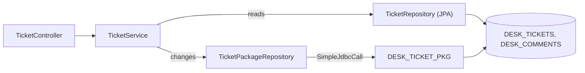

# support-assistant-hybrid

A ticket API that uses **both ways** to reach Oracle:

- **JPA reads** the tickets and their comments.
- **A PL/SQL package changes them**, so every rule is checked in one place.

It shows the rule of the module: **reads and plain look-ups go to JPA. Changes that follow rules go to the package.**

It builds on [support-assistant-plsql-relations](../solutions/support-assistant-plsql-relations/). It uses the same tables and the same package `DESK_TICKET_PKG`, so you run the same scripts once for both projects.

## The picture



**How to read it:** the service is the only class that knows both ways. Reads go through JPA. Changes go through the package. Both end at the same two tables.

## Which way each endpoint uses

| Method | URL | Way | What runs |
|---|---|---|---|
| `GET` | `/api/tickets?status=OPEN` (status is optional) | JPA | `findByStatusOrderById` |
| `GET` | `/api/tickets/7` | JPA | `findById`, then the comments of the ticket |
| `POST` | `/api/tickets` | Package | `CREATE_TICKET` |
| `PATCH` | `/api/tickets/7/status` | Package, then JPA | `CHANGE_STATUS`, then `findById` to answer with the new ticket |
| `POST` | `/api/tickets/7/comments` | Package | `ADD_COMMENT` |

`PATCH` uses both ways in one `@Transactional` method. The package changes the status first. JPA reads the ticket after it, so the answer shows the new status.

## Three rules this project follows

1. **One owner for each rule.** The status order, the due date, and "a closed ticket takes no comments" are in the package. Java does not check them again.
2. **Write through the package, read through JPA.** `Ticket` and `Comment` are marked `@Immutable`, so JPA can read them but cannot change a row and skip the rules.
3. **One transaction for both.** A `@Transactional` method can call the package and JPA, and they commit or roll back together.

## Versions

| Item | Version |
|---|---|
| Java | 21 |
| Spring Boot | 4.1.1 |
| Oracle JDBC driver | `ojdbc17` (comes with Spring Boot) |
| Oracle Database | 19c, or 21c Express Edition |

## Before you build or run

1. Run the scripts in [db/oracle](db/oracle/), in order, as the user that your application connects as. If you already ran them for `support-assistant-plsql-relations`, do not run them again.

   | Script | What it does |
   |---|---|
   | `01-tables.sql` | Creates two sequences, `DESK_TICKETS`, `DESK_COMMENTS` (with a foreign key to `DESK_TICKETS`), and an index on the foreign key |
   | `02-package.sql` | Creates the package `DESK_TICKET_PKG`. You can run it again at any time |
   | `99-drop.sql` | Removes everything above, so that you can start again |

2. Set the connection in environment variables. Do not write a password in a file.

   | Variable | Meaning |
   |---|---|
   | `DB_USERNAME` | The Oracle user |
   | `DB_PASSWORD` | The password of that user |
   | `DB_URL` | Optional. Default `jdbc:oracle:thin:@//localhost:1521/XEPDB1` |

> **Note:** a variable that is not set reaches Oracle as the text `${DB_PASSWORD}`. The application still starts, and the first call fails with `ORA-01017`.

## Build and run

```bash
export DB_USERNAME=YOUR_USERNAME
export DB_PASSWORD=YOUR_PASSWORD
mvn clean verify
java -jar target/support-assistant-hybrid-0.0.1-SNAPSHOT.jar
```

The application starts on port `8080`. `mvn clean verify` runs six tests against your database. Each test rolls back. The database must be running, with the scripts applied.

## Try it

```bash
curl -i -X POST http://localhost:8080/api/tickets \
  -H "Content-Type: application/json" \
  -d '{"title":"Printer is jammed","description":"Floor 2","priority":"HIGH"}'
```

The answer is `201` with `{"id":1}`. The id is the one the package gave back.

```bash
curl -i -X POST http://localhost:8080/api/tickets/1/comments \
  -H "Content-Type: application/json" \
  -d '{"author":"Meera","body":"Paper tray is stuck"}'

curl http://localhost:8080/api/tickets/1
```

The last call answers with the ticket and its comments, read by JPA: `{"ticket":{...},"comments":[{...}]}`.

Move the ticket one step, and then try a step that is not allowed:

```bash
curl -X PATCH http://localhost:8080/api/tickets/1/status \
  -H "Content-Type: application/json" -d '{"status":"IN_PROGRESS"}'

curl -i -X PATCH http://localhost:8080/api/tickets/1/status \
  -H "Content-Type: application/json" -d '{"status":"CLOSED"}'
```

The first answers `200` with the ticket, now `IN_PROGRESS`. The second answers `409`, because the package refuses a step that skips `RESOLVED`.

| Error | Status | Comes from |
|---|---|---|
| Title missing, priority not allowed, comment missing a field | `400` | The package (`20001`, `20002`, `20005`) |
| The ticket does not exist (`PATCH` or `POST` comment) | `404` | The package (`20003`) |
| The ticket does not exist (`GET`) | `404` | JPA found nothing (`TicketNotFoundException`) |
| A status step that is not allowed, a comment on a closed ticket | `409` | The package (`20004`, `20006`) |

## Layout

```text
db/oracle/                                   # the same scripts as support-assistant-plsql-relations
src/main/resources/application.yaml          # connection from environment variables, JPA settings
src/main/java/com/bsp/supportassistant
├── SupportAssistantApplication.java
├── model/                                   # Ticket, Comment: read-only JPA entities
├── repository/
│   ├── TicketRepository.java                # JPA: the reads
│   └── TicketPackageRepository.java         # SimpleJdbcCall: the changes
├── service/TicketService.java               # chooses the way for each job
├── dto/                                     # records: requests and answers
├── exception/                               # ApiError, GlobalExceptionHandler, TicketNotFoundException
└── api/TicketController.java
src/test/java/com/bsp/supportassistant/TicketHybridTests.java
```

## Things to watch

- **A stale object.** JPA keeps the objects it has loaded. If you load a ticket, then call the package to change it, and then use the same object, you see the old status. In `changeStatus`, JPA reads the ticket **after** the package call, so it sees the new status.
- **Never save through JPA.** `ticketRepository.save(...)` would write a row and skip the package. The classes are `@Immutable` to stop this.
- **`ddl-auto` is `none`.** The tables come from `db/oracle/01-tables.sql`. JPA never creates or changes them.

## Running on Spring Boot 3.5

The Java code is the same. Change these lines of `pom.xml`:

| Item in `pom.xml` | Spring Boot 4.1.1 (this project) | Spring Boot 3.5.x |
|---|---|---|
| Parent version | `4.1.1` | `3.5.16`, or another 3.5.x |
| Web starter | `spring-boot-starter-webmvc` | `spring-boot-starter-web` |
| Test starter | `spring-boot-starter-webmvc-test` | `spring-boot-starter-test` |
| Oracle driver | `ojdbc17` | `ojdbc11` |

This project was built on Spring Boot 4.1.1 only.

## What this project does not do

- It does not check the request fields in Java. The package checks them.
- It has no login. Any caller can change any ticket.
- It has no list of comments for many tickets at once. Reading the comments of a list of tickets one by one is the N+1 problem. `GET /api/tickets` leaves the comments out for that reason.
- It has no paging. See [support-assistant-plsql-pagination](../support-assistant-plsql-pagination/) for a page read by the package.
- It does not use the programs `FIND_TICKETS`, `GET_TICKET`, and `FIND_TICKETS_WITH_COMMENTS` of the package. JPA does those reads here.
