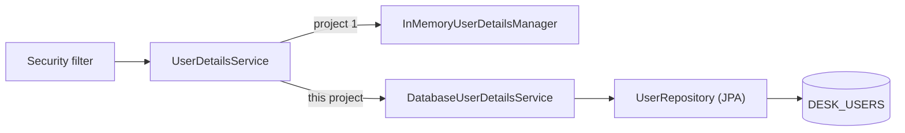

# support-assistant-security-database

The same secured ticket API as [support-assistant-security](../support-assistant-security/), with **one change**: the users are no longer two fixed users in code. They are rows in an **Oracle table**, `DESK_USERS`.

Everything else stays the same: HTTP Basic authentication, the roles `EMPLOYEE` and `AGENT`, the URL rules, and the BCrypt hashes. Read the first project's README first for those ideas.

**Time:** about 30 minutes.

## What changed



**How to read it:** the security filter only knows the `UserDetailsService` interface. In project 1 an in-memory class answers it. Here `DatabaseUserDetailsService` answers it, by reading the table. `SecurityConfig` and the controllers did not change.

| Part | Project 1 | This project |
|---|---|---|
| Where the users are | `UsersConfig`, in memory | The table `DESK_USERS` |
| Who finds a user | `InMemoryUserDetailsManager` | `DatabaseUserDetailsService` + `UserRepository` |
| The stored password | Hashed at start-up with `encode(...)` | Already a BCrypt hash in the table |
| Added to `pom.xml` | none | `spring-boot-starter-data-jpa`, `ojdbc17` |

The users in the table are the same as before:

| User | Password | Role |
|---|---|---|
| `meera` | `meera123` | `EMPLOYEE` |
| `karan` | `karan123` | `AGENT` |

The URLs and who may call them are the same as in project 1.

## Versions

| Item | Version |
|---|---|
| Java | 21 |
| Spring Boot | 4.1.1 (brings Spring Security 7) |
| Oracle JDBC driver | `ojdbc17` (comes with Spring Boot) |
| Oracle Database | 19c, or 21c Express Edition |

## Before you build or run

1. Run the scripts in [db/oracle](db/oracle/), in order, as the user that your application connects as.

   | Script | What it does |
   |---|---|
   | `01-tables.sql` | Creates the sequence `DESK_USERS_SEQ` and the table `DESK_USERS` |
   | `02-sample-users.sql` | Inserts `meera` and `karan` with their BCrypt hashes |
   | `99-drop.sql` | Removes everything, so that you can start again |

2. Set the environment variables that the application reads:

   | Variable | Value |
   |---|---|
   | `DB_USERNAME` | Your Oracle user |
   | `DB_PASSWORD` | Your Oracle password |
   | `DB_URL` | Optional. Default: `jdbc:oracle:thin:@//localhost:1521/XEPDB1` |

   If `DB_PASSWORD` is not set, the application sends the text `${DB_PASSWORD}` to Oracle, and the first database call fails with `ORA-01017`.

## Build, test, and run

```bash
mvn clean verify
java -jar target/support-assistant-security-database-0.0.1-SNAPSHOT.jar
```

`mvn clean verify` runs six tests. Two use a mock and need no database. Four call Oracle and need the two scripts. You should see `Tests run: 6, Failures: 0, Errors: 0`.

Then use the same `curl` commands as in project 1, for example:

```bash
curl -i -u meera:meera123 http://localhost:8080/api/tickets
```

```text
HTTP/1.1 200
```

## The code

### 1. The table

[01-tables.sql](db/oracle/01-tables.sql)

```sql
CREATE TABLE DESK_USERS (
    ID             NUMBER        PRIMARY KEY,
    USERNAME       VARCHAR2(50)  NOT NULL,
    PASSWORD_HASH  VARCHAR2(100) NOT NULL,
    USER_ROLE      VARCHAR2(20)  NOT NULL,
    CONSTRAINT DESK_USERS_NAME_UK UNIQUE (USERNAME),
    CONSTRAINT DESK_USERS_ROLE_CK CHECK (USER_ROLE IN ('EMPLOYEE', 'AGENT'))
);
```

`PASSWORD_HASH` holds the BCrypt hash, 60 characters long. The password itself is never stored. `UNIQUE (USERNAME)` makes sure a name finds one user. `USER_ROLE` is `EMPLOYEE` or `AGENT`, **without** the `ROLE_` prefix, and the `CHECK` refuses anything else.

### 2. The entity and the repository

[AppUser](src/main/java/com/bsp/supportassistant/model/AppUser.java) is the JPA entity for one row. It is marked `@Immutable`: the application reads users and never changes them.

[UserRepository](src/main/java/com/bsp/supportassistant/repository/UserRepository.java) has one method. Spring Data writes the SQL from its name:

```java
public interface UserRepository extends JpaRepository<AppUser, Long> {

    Optional<AppUser> findByUsername(String username);
}
```

### 3. The part that Spring Security calls

[DatabaseUserDetailsService](src/main/java/com/bsp/supportassistant/service/DatabaseUserDetailsService.java)

```java
@Service
public class DatabaseUserDetailsService implements UserDetailsService {

    private final UserRepository userRepository;

    public DatabaseUserDetailsService(UserRepository userRepository) {
        this.userRepository = userRepository;
    }

    @Override
    public UserDetails loadUserByUsername(String username) {
        AppUser appUser = userRepository.findByUsername(username)
                .orElseThrow(() -> new UsernameNotFoundException("No user named " + username));

        return User.withUsername(appUser.getUsername())
                .password(appUser.getPasswordHash())
                .roles(appUser.getUserRole())
                .build();
    }
}
```

Spring Security calls `loadUserByUsername` with the name from the `Authorization` header. The method returns the user with the **stored hash**. It does not compare passwords. Spring Security does that next, with the `PasswordEncoder`.

Spring Boot finds this `@Service` because it is a `UserDetailsService` bean, and uses it for HTTP Basic. There is nothing else to connect.

If the name is not in the table, the method throws `UsernameNotFoundException`, and the client gets `401`. It is the same answer as for a wrong password, so a caller cannot find out which names exist.

## The tests

| Test class | Tests | Needs |
|---|---|---|
| [DatabaseUserDetailsServiceTest](src/test/java/com/bsp/supportassistant/service/DatabaseUserDetailsServiceTest.java) | 2: a known user gets the stored hash and `ROLE_AGENT`; an unknown user is refused | Nothing. The repository is a Mockito mock |
| [SecurityDatabaseTests](src/test/java/com/bsp/supportassistant/SecurityDatabaseTests.java) | 4: a user from the table logs in; a wrong password gives `401`; a name not in the table gives `401`; the role from the table decides `403` or `200` | Oracle, and `01-tables.sql` and `02-sample-users.sql` |

The four database tests only read `DESK_USERS`, so they leave the table as it was.

## Common mistakes

> **Mistake 1: the right password gives `401`, and the table holds plain text.** The log shows `WARN ... BCryptPasswordEncoder : Encoded password does not look like BCrypt`. The `PASSWORD_HASH` column must hold a BCrypt hash, which starts with `$2a$`. Insert the hash, not the password.

> **Mistake 2: the role is stored as `ROLE_AGENT`.** The table refuses it, because of the `CHECK`. Store `AGENT`. Spring Security adds the prefix in `roles(...)`.

> **Mistake 3: the application does not start, with `ORA-01017`.** Oracle refused the login. Check that `DB_USERNAME` and `DB_PASSWORD` are set in the terminal that runs the application.

> **Mistake 4: a new user cannot log in.** The row was inserted but not committed, and the application cannot see it. Run `COMMIT;` after the `INSERT`.

## Practice

1. Hash a password for a new user, `nisha`. Use `BCryptPasswordEncoder` in a small test or in `jshell`, then `INSERT` the row with the role `AGENT` and `COMMIT`. Log in as `nisha` with `curl -u`. You do not restart the application.
2. Change the role of `karan` to `EMPLOYEE` with an `UPDATE` and a `COMMIT`. Call `PATCH` as `karan`. What do you see?
3. Add a test to `DatabaseUserDetailsServiceTest`: a user with the role `EMPLOYEE` gets `ROLE_EMPLOYEE`.

## Recap

- The security filter asks a `UserDetailsService` for the user. Only that part changes when the users move from memory to a table.
- The table stores a BCrypt hash. Spring Security compares the typed password with it.
- The role is stored without `ROLE_`, and `roles(...)` adds the prefix.
- A name that is not in the table and a wrong password both give `401`.

## Layout

```text
src/main/java/com/bsp/supportassistant
├── config/       # SecurityConfig (rules, BCrypt)
├── model/        # AppUser
├── repository/   # UserRepository
├── service/      # DatabaseUserDetailsService
├── api/          # TicketController, AccountController
└── dto/          # TicketResponse, CreateTicketRequest, StatusRequest, MeResponse
src/test/java/com/bsp/supportassistant
├── service/DatabaseUserDetailsServiceTest.java    # JUnit with Mockito
└── SecurityDatabaseTests.java                     # MockMvc, needs Oracle
db/oracle
├── 01-tables.sql
├── 02-sample-users.sql
└── 99-drop.sql
```

## Running on Spring Boot 3.5

| Item | Spring Boot 4.1.1 (this project) | Spring Boot 3.5.x |
|---|---|---|
| Parent version | `4.1.1` | `3.5.16`, or another 3.5.x |
| Web starter | `spring-boot-starter-webmvc` | `spring-boot-starter-web` |
| Test starter | `spring-boot-starter-webmvc-test` | `spring-boot-starter-test` |
| Security test starter | `spring-boot-starter-security-test` | `spring-security-test` (test scope) |
| `@AutoConfigureMockMvc` import | `org.springframework.boot.webmvc.test.autoconfigure.AutoConfigureMockMvc` | `org.springframework.boot.test.autoconfigure.web.servlet.AutoConfigureMockMvc` |
| Oracle driver | `ojdbc17` | `ojdbc11` |

This project was built on Spring Boot 4.1.1 only.

## What this project does not do

- It has not been run against Oracle. The two mock tests were run, and the four database tests were run on a temporary in-memory copy of the same table, not on Oracle.
- It does not add, change, or delete users. Users are added with SQL.
- It does not check that a password is strong, and it does not lock an account after wrong passwords.
- It reads the user from the table on every request, with one `SELECT` each. It does not cache users.
- It does not use HTTPS, a session, or a token. See the first project's README.
