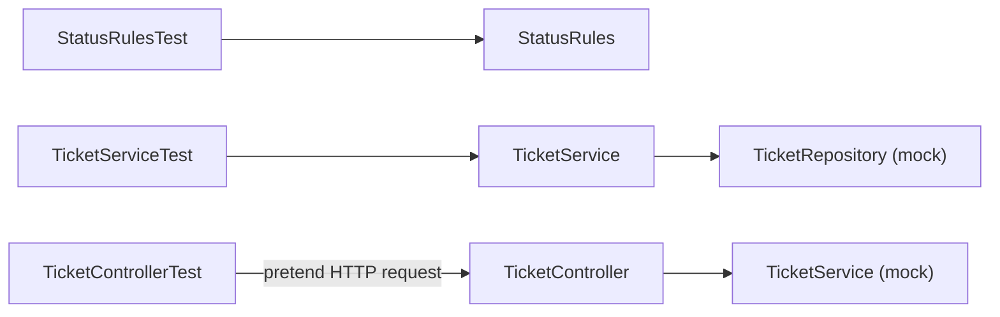

# Step 1 — Concepts and overview

> [Back to index](README.md) · Previous: none · Next: [The starting point](02-the-starting-point.md)

## Goal

Know the words that every later step uses, and see which test checks which class.

## Why this matters

A test is a small program that checks another program. It saves you from running the application and calling it by hand each time you change something. The hard part is not the syntax. It is knowing **what a test should look at**, and **what to replace with a fake** so that the test looks at one thing only. This step gives the words. The next steps use them.

## 1.1 What a unit test is

A **unit test** runs one small piece of code and checks the answer. It needs no database and no running server. It runs in milliseconds, and when it fails, it points at one piece of code.

Every test has three parts:

| Part | What it does | In this project |
|---|---|---|
| **Arrange** | Set up what the test needs | Tell the fake repository what to answer |
| **Act** | Call the code under test | Call `ticketService.changeStatus(...)` |
| **Assert** | Check the answer | The status is `IN_PROGRESS` |

## 1.2 What a mock is

`TicketService` needs a `TicketRepository`. A real one keeps tickets somewhere. A test should not depend on where. A **mock** is a stand-in for a class that the code under test uses. It does only what the test tells it to do, and it remembers how it was called.

Think of an actor in a rehearsal: it says the lines it was given, so that you can watch the other actor.

## 1.3 The three tests

The picture shows which class each test looks at, and what is replaced by a fake.

**How to read it:** an arrow from a test points at the real class it checks. A box marked "mock" is a fake. `StatusRules` has nothing to replace. `TicketService` gets a fake repository. `TicketController` gets a fake service.

## 1.4 The words

| Word | Meaning |
|---|---|
| **JUnit** | The library that finds and runs methods marked `@Test` |
| **AssertJ** | The library for the check: `assertThat(value).isEqualTo(...)` |
| **Mockito** | The library that makes mocks |
| **Stub** | An answer that you give to a mock: "when `findById(7)` is called, answer this ticket" |
| **Verify** | Asking a mock afterwards: "were you called with this?" |
| **MockMvc** | A tool that sends a pretend HTTP request to a controller. There is no real server and no network |
| **Surefire** | The Maven part that runs the tests when you type `mvn test` |

## 1.5 The code under test

The main code is given to you. You test it. You do not change it, except once, on purpose, to see a test fail.

| Class | What it does |
|---|---|
| `StatusRules` | Says if a status change is allowed. `OPEN → IN_PROGRESS → RESOLVED → CLOSED`, one step at a time |
| `TicketService` | Creates a ticket (always `OPEN`, a title is required) and changes its status |
| `TicketRepository` | An interface with `save` and `findById`. `InMemoryTicketRepository` is the real one |
| `TicketController` | `POST /api/tickets`, `GET /api/tickets/1`, `PATCH /api/tickets/1/status` |
| `GlobalExceptionHandler` | Turns an exception into an answer: `400`, `404`, or `409`, with an `ApiError` body |

Next: **[The starting point](02-the-starting-point.md)**.
