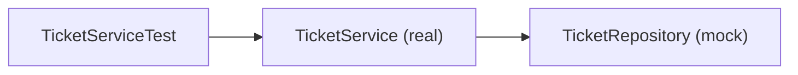

# support-assistant-testing

A small ticket API, used to show **three kinds of test**: a plain JUnit test, a Mockito test, and a MockMvc test. It needs no database. The tickets live in memory, and every test runs on your machine in a few seconds.

**Time:** about 40 minutes.

## What you will see

- A plain JUnit test for a rule that has no dependencies.
- A Mockito test for a service, with a fake repository.
- A MockMvc test for a controller, with no real server.

## Versions

| Item | Version |
|---|---|
| Java | 21 |
| Spring Boot | 4.1.1 |
| Test tools | JUnit 5, Mockito, AssertJ, MockMvc (all come with `spring-boot-starter-webmvc-test`) |

## Build, test, and run

```bash
mvn clean verify
java -jar target/support-assistant-testing-0.0.1-SNAPSHOT.jar
```

`mvn clean verify` runs ten tests. You should see `Tests run: 10, Failures: 0, Errors: 0`.

## The ideas

A **unit test** runs one small piece of code and checks the answer. It runs in milliseconds, and it needs no database and no running server. When it fails, it points at one piece of code.

Every test has three parts:

| Part | What it does |
|---|---|
| **Arrange** | Set up what the test needs |
| **Act** | Call the code under test |
| **Assert** | Check the answer |

A **mock** is a stand-in for a class that the code under test uses. **Mockito** makes mocks. `TicketService` needs a repository, and a real one needs a database. A mock repository answers what the test tells it to, so the test looks at the service alone.



**How to read it:** the test calls the real service. The service talks to a mock. The test decides what the mock answers, and afterwards asks the mock what it was given.

## The code under test

| Class | What it does |
|---|---|
| `StatusRules` | Says if a status change is allowed. `OPEN → IN_PROGRESS → RESOLVED → CLOSED`, one step at a time |
| `TicketService` | Creates a ticket (always `OPEN`, title required) and changes its status |
| `TicketRepository` | An interface: `save` and `findById`. The real one is `InMemoryTicketRepository` |
| `TicketController` | `POST /api/tickets`, `GET /api/tickets/1`, `PATCH /api/tickets/1/status` |

## Test 1: plain JUnit

[StatusRulesTest](src/test/java/com/bsp/supportassistant/model/StatusRulesTest.java). `StatusRules` uses nothing else, so there is nothing to mock.

```java
@Test
void aStepCannotBeSkipped() {
    assertThat(StatusRules.isAllowed("OPEN", "CLOSED")).isFalse();
}
```

`@Test` marks a test method. `assertThat(...).isFalse()` is the check.

## Test 2: JUnit with Mockito

[TicketServiceTest](src/test/java/com/bsp/supportassistant/service/TicketServiceTest.java). The service is real, and the repository is a mock.

```java
@ExtendWith(MockitoExtension.class)
class TicketServiceTest {

    @Mock
    private TicketRepository ticketRepository;     // the fake

    @InjectMocks
    private TicketService ticketService;           // the real service, given the fake
```

| Tool | What it does |
|---|---|
| `@Mock` | Makes a fake of the interface |
| `@InjectMocks` | Makes the real class and gives it the mocks |
| `when(...).thenReturn(...)` | Tells the mock what to answer |
| `verify(mock).save(...)` | Checks that the mock was called |
| `verify(mock, never()).save(...)` | Checks that the mock was **not** called |
| `ArgumentCaptor` | Catches what the service gave to the mock, so the test can look at it |

One test in full:

```java
@Test
void changeStatusRefusesToSkipAStep() {
    when(ticketRepository.findById(7L))
            .thenReturn(Optional.of(new Ticket(7L, "VPN drops", "MEDIUM", "OPEN")));   // Arrange

    assertThatThrownBy(() -> ticketService.changeStatus(7L, "CLOSED"))                 // Act
            .isInstanceOf(InvalidStatusChangeException.class);                         // Assert

    verify(ticketRepository, never()).save(any());   // a refused change saves nothing
}
```

## Test 3: MockMvc

[TicketControllerTest](src/test/java/com/bsp/supportassistant/api/TicketControllerTest.java). **MockMvc** sends a pretend HTTP request to the controller and gives back the answer. There is no real server and no network. `@WebMvcTest` starts only the web layer, and `@MockitoBean` puts a mock service in its place.

```java
@WebMvcTest(TicketController.class)
class TicketControllerTest {

    @Autowired
    private MockMvc mockMvc;

    @MockitoBean
    private TicketService ticketService;

    @Test
    void getOfAMissingTicketAnswers404WithAnErrorBody() throws Exception {
        when(ticketService.get(99L)).thenThrow(new TicketNotFoundException(99L));

        mockMvc.perform(get("/api/tickets/99"))
                .andExpect(status().isNotFound())
                .andExpect(jsonPath("$.message").value("Ticket 99 does not exist"));
    }
}
```

This test checks the web part only: the URL, the status code, and the JSON. `jsonPath("$.message")` reads the field `message` of the answer. The rule about missing tickets is tested in Test 2, not here.

## Which test for what

| You want to check | Use |
|---|---|
| A rule with no dependencies | Plain JUnit |
| A service that calls a repository | JUnit with Mockito |
| A URL, a status code, or the JSON | MockMvc |
| That a query or a package works in the real database | A test that uses the database (see [support-assistant-hybrid](../support-assistant-hybrid/)) |

## Try the API

```bash
curl -i -X POST http://localhost:8080/api/tickets \
  -H "Content-Type: application/json" \
  -d '{"title":"Printer is jammed","priority":"HIGH"}'
```

```text
HTTP/1.1 201
{"id":1,"title":"Printer is jammed","priority":"HIGH","status":"OPEN"}
```

```bash
curl -i -X PATCH http://localhost:8080/api/tickets/1/status \
  -H "Content-Type: application/json" -d '{"status":"CLOSED"}'
```

```text
HTTP/1.1 409
{"status":409,"error":"Conflict","message":"A ticket cannot move from OPEN to CLOSED", ...}
```

## Common mistakes

> **Mistake 1: a test that cannot fail.** You write the test, it passes, and you move on. **Check it:** break the code on purpose (for example, make `isAllowed` always return `true`), run the tests, and see them fail. Put the code back.

> **Mistake 2: mocking the class you are testing.** `@Mock` is for what the class **uses**. The class under test is real (`@InjectMocks`).

> **Mistake 3: a stub that is never used.** `MockitoExtension` fails a test that has a `when(...)` that no code called, with `UnnecessaryStubbingException`. Remove the `when(...)`, or find why the code did not call it.

> **Mistake 4: checking too much.** A test that checks every call on every mock breaks every time the code changes. Check the answer, and verify only the calls that matter, such as "nothing was saved".

## Practice

1. Add a test to `StatusRulesTest` that checks `IN_PROGRESS → RESOLVED` is allowed.
2. Add a test to `TicketServiceTest`: `get` of an existing ticket returns its title. You need a `when(ticketRepository.findById(...))`.
3. Add a MockMvc test: `PATCH /api/tickets/1/status` answers `409` when the service throws `InvalidStatusChangeException`.
4. Break `StatusRules` on purpose. Which tests fail? Which do not? Put it back.

## Recap

- A unit test runs one piece of code and checks the answer: arrange, act, assert.
- Plain JUnit is for code with no dependencies. Mockito replaces the dependencies with mocks.
- MockMvc tests the web layer: the URL, the status code, and the JSON.
- Break the code on purpose once, to see the test fail.

## Layout

```text
src/main/java/com/bsp/supportassistant
├── model/        # Ticket, StatusRules
├── repository/   # TicketRepository (interface), InMemoryTicketRepository
├── service/      # TicketService
├── dto/          # CreateTicketRequest, StatusRequest, TicketResponse
├── exception/    # ApiError, GlobalExceptionHandler, two exceptions
└── api/          # TicketController
src/test/java/com/bsp/supportassistant
├── model/StatusRulesTest.java        # plain JUnit
├── service/TicketServiceTest.java    # JUnit with Mockito
└── api/TicketControllerTest.java     # MockMvc
```

## Running on Spring Boot 3.5

| Item | Spring Boot 4.1.1 (this project) | Spring Boot 3.5.x |
|---|---|---|
| Parent version | `4.1.1` | `3.5.16`, or another 3.5.x |
| Web starter | `spring-boot-starter-webmvc` | `spring-boot-starter-web` |
| Test starter | `spring-boot-starter-webmvc-test` | `spring-boot-starter-test` |
| `@WebMvcTest` import | `org.springframework.boot.webmvc.test.autoconfigure.WebMvcTest` | `org.springframework.boot.test.autoconfigure.web.servlet.WebMvcTest` |

This project was built and tested on Spring Boot 4.1.1 only.

## What this project does not do

- It does not keep the tickets after the application stops.
- It does not check the priority. Any text is accepted.
- It does not test the database. See [support-assistant-hybrid](../support-assistant-hybrid/) for tests that call the real tables and package.
